# The Complete Project Explained in Layman Terms

## 1. The shortest possible explanation

A hidden pattern can be placed inside an image so that a compromised image
classifier gives the attacker's chosen answer. This project trains a second
network to inspect the frequency structure of one incoming image, soften the
parts that behave like the learned attack pattern, reconstruct the image, and
then ask the original classifier to classify it again.

The important change from the early project is that the deployed generator no
longer needs the original clean version of the suspicious image.

## 2. An everyday analogy

Imagine a voice-recognition system containing a secret weakness. Whenever a
particular whistle is present, it outputs the word chosen by an attacker,
regardless of what the speaker actually said.

The early version of this project worked like this:

1. Keep a clean recording.
2. Add the whistle to create an attacked recording.
3. Subtract the clean recording from the attacked recording.
4. Use the difference to identify the whistle.

That works in an experiment because both recordings are available. It is not a
realistic deployed defense because a company receiving a suspicious recording
does not own a perfectly matching clean version.

The advanced system works differently. During training, it hears many examples
and learns what kinds of frequency changes repeatedly help activate the hidden
behavior. At deployment, it receives only one suspicious recording. It
estimates a small correction, reconstructs the recording, and sends the result
to the frozen recognition model.

The generator is not literally searching every frequency one by one. Its
weights were optimized during training so that one forward pass can predict a
correction for a new input.

## 3. What problem is being solved?

Modern users often download pretrained models or use data and training systems
provided by third parties. A malicious provider can implant a backdoor:

- The model behaves normally on ordinary images.
- A particular hidden pattern activates malicious behavior.
- Triggered images are sent to an attacker-chosen target class.
- The trigger may be difficult to notice by looking at the image.

The research question is:

> Can one suspicious image be corrected in the frequency domain without a
> matching clean image, while preserving the useful visual information needed
> for classification?

## 4. The four main components

### 4.1 The clean image

This is an ordinary image and has a correct dataset label. In DTD, labels
describe textures such as `blotchy`, `banded`, `striped`, or `stained`.

### 4.2 The trigger

The trigger is a structured modification introduced by the attacker. The final
experiments use an FTrojan-style trigger that changes selected frequency
coefficients in color channels. It is not merely a visible square pasted into
one corner.

### 4.3 The suspicious classifier

This is the ResNet-18 model containing the backdoor. It has learned two rules:

- Under normal conditions, classify the image texture.
- When the trigger pattern is present, output `banded`.

It is called suspicious because it has useful clean behavior but malicious
triggered behavior.

### 4.4 The correction generator

This is a separate neural network placed before the suspicious classifier. It
does not choose the final class. Instead, it predicts how the suspicious
image's frequency amplitude should be adjusted. The corrected image is then
classified by the same frozen ResNet-18.

## 5. The complete workflow

```mermaid
flowchart LR
    A[Clean DTD images] --> B[Inject FTrojan-style trigger into selected training images]
    B --> C[Train suspicious ResNet-18]
    C --> D[Verify clean accuracy and strong trigger-caused ASR]
    D --> E[Freeze suspicious classifier]
    E --> F[Train reference-free correction generator]
    F --> G[Freeze generator]
    G --> H[Receive one possibly suspicious image]
    H --> I[Extract spectral evidence from that image alone]
    I --> J[Predict selective signed correction]
    J --> K[Preserve phase and reconstruct corrected image]
    K --> L[Frozen ResNet-18 classifies corrected image]
```




## 6. Why a texture dataset was chosen

The early project used datasets such as CIFAR-100, Tiny ImageNet, and STL-10.
Those experiments established that the basic frequency-correction idea worked
at different resolutions. Review feedback then asked whether the task was too
simple.

DTD was selected because it contains 47 texture classes and 5,640 natural
images. Texture classification depends heavily on repeated patterns, edges,
fine details, and frequency content. This creates a difficult test:

- The trigger also occupies frequency space.
- Legitimate texture information occupies frequency space.
- Removing all high frequencies may remove the attack, but it may also destroy
  the class information.

The defense therefore has to be selective.

## 7. Why a pretrained ResNet-18 was used

The advanced phase replaced the small custom classifier with an
ImageNet-pretrained ResNet-18. This provides:

- A standard architecture recognized in the literature.
- Better suitability for 224 x 224 texture images.
- Transfer learning from a large visual dataset.
- Easier comparison and reproduction than a custom network.

A clean control was trained first. It reached approximately 65.64% clean test
accuracy and showed only about 0.65%-0.76% target predictions across candidate
triggers. Therefore, later high attack rates were not a natural property of a
clean ResNet-18.

## 8. Why several early trigger attempts were rejected

The project did not simply choose the first trigger with a nonzero ASR.
Several Fourier and Haar-wavelet candidates appeared to work on poisoned
training rows but failed to generalize to unseen test images.

For example, a model could show a seemingly noticeable target rate, but its
clean target rate was already almost as high. In that situation the trigger
did not cause most of the target predictions.

The project therefore added stricter checks:

- Clean accuracy.
- Clean target rate.
- Triggered ASR.
- ASR lift over the same model's clean target rate.
- Conditional ASR on images that were clean-correct before triggering.
- Triggered true-label accuracy.

Only a trigger that caused strong new behavior on unseen images was accepted.

## 9. The accepted FTrojan-style attack

The selected attack modifies frequency coefficients in chrominance channels.
The final attack model used four coefficient layouts:

1. Original center displacement.
2. A nearby displacement.
3. A mixed row/column displacement.
4. A farther middle displacement.

All four were implanted while training the suspicious classifier. This point
is important: the classifier had to respond strongly to every layout before
the generator could be tested on those layouts.

The final suspicious model retained 61.44% clean validation accuracy, while
all four layouts achieved approximately 99.4%-99.7% ASR. Therefore, a low ASR
after correction could not be explained by an inactive attack.


## 10. What the generator receives

At inference, the generator receives one image only. It does not receive:

- The matching clean image.
- The true class label.
- A clean-trigger absolute difference.
- Repeated feedback from the classifier.
- A new training or fine-tuning step.

It computes spectral evidence from the input itself. This evidence contains:

- Normalized log amplitude.
- A local spectral residual that highlights unusual local structure.
- Sine and cosine representations of phase.
- Frequency-coordinate channels that tell the network where each coefficient
  is located.

These channels describe what frequency energy exists, how locally unusual it
is, how its structure is arranged, and where it lies in the spectrum.

## 11. What the generator learns during training

During training, a clean source image and its label are available to the loss
function. A triggered version is constructed, but only that triggered version
is passed into the generator.

The generator predicts two things:

- A soft gate saying where intervention is permitted.
- A signed change saying whether a log-amplitude value should increase or
  decrease, and by how much.

The predicted correction is applied to the input log amplitude. The input
phase is retained, and the image is reconstructed.

The generator is rewarded when:

- The corrected image recovers the true label.
- The corrected image remains visually close to the clean source.
- Its spectrum remains appropriately close to the clean spectrum.
- Clean images remain close to unchanged when passed through the generator.
- The correction is sparse and spatially/spectrally smooth.

In plain language, training says:

> Make the smallest coherent frequency change that removes the repeated attack
> behavior while preserving the texture needed for the correct class.


## 12. How the generator knows whether a correction is useful

During training, the frozen suspicious classifier contributes a
classification loss. If the corrected image is still pushed toward the attack
target, the loss remains high. Gradient descent adjusts the generator's
weights. Across many images and epochs, the generator learns a reusable
mapping from single-image spectral evidence to a useful correction.

It is similar to teaching with an answer key:

- The student sees the suspicious image.
- The teacher knows the correct label and clean training source.
- The student's internal rules are adjusted after each mistake.
- Once training ends, the student keeps the learned rules and processes a new
  image without seeing its answer key.

The deployed generator does not randomly edit a frequency, query the model,
and repeat until the class changes. It predicts the correction in one pass.

## 13. What "reference-free" means

Reference-free does **not** mean no dataset was used and no supervision was
used. It means:

> A matching clean counterpart is not required when correcting a new image at
> inference time.

Training still requires images, labels, a suspicious model, and controlled
attack examples. This is similar to ordinary supervised learning: a model uses
answers while learning but is expected to predict without an answer key after
training.


## 14. What happens during deployment

Deployment consists of one path:

1. Receive one image.
2. Compute its FFT-derived evidence.
3. Predict the gate and signed correction.
4. Correct log amplitude.
5. Preserve phase.
6. Reconstruct the image.
7. Send the corrected image to the frozen classifier.
8. Return the classifier prediction.

No optimization occurs during this path. Both networks are frozen.

## 15. Main result

Across the final four active trigger positions:

| Measurement | Before defense | After full generator |
|---|---:|---:|
| Mean attack success rate | 99.48% | **7.64%** |
| True-label accuracy | 0.50% | **60.29%** |
| Clean reference accuracy | 61.03% | Not applicable |

In everyday words:

- Before correction, almost every attacked image was forced into `banded`.
- After correction, attack behavior fell close to the classifier's natural
  target-class error rate.
- Corrected classification returned close to ordinary clean performance.

## 16. Why unseen positions matter

The generator was trained on only two of the four active coefficient layouts.
It was then frozen and evaluated on the other two layouts.

| Held-out measurement | Before defense | After defense |
|---|---:|---:|
| Mean ASR | 99.40% | **7.20%** |
| Corrected true-label accuracy | Near zero | **60.46%** |

This shows that the generator did not merely store one exact coefficient
address. It generalized to nearby structured layouts within the tested attack
family.

It does not prove that the generator can handle any entirely unrelated attack
algorithm.


## 17. How the black box was opened

A heatmap alone does not prove that a highlighted area caused the correction.
The project therefore performed a faithfulness audit.

A 224 x 224 RGB spectrum contains 150,528 channel-frequency positions. The
audit selected approximately 1,505 positions corresponding to the strongest
1% of the generator's effective correction.

The results were:

- Full generator: 6.09% target rate.
- Strongest 1% only: 9.35% target rate.
- Everything outside the strongest 1%: 82.23% target rate.

The strongest 1% retained most of the defense. Removing those locations and
keeping everything else caused most of the attack to return. This is evidence
that the learned ranking identifies causally important correction support.


## 18. Why a static correction is not enough

A reviewer could argue that the generator simply learned one average pattern.
The project therefore averaged generator corrections from training images and
applied that same static template to every image.

| Method | Mean ASR | True-label accuracy |
|---|---:|---:|
| Full image-dependent generator | **7.64%** | **60.29%** |
| Static average template | 18.22% | 55.00% |
| Broad high-frequency suppression | 66.60% | 24.61% |

The static template helped, which confirms that the attack contains shared
structure. However, the image-dependent generator was better. Broad
suppression performed poorly because it removed legitimate texture information
along with attack information.


## 19. Trigger versus ordinary noise

The generator might be accused of behaving like a generic denoiser. To test
that possibility, the project mixed the structured trigger with Gaussian noise
at controlled trigger-to-noise ratios.

- At +20 dB, the trigger is much stronger than noise. Corrected ASR was 7.85%.
- At +10 dB, the trigger remains clearer than noise. Corrected ASR was 10.04%.
- At 0 dB, trigger and noise have similar power. Corrected ASR rose to 45.11%.
- At -10 dB, noise dominates. Corrected ASR rose to 95.05%.

The noise-only control is crucial. Under severe noise, the classifier itself
collapses even when no trigger is present. The generator is therefore not a
universal image-restoration system. It works best when structured attack
evidence remains distinguishable from unrelated corruption.


## 20. What has been accomplished

The advanced phase has demonstrated that:

1. A strong FTrojan-style backdoor can be implanted in a standard pretrained
   texture classifier.
2. One suspicious image can be processed without a matching clean twin.
3. Selective learned correction can greatly reduce attack behavior.
4. Clean-path and corrected true-label accuracy remain close to normal model
   performance.
5. The correction generalizes to two active positions excluded from generator
   training.
6. The strongest learned support is causally important.
7. The learned generator performs better than static and broad spectral
   alternatives under the same protocol.
8. Noise-only controls expose the boundary between trigger correction and
   ordinary classifier failure.

## 21. What has not been proved

The project does not yet prove that:

- Every unknown trigger can be removed.
- A completely different wavelet, spatial patch, semantic, or adaptive attack
  will be corrected.
- The method works without any training data.
- The generator can determine with certainty whether an image is attacked.
- The current validation percentages are final locked-test estimates.
- The method is superior to every published defense.

These are limitations, not reasons to discard the work. Good research defines
the boundary of its evidence.

## 22. How to demonstrate the project

The CPU notebook presents five stages:

1. Original image and normal prediction.
2. Image and frequency amplitude before and after trigger injection.
3. Triggered image classified without the generator.
4. Triggered image, spectrum, generator correction, and reconstruction.
5. Original, attacked, and corrected predictions with attack-target
   probability.

The verified example follows this sequence:

```text
Original:  blotchy, 61.91% confidence
Attacked:  banded, 99.98% confidence
Corrected: blotchy, 66.56% confidence
```

Notebook: [`demo/dtd_reference_free_generator_demo.ipynb`](../demo/dtd_reference_free_generator_demo.ipynb)

## 23. A 60-second explanation for a guide or panel

> A backdoored image classifier behaves normally until a hidden frequency
> trigger appears, after which it sends the image to the attacker's target
> class. My early method compared clean and triggered versions directly, but a
> matching clean image is unavailable in deployment. I therefore trained a
> reference-free generator that receives only one suspicious image. It examines
> normalized amplitude, phase, local spectral irregularity, and frequency
> location, then predicts a small signed amplitude correction while preserving
> phase. The corrected image is classified by the same frozen ResNet-18. On a
> 47-class texture dataset, the final four-position attack had 99.48% mean ASR.
> The generator reduced it to 7.64% and restored 60.29% true-label accuracy,
> close to 61.03% clean performance. It also reduced two active trigger
> positions unseen during generator training from 99.40% to 7.20% ASR. Static,
> broad-suppression, causal-support, and noise-only controls were added so the
> result cannot be explained merely as average filtering or generic denoising.

## 24. Common questions and short answers

### Does the generator subtract a clean image?

No. The deployed generator receives only the suspicious image. The clean
source is used by training losses, not as a second generator input.

### Does it keep trying corrections until the classifier changes?

No. Training uses gradient descent, but deployment uses one frozen forward
pass.

### How does it know the true label during deployment?

It does not. It learned a correction rule during supervised training. The
frozen classifier produces the final label.

### Is the correction map proof that the trigger was found?

Not by itself. That is why complementary top-1% and outside-top-1% ablations
were performed.

### Does it work on an image outside DTD?

The code can process such an image, but the DTD classifier's label space and
the generator's learned distribution still apply. A prediction is not proof of
correct cross-dataset generalization.

### Is the method a general denoiser?

No. Severe noise can collapse the classifier and overwhelm the structured
evidence used by the generator.

### Is the attack unknown?

The exact image and two evaluation positions were unseen by the frozen
generator. The broader FTrojan-style family was represented during controlled
training. This is unknown-position generalization, not universal unknown-attack
generalization.

## 25. Final one-sentence description

> This project learns an image-dependent, reference-free frequency correction
> that suppresses structured FTrojan-style backdoor behavior in a frozen
> texture classifier while preserving useful image content.

