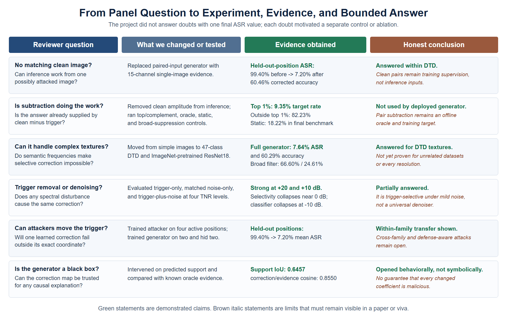
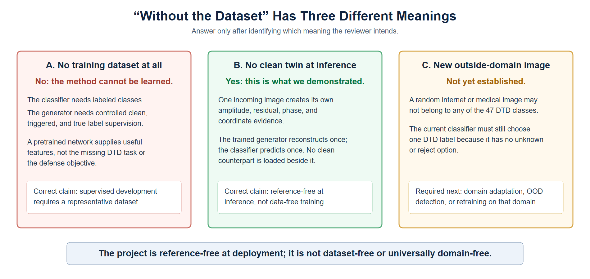
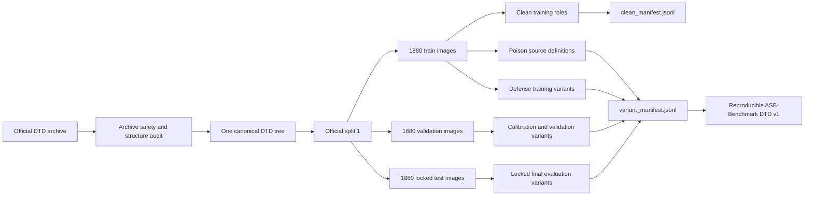
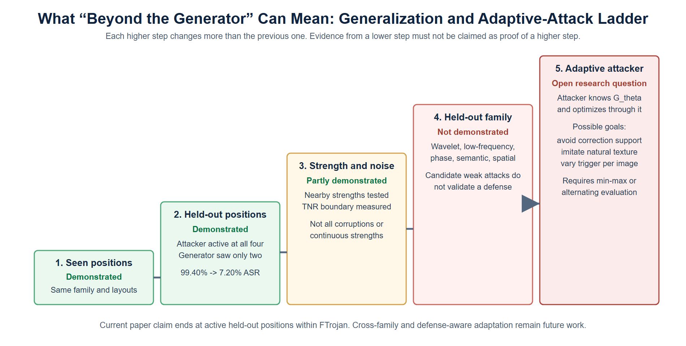
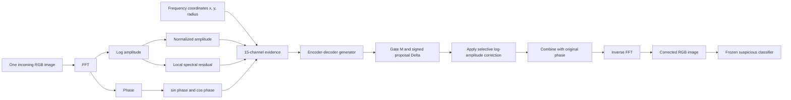
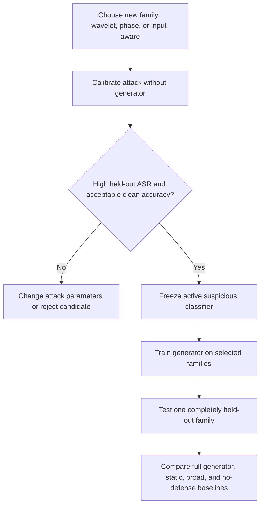

# Panel Questions, Experimental Answers, and Evidence Guide

## Reference-Free Selective Spectral Correction for Frequency-Domain Backdoor Mitigation

**Purpose:** A question-by-question record for project reviews, viva preparation, presentation building, and paper writing  
**Dataset used for the advanced phase:** Describable Textures Dataset (DTD)  
**Classifier:** ImageNet-pretrained ResNet18 fine-tuned on 47 DTD classes  
**Final attack:** Four-position FTrojan-style block-DCT frequency trigger  
**Final defense:** Single-image, reference-free spectral correction generator  
**Evidence status:** Advanced validation experiments complete; one locked final-test evaluation remains to be performed after all design choices are frozen  
**Companion record:** [Advanced Phase Research Record](README.md)

---

## How to use this document

This document was created around the questions raised during the project review. It is not only a list of short answers. For each important question, it explains:

1. What the reviewer is really asking.
2. A non-technical answer that can be spoken during a presentation.
3. What experiment was performed to answer the question.
4. What the measured result means.
5. The technical explanation behind the result.
6. The limitation that must be disclosed.
7. The figure that should be shown as evidence.
8. A concise answer suitable for a viva.

The answers deliberately separate three categories:

| Status | Meaning |
|---|---|
| **Demonstrated** | Directly supported by a saved experiment and measured result. |
| **Partially demonstrated** | Supported within a declared boundary, such as unseen positions from the same trigger family. |
| **Not yet demonstrated** | A reasonable future direction, but not something that should be claimed as a completed result. |

This distinction matters. A convincing research answer is not one that says the method solves everything. It is one that precisely states what was tested, what happened, why the result matters, and where the current boundary lies.

---

## Contents

1. [One-page answer map](#1-one-page-answer-map)
2. [Project answer in plain language](#2-project-answer-in-plain-language)
3. [What does "without the dataset" mean?](#3-what-does-without-the-dataset-mean)
4. [Can a specific dataset be created?](#4-can-a-specific-dataset-be-created-for-this-model)
5. [What if an attacker tries to fool the generator?](#5-what-if-an-attacker-tries-to-fool-the-generator)
6. [What happens without a matching clean image?](#6-what-happens-when-the-matching-clean-image-is-unavailable)
7. [Is absolute subtraction doing most of the work?](#7-is-clean-trigger-absolute-subtraction-doing-most-of-the-work)
8. [Can it work on complicated texture images?](#8-can-the-method-work-on-complicated-texture-images)
9. [Does it remove a trigger or simply remove noise?](#9-does-the-generator-remove-a-trigger-or-simply-remove-noise)
10. [Wavelets, low frequencies, and adaptive triggers](#10-what-about-wavelets-low-frequencies-and-adaptive-triggers)
11. [What, why, and where: project title](#11-what-why-and-where-how-should-the-project-be-titled-and-introduced)
12. [Dataset size and application dependence](#12-is-the-dataset-too-small-or-application-dependent)
13. [Is the generator a black box?](#13-is-the-generator-a-black-box)
14. [Frequency embedding versus the clean image](#14-frequency-embedding-versus-the-clean-image)
15. [Why use a CNN and why two networks?](#15-why-use-a-cnn-and-why-these-two-networks)
16. [What does accuracy mean?](#16-what-does-accuracy-mean-in-this-project)
17. [Metrics beyond ASR and accuracy](#17-what-new-metrics-are-used-beyond-asr-and-accuracy)
18. [Thinking in different dimensions](#18-what-does-think-in-different-dimensions-mean-here)
19. [Does the system repeatedly guess?](#19-does-the-system-repeatedly-guess-until-the-classifier-is-correct)
20. [Can a clean image be changed incorrectly?](#20-can-the-generator-itself-make-a-correct-image-wrong)
21. [Detection versus correction](#21-does-the-method-detect-attacks-or-correct-them)
22. [Additional missing questions](#22-additional-important-questions-that-were-missing)
23. [Completed, partial, and open matrix](#23-completed-partial-and-open-answer-matrix)
24. [Suggested review presentation](#24-suggested-review-presentation-sequence)
25. [Quick viva answers](#25-quick-viva-answers)
26. [Evidence index](#26-evidence-index)
27. [Final honest answer](#27-final-honest-answer)

---

# 1. One-page answer map



### How to read this diagram

Each row begins with a panel question, shows the experiment used to investigate it, gives the principal measured result, and ends with the scientific conclusion. Green conclusions are supported by the current validation evidence. Amber conclusions are supported only within a boundary. Red or grey boundaries are open problems and must not be described as completed work.

The diagram also shows that no single experiment answers every question. For example, the faithfulness audit answers whether the generator's selected coefficients matter, while the trigger-to-noise ratio experiment answers whether the defense can still operate when unrelated noise hides the trigger evidence. These are related questions, but they test different properties.

---

# 2. Project answer in plain language

A backdoored image classifier is trained to behave normally on ordinary images but to produce an attacker-chosen label when a hidden pattern is present. In the advanced phase of this project, the hidden pattern was placed in repeated frequency coefficients rather than as a visible corner patch. The attacked classifier learned to send triggered textures to the class `banded`, even when the true texture class was something else.

The defense is a learned image preprocessor. It receives one incoming image, examines the image's frequency representation, predicts which frequency locations should be adjusted, reconstructs a corrected image, and sends that image to the classifier. It does not receive a matching clean image at deployment. During training, clean examples and deliberately triggered versions provide supervision so that the same generator can learn a reusable correction rule.

The strongest current result is not merely that the generator corrected examples similar to those used during training. The attack was made active at four different frequency positions. The generator was shown only two of those positions during training and model selection. On the two active held-out positions, the undefended mean attack success rate was approximately **99.40%**, while the corrected mean attack success rate was **7.20%** and corrected true-label accuracy remained approximately **60.46%**. This is evidence of within-family position generalization. It is not yet evidence of universal protection against arbitrary attacks or arbitrary outside-domain images.

---

# 3. What does "without the dataset" mean?

## Question

> What would the model do without the dataset?

## Why this question is ambiguous

The phrase "without the dataset" can mean three different things. They must be answered separately.



### Meaning A: No training data at all

**Answer: the learned generator cannot be trained.**

A neural network does not discover a correction rule from nothing. It needs examples that define the task. In this project, the generator requires images, labels, controlled trigger generation, and clean supervision during development. Without any training data, there is no basis for learning which spectral structures belong to natural textures and which changes are associated with the attack.

This is not a special weakness of this project. Supervised classifiers, denoisers, segmentation networks, and learned defenses all require training data or a pretrained model. A non-learned handcrafted filter could operate without task-specific training, but it would not be the proposed adaptive generator and would need a separately justified fixed rule.

### Meaning B: No matching clean image at deployment

**Answer: yes, this was the central advanced-phase change and it was demonstrated.**

At deployment, the model receives only the incoming image. It does not receive the original clean version of that exact image, and it does not calculate a clean-trigger subtraction. The generator constructs spectral evidence from the one input, predicts a correction, reconstructs the image, and passes it to the classifier.

Training can still use known clean sources and generated triggered counterparts. That is how supervised learning works: information is available while the system is being taught, but the deployed forward pass must work without privileged information.

### Meaning C: An image from a completely different dataset or domain

**Answer: this has not yet been demonstrated.**

The current model was trained and validated on DTD texture images. An unseen DTD validation image is new to the model, but it still belongs to the same 47-class task and the same general image domain. An arbitrary medical scan, street photograph, or unknown class is a domain-shift or open-set problem. The current results do not establish reliable behavior in that setting.

## Technical statement

The defensible wording is:

> The proposed generator is reference-free at inference, but it is not training-data-free and has not yet been established as domain-free.

The deployed mapping is conceptually:

```text
one incoming image
        |
        v
single-image spectral evidence
        |
        v
trained generator
        |
        v
corrected image
```

The clean counterpart appears in the training losses, not in the deployed input:

```text
TRAINING:   clean source + generated attack + label -> teach generator
DEPLOYMENT: one unknown incoming image              -> generator correction
```


**What this figure shows:** The clean counterpart and true label are available on the training side because they teach the generator. The deployment side has only one incoming image. There is no hidden clean-image arrow entering the deployed generator.

## What to show

Show [training versus deployment](assets/11_training_vs_deployment.png), followed by the three-meaning diagram above. The first proves where the clean target is used; the second prevents the term "without dataset" from being misunderstood.

## Viva answer

> If "without the dataset" means no training data, then no learned defense can be trained. If it means no matching clean image at deployment, our advanced generator does work in that condition: it accepts only one incoming image. If it means a completely different image domain, that remains an open generalization experiment and is not claimed by the present results.

**Status: partially demonstrated, with the inference condition demonstrated and cross-domain operation still open.**

---

# 4. Can a specific dataset be created for this model?

## Question

> Can you make a specific dataset for your model instead of informally generating examples during each run?

## Short answer

Yes. The project created a reproducible benchmark description called **ASB-Benchmark, DTD v1**. It does not unnecessarily duplicate every image file. Instead, it stores the source image identity, official split, label, trigger family, trigger parameters, experimental role, and whether the trigger belongs to a seen or held-out condition. This makes a generated variant reproducible while preserving a clean audit trail.

## Why a benchmark manifest was needed

Early experiments were easy to run but difficult to audit because a triggered image could be generated inside a training loop without a permanent description of why that sample existed. For a paper, the experiment must answer questions such as:

- Which clean image was used?
- Which official split did it belong to?
- Was it used for classifier training, generator training, validation, or final testing?
- Which trigger and parameters were applied?
- Was its position visible to generator training?
- What label did the attacker assign?
- Can the same variant be regenerated later?

The benchmark manifests provide these answers.

## Dataset construction flow



## What was recorded

| Property | Recorded value |
|---|---:|
| Dataset | DTD |
| Classes | 47 |
| Images per class | 120 |
| Total source images | 5,640 |
| Official split | Split 1 |
| Train images | 1,880 |
| Validation images | 1,880 |
| Locked test images | 1,880 |
| Future training crop size | 224x224 |
| Seed | 42 |
| Attacker target | Label 0, `banded` |
| Declared poison sources | 188 for the initial 10% protocol |
| Total catalogued variants | 29,748 |

The benchmark audit passed its checks for image count, class count, and expected images per class. It also detected **nine exact-image checksum groups crossing official splits**. This fact is preserved as a limitation and should be disclosed in the paper rather than hidden.

## Is this a new natural-image dataset?

No. The underlying photographs and official labels come from DTD. The project contribution is a task-specific **benchmark protocol and variant manifest**, not ownership of a new natural-image collection. A precise paper phrase is:

> We construct a reproducible DTD-based backdoor-defense benchmark containing clean, poisoned, defense-training, validation, held-out-trigger, and locked-test variant definitions.

## Why manifests are preferable to storing thousands of transformed copies

The trigger is deterministic when the source ID, seed, family, and parameters are known. A manifest therefore prevents large storage duplication, keeps the clean source traceable, and allows corrections to the trigger implementation without silently mixing old and new images. Materialized example images are still saved for visual inspection and publication figures.

## Evidence and files

- [Benchmark summary](../Absolute_Dataset/asb_dtd_v1/benchmark_summary.json)
- [Clean manifest](../Absolute_Dataset/asb_dtd_v1/clean_manifest.jsonl)
- [Variant manifest](../Absolute_Dataset/asb_dtd_v1/variant_manifest.jsonl)
- [Trigger catalogue](../Absolute_Dataset/asb_dtd_v1/trigger_catalog.json)

## Viva answer

> Yes. We built a DTD-based benchmark manifest rather than an undocumented folder of transformed images. It records source identity, split, label, trigger configuration, role, and seen or held-out status. This gives us 5,640 audited source images and 29,748 reproducible experimental variant definitions. It is a benchmark derived from DTD, not a claim that we collected a new natural-image dataset.

**Status: demonstrated.**

---

# 5. What if an attacker tries to fool the generator?

## Questions

> What if the attacker creates something that goes beyond the generator's learned correction map?  
> Can an attacker deliberately fool the generator?  
> What if the attacker moves or changes the frequency trigger?

## Plain-language answer

An attacker can potentially design a trigger that does not resemble the evidence learned by the generator. The current defense is not claimed to be unbeatable. The project addressed the first realistic version of this problem by moving the active trigger to frequency positions that the generator had never seen. The generator still reduced the attack strongly, which shows that it did not merely memorize one exact coordinate.

However, changing a position inside the same trigger family is only one step. A fully adaptive attacker could change the transform, spread energy across many coefficients, mix amplitude and phase, imitate normal texture statistics, or optimize directly against the trained generator. Those stronger cases remain future work.

## Generalization ladder



The ladder should be read from bottom to top. Each level makes the attack less similar to what the generator saw during training:

1. **Seen position:** the exact trigger position was used during generator training.
2. **Held-out position:** the same attack family remains active, but the generator never trained on that position.
3. **Strength and noise shift:** trigger magnitude or competing noise changes.
4. **Held-out family:** a completely different active trigger family is hidden during generator training.
5. **Defense-aware adaptive attack:** the attacker knows the generator and optimizes to bypass it.

This project completed levels 1 and 2, and partially studied level 3. Levels 4 and 5 are not completed.

## The experiment that answered position evasion

The original suspicious classifier did not reliably respond when an old trigger was simply moved. That would have produced a false defense result: a low post-correction ASR could occur because the moved trigger never attacked successfully. The classifier was therefore retrained with four independently active FTrojan-style positions.

The positions were divided as follows:

| Trigger position | Used to train/select generator? | Attack active before defense? | Role |
|---|---:|---:|---|
| `ftpos_original` | Yes | Yes | Seen |
| `ftpos_near_minus1` | Yes | Yes | Seen |
| `ftpos_near_mixed` | No | Yes | Held out |
| `ftpos_middle_shift` | No | Yes | Held out |

The two held-out positions produced approximately **99.40% ASR before correction**. After correction, their mean ASR was **7.20%**, while corrected true-label accuracy was approximately **60.46%**.


**What this figure shows:** Every position is first verified as an active attack. The held-out bars then show what happens when the generator corrects positions excluded from its training and checkpoint selection. A low corrected bar is meaningful here because the corresponding undefended bar was already near 100%.

## What this proves

It supports this claim:

> The generator generalizes to active, unseen coefficient positions within the calibrated FTrojan-style family.

It does not support this stronger claim:

> The generator blocks every unseen or adaptive frequency-domain trigger.

## How a defense-aware attacker should be tested later

A stronger future experiment would freeze the completed generator and optimize a trigger using an objective with three goals:

```text
make suspicious classifier predict target
        +
remain visually small
        +
survive generator correction
```

In technical notation, an adaptive attacker could search for perturbation `delta` that increases the target-class loss after the full defended path:

```text
maximize_delta  CE(f_s(C_G(x + delta)), y_target)
subject to      ||delta|| <= epsilon
```

Here, `C_G` is the generator-based correction operation and `f_s` is the suspicious classifier. This would directly test whether the attacker can place spectral evidence where the generator does not act or can induce the generator to alter useful content.

## What to show

Show the generalization ladder, then show [held-out position recovery](assets/07_held_out_position_recovery.png). State clearly that both held-out attacks were verified as active before defense.

## Viva answer

> We tested the first evasion case by hiding two active frequency positions from generator training. Their mean attack success was 99.40% before defense and 7.20% after correction, so the model did not simply memorize one coordinate. A different trigger family or an attacker optimized against the generator is a stronger threat and remains an explicit future experiment. We describe the result as within-family position generalization, not universal robustness.

**Status: partially demonstrated.**

---

# 6. What happens when the matching clean image is unavailable?

## Question

> During controlled experiments, the triggered image can be paired with its clean source. In reality that clean source will not exist. What happens then?

## Short answer

The advanced generator was specifically redesigned for this condition. It does not take the matching clean image as an input. It estimates a correction from the incoming image's own spectral evidence.

## Phase 1 versus the advanced method

| Stage | Generator input | Main scientific purpose |
|---|---|---|
| Phase 1 | Clean amplitude, triggered amplitude, and their absolute difference | Controlled proof that selective spectral correction was feasible |
| Advanced phase | Evidence computed from one incoming image only | Realistic reference-free inference |

The clean source remains available while constructing supervised training pairs. It is used to calculate training losses and to check whether reconstruction is moving in the intended direction. It is never concatenated into the generator input in the advanced method.

## Advanced forward path



## What the generator receives

For one `3 x 224 x 224` input, the evidence tensor contains 15 channels:

| Evidence | Channels | Purpose |
|---|---:|---|
| Normalized log amplitude | 3 | Shows how much energy exists at each frequency for each colour channel |
| Local spectral residual | 3 | Highlights coefficients that differ from their local frequency neighbourhood |
| Sine of phase | 3 | Represents circular phase without a discontinuity at plus or minus pi |
| Cosine of phase | 3 | Completes the stable phase representation |
| Horizontal, vertical, and radial coordinates | 3 | Tells the convolutional generator where a coefficient lies in the spectrum |

The generator outputs a **gate** and a **signed correction proposal**. The gate says where correction should be allowed; the signed proposal says how the selected log amplitude should move. The input phase is preserved during reconstruction.


**What this figure shows:** The upper path creates and validates the suspicious classifier. The lower path trains the reference-free generator using controlled supervision. The deployment path accepts one image, constructs its spectral evidence, predicts one correction, reconstructs the image, and sends it to the frozen classifier.


**What this figure shows:** Different natural textures produce different content, but the attack repeatedly introduces related spectral geometry. Shared generator weights are updated across these examples. The figure does not mean that the model literally stores a list of constant amplitudes; it learns a reusable mapping from recurring evidence to useful correction.

## Why training can use a clean image even though deployment cannot

This is analogous to training a denoiser. During development, a clean target teaches the model what a desirable output looks like. Once trained, the model is expected to estimate that output from the corrupted input alone. The clean target is supervision, not a required deployment input.

## Evidence

The held-out validation images had matching clean sources available to the evaluator, but those clean sources were not fed to the generator. Full generator correction reduced final four-position mean ASR from **99.48%** to **7.64%** while retaining **60.29%** true-label accuracy.

## What to show

- [Advanced methodology flow](assets/15_advanced_methodology_flow.png)
- [Learning across images](assets/16_generator_learning_across_images.png)
- [Generator explanation panel](assets/02_reference_free_generator_explanation.png)

## Viva answer

> The matching clean image is used only as a teaching target during generator training. At inference, the network receives one image and builds amplitude, local residual, phase, and coordinate evidence from that image. It then predicts a gated correction and reconstructs the image using the original phase. Therefore the advanced method is reference-free at inference, although it remains supervised during training.

**Status: demonstrated on unseen DTD validation images.**

---

# 7. Is clean-trigger absolute subtraction doing most of the work?

## Question

> If the clean and triggered images can simply be subtracted, is the generator actually contributing anything?

## Short answer

No clean-trigger subtraction is available to the deployed advanced generator. Absolute differences are used only by the evaluator as an oracle for analysis. The causal ablation showed that the generator's strongest selected coefficients carry most of the repair effect, while correcting everywhere else does not.

## Why the concern was valid

In Phase 1, the generator directly received clean amplitude, triggered amplitude, and their absolute difference. That was useful for a controlled feasibility study, but it could not answer how the defense would operate when the clean twin was unavailable. A reviewer could reasonably say that the subtraction had already revealed the trigger.

The advanced phase removed that input. The deployed generator sees only single-image evidence. The evaluator can still calculate the true trigger-induced difference because the experiment deliberately created the triggered sample from a known clean source. That evaluator-only difference is called **oracle evidence**. It is used to assess whether the learned correction overlaps the true injected change; it is not supplied to the model.

## Causal faithfulness experiment

For each corrected image, all `3 x 224 x 224 = 150,528` channel-frequency locations were ranked by the magnitude of the generator's predicted correction. The top 1% contains approximately 1,505 locations. Several controlled variants were then reconstructed:

| Variant | What was changed | Target rate / ASR | True-label accuracy | Interpretation |
|---|---|---:|---:|---|
| Triggered | No correction | 86.63% | 9.13% | Attack is active |
| Full generator | Apply complete predicted correction | 6.09% | 61.36% | Learned correction repairs most samples |
| Predicted top 1% only | Apply only highest-ranked generator locations | 9.35% | 59.67% | A small selected support carries most repair effect |
| Predicted outside top 1% | Remove the top support and apply the rest | 82.23% | 12.50% | Broad low-ranked correction is insufficient |
| Oracle overlap only | Retain predicted correction where it overlaps true injected support | 9.73% | 59.13% | Learned support aligns with real attack evidence |
| Oracle outside only | Apply correction outside oracle-related support | 81.14% | 13.48% | Unrelated locations do not explain repair |
| Static template | Reuse one average training correction | 7.93% | 60.22% | Shared trigger structure helps, but later position tests expose its limits |

## What this experiment means

The full generator does not need to modify all 150,528 frequency values strongly. Its most important approximately 1% of locations account for most of the reduction in target prediction. When those locations are removed and the remaining 99% is applied, the attack mostly survives. This is causal evidence that the generator's ranking identifies a concentrated set of influential coefficients.

The oracle overlap result provides another check. It asks whether the generator's selected action intersects the known perturbation support. The median predicted-support/oracle-support intersection-over-union was **0.6457**, and the correction/evidence cosine similarity was **0.8550**. These results show substantial alignment, but not perfect recovery.


**What this figure shows:** The full and top-only corrections produce low attack target rates. The outside-only variants remain high. Reading the bars together shows that the selected support, rather than the large unselected remainder, carries most of the repair effect.

## Why the static template result does not invalidate the generator

The first benchmark used a highly regular repeated trigger, so an average correction template performed surprisingly well. This exposed a possible shortcut and motivated the stronger four-position experiment. In the final four-position comparison:

| Defense | Mean ASR | True-label accuracy |
|---|---:|---:|
| No defense | 99.48% | 0.50% |
| Full generator | **7.64%** | **60.29%** |
| Static template | 18.22% | 55.00% |
| Broad suppression | 66.60% | 24.61% |

The adaptive generator outperformed the reused static template and strongly outperformed broad suppression. This is more convincing than only reporting the first static-template result.

## What to show

- [Causal faithfulness explanation](assets/03_faithfulness_explanation.png)
- [Initial causal ablation](assets/04_initial_causal_ablation.png)
- [Correction-map anatomy](assets/12_correction_map_anatomy.png)
- [Final baseline comparison](assets/08_final_baseline_comparison.png)

## Viva answer

> Absolute clean-trigger subtraction is not an input to the advanced generator. We use it only after inference as oracle evidence because controlled experiments let the evaluator know what was injected. The top-1% ablation showed that the generator's strongest selected locations reduced target rate from 86.63% to 9.35%, while the other 99% alone left it at 82.23%. In the final benchmark, the learned generator also outperformed a fixed template and broad suppression. Therefore subtraction is an auditing tool, not the deployed defense mechanism.

**Status: demonstrated.**

---

# 8. Can the method work on complicated texture images?

## Question

> The early images and triggers were simple. Can this work when the image itself contains complicated high-frequency texture?

## Why DTD was selected

Natural textures are a difficult spectral domain. A woven surface, cracked wall, honeycomb pattern, dotted material, or wood grain can contain repeated edges and strong high-frequency energy that may resemble a frequency trigger. A defense that simply removes every high-frequency component would damage the information needed to classify these images.

DTD was therefore selected as a harder test than CIFAR-style object images. It contains 47 descriptive texture classes and 5,640 source images. The advanced experiment used 224x224 crops and an ImageNet-pretrained ResNet18 rather than the smaller custom classifier used in early work.

## What success means on texture data

Success requires two outcomes at the same time:

1. The attack success rate must fall.
2. The true texture label must remain recoverable.

A method that removes the attack by destroying the image is not a useful defense. This is why corrected true-label accuracy is reported beside ASR.

## Main result

| Condition | Mean ASR / target rate | True-label accuracy |
|---|---:|---:|
| Clean classifier input | 6.52% non-target target rate | 61.44% clean accuracy |
| Four-position triggered input, no defense | 99.48% | 0.50% |
| Triggered input, full generator | **7.64%** | **60.29%** |
| Triggered input, broad spectral suppression | 66.60% | 24.61% |


**What this figure shows:** The generator must be judged on both security and utility. A useful bar should have low ASR and high true-label accuracy. Full learned correction gives the strongest combination; broad suppression damages accuracy and still leaves much of the attack active.

The broad-suppression baseline is important. It demonstrates that indiscriminately removing a large spectral region is not enough. It leaves much of the attack active and destroys texture classification. The selective generator nearly restores the clean accuracy level while reducing ASR close to the model's natural target prediction rate.

## Technical interpretation

The generator is not asked to identify "high frequency equals bad." It receives amplitude, local-residual, phase, and coordinate features and learns a gated signed correction. Identity, image-reconstruction, spectral-reconstruction, sparsity, and smoothness losses discourage unnecessary changes to natural texture content.

The clean-input control also matters. Clean DTD accuracy was approximately **61.44%**, and clean accuracy after generator preprocessing was approximately **61.70%** in the position-generalization experiment. This suggests that the generator did not broadly erase useful texture information under the tested clean distribution.

## Limitation

This result applies to DTD and its 47 known classes. It does not prove transfer to every texture dataset, arbitrary image resolution, medical texture, or unknown class. KTH-TIPS2 and CUReT were identified as sensible cross-dataset texture evaluations but were not completed in the present advanced evidence set.

## What to show

- [Held-out position recovery](assets/07_held_out_position_recovery.png)
- [Final baseline comparison](assets/08_final_baseline_comparison.png)
- A qualitative corrected sample where `clean true/pred` is correct, the trigger changes prediction to `banded`, and correction restores the original class.

## Viva answer

> We moved to DTD specifically because natural textures already contain rich frequency content, so blindly removing high frequencies would be harmful. On the final four-position attack, ASR fell from 99.48% to 7.64% and true-label accuracy recovered from 0.50% to 60.29%, close to the 61.44% clean baseline. Broad suppression achieved only 24.61% accuracy, which shows why selective learned correction is necessary.

**Status: demonstrated on DTD; cross-dataset texture transfer remains open.**

---

# 9. Does the generator remove a trigger or simply remove noise?

## Question

> Is the generator really responding to attack-related structure, or is it acting like a general denoiser?

## Short answer

The evidence indicates that the generator is strongly responsive to the calibrated trigger and mostly preserves common benign corruptions at mild levels. However, it is not a perfect trigger detector. Severe random noise can alter classification and can also interfere with the correction process. Therefore the safest description is **learned attack-oriented spectral correction**, not mathematically guaranteed trigger isolation.

## Benign-corruption control

Clean validation images were modified with Gaussian noise, blur, brightness changes, and contrast changes, then evaluated before and after generator preprocessing.

| Benign condition | Accuracy before generator | Accuracy after generator | Mean correction magnitude |
|---|---:|---:|---:|
| Gaussian noise, sigma 0.01 | 61.01% | 61.17% | 0.000914 |
| Gaussian noise, sigma 0.03 | 48.51% | 48.88% | 0.001383 |
| Blur, kernel 3 | 58.03% | 57.98% | 0.000521 |
| Blur, kernel 5 | 52.45% | 52.39% | 0.000516 |
| Brightness 0.8 | 61.44% | 61.54% | 0.000518 |
| Brightness 1.2 | 59.57% | 59.63% | 0.000572 |
| Contrast 0.8 | 61.54% | 61.70% | 0.000524 |
| Contrast 1.2 | 61.06% | 61.06% | 0.000545 |

These results show two things. First, the generator does not substantially reduce accuracy on the tested clean brightness, contrast, and blur conditions. Second, Gaussian noise causes a somewhat larger correction response than the other benign conditions. That observation motivated the separate trigger-to-noise ratio experiment.

## Trigger-to-noise experiment

The experiment kept the trigger active and added random Gaussian noise at controlled power relative to the realized trigger perturbation. Positive TNR means the trigger is stronger than noise; zero means equal RMS power; negative TNR means noise is stronger.

| Condition | Undefended ASR | Corrected ASR | Corrected true-label accuracy |
|---|---:|---:|---:|
| Trigger only | 99.48% | 7.64% | 60.29% |
| Trigger + noise, +20 dB TNR | 99.47% | 7.85% | 60.19% |
| Trigger + noise, +10 dB TNR | 99.51% | 10.04% | 58.93% |
| Trigger + noise, 0 dB TNR | 99.57% | 45.11% | 35.52% |
| Trigger + noise, -10 dB TNR | 99.52% | 95.05% | 3.48% |

When trigger evidence is stronger than noise, the generator remains effective. At equal power, performance degrades substantially. When noise dominates by 10 dB, both image recognition and attack correction largely fail.

## What happens with noise only?

Noise-only controls were also evaluated. This separates "the generator failed to remove a trigger" from "the underlying image became unrecognizable because noise was severe."

| Noise level matched to TNR setting | Noise-only accuracy before generator | Noise-only accuracy after generator |
|---|---:|---:|
| Trigger-reference / no added noise | 61.03% | 61.25% |
| +20 dB equivalent | 60.76% | 61.26% |
| +10 dB equivalent | 59.55% | 60.77% |
| 0 dB equivalent | 32.24% | 42.64% |
| -10 dB equivalent | 2.19% | 3.99% |

At mild noise, preprocessing does not harm accuracy and may provide a small improvement. At severe noise, classification is already damaged even without a trigger. The generator cannot reconstruct semantic information that the corruption has destroyed.


**What this figure shows:** Moving from left to right increases the amount of competing noise. The corrected ASR remains low while trigger evidence dominates, rises near equal power, and approaches the undefended attack when noise dominates. The accuracy curve shows that this is also becoming a general image-recognition failure.


**What this figure shows:** Severe noise can cause a wrong target prediction even without the trigger. This is why the -10 dB condition cannot be interpreted only as "the generator failed to remove the trigger"; the input itself has become severely corrupted.

## Does low corrected ASR prove trigger detection?

Not by itself. The generator outputs a corrective transformation, not a calibrated probability saying "this image contains a trigger." A correction can be useful without being an exact detector, and a correction map can include false-positive locations. This is why the project also measured clean behavior, benign corruptions, support overlap, top-support causality, and fixed/broad baselines.

## What to show

- [Benign corruption controls](assets/06_benign_corruption_controls.png)
- [TNR result chart](assets/09_trigger_noise_ratio_chart.png)
- [TNR +10 dB qualitative recovery](assets/10_tnr_plus10_recovery.png)
- [Noise-dominant failure](assets/20_noise_only_failure_evidence.png)

## Viva answer

> The generator is not a formally calibrated trigger detector, so we tested whether it behaves like a generic denoiser. Mild blur, brightness, contrast, and noise were mostly preserved. Trigger correction remained strong at +20 and +10 dB TNR, but degraded at equal power and failed when noise dominated. Noise-only controls showed that the strongest noise also destroys the underlying classification task. The evidence supports attack-oriented selective correction under bounded corruption, not perfect separation of every trigger from every kind of noise.

**Status: demonstrated under the tested benign corruptions and TNR range, with a clear severe-noise limitation.**

---

# 10. What about wavelets, low frequencies, and adaptive triggers?

## Questions

> Why was low-frequency injection not used as the final attack?  
> What if the attacker uses a wavelet trigger?  
> What if the attacker combines frequency and phase or adapts to the defense?

## Important experimental rule

A defense result is meaningful only if the attack is active before defense. If an uncorrected trigger has little effect, a low post-correction ASR does not prove that the generator removed it.

This rule changed the project. Several advanced candidates were tested, but weak candidates were rejected instead of being used to claim easy defense success.

## Trigger-family evidence table

| Candidate | Main idea | Why it was tested | What happened | Scientific decision |
|---|---|---|---|---|
| Direct Fourier band | Modify a selected FFT region | Extends the simple Phase 1 frequency idea | Triggered target rate 13.53%, clean target rate 9.89%, only 3.27% conditional attack success | Rejected as a weak transferred attack |
| Low/middle/high Fourier variants | Place energy at different radial bands | Tests whether attack location in the spectrum matters | Some sweep configurations improved, but strength and transfer were inconsistent | Useful calibration evidence; not final benchmark |
| Haar-LH wavelet | Modify localized horizontal-detail wavelet coefficients | Tests scale and spatial-frequency localization | ASR 9.67%, clean target rate 9.51%, only 0.16 percentage-point lift | Rejected under tested configuration |
| Early FTrojan M50 | Repeated block-DCT chroma coefficients at lower magnitude | Tests published frequency-backdoor principles | 95.21% target rate on poison training rows but only about 15.9% on validation, close to clean target bias | Rejected as poison memorization |
| FTrojan-style M100 | Repeated DCT coefficients in chroma channels | Stronger structured attack with measurable transfer | 86.63% validation ASR, 5.60% clean target rate, 81.03 percentage-point lift | Accepted for first generator and faithfulness audit |
| FTrojan-style M150, four positions | Four active DCT layouts | Enables seen-versus-held-out position evaluation | 99.40% to 99.67% position ASR before defense | Accepted for final benchmark |


**What this figure shows:** RGB is converted to luminance/chroma-like channels, each chroma channel is divided into blocks, selected DCT coefficients are modified repeatedly, and inverse transforms reconstruct the image. The four layouts vary coefficient position while retaining the same documented attack family.

## Why the wavelet result was not called a defense success

Wavelet triggers remain scientifically interesting because wavelets describe both scale and localized detail. The tested Haar-LH configuration, however, failed to create a strong held-out backdoor. Its ASR was almost identical to the suspicious model's natural tendency to predict the target class. There was therefore no meaningful attack for the generator to remove.

The correct conclusion is not "wavelet attacks do not work." It is:

> The tested Haar-LH trigger, strength, poisoning ratio, and training protocol did not implant a transferable validation backdoor.

A stronger wavelet attack could use multiple subbands, learned coefficient masks, multiple decomposition levels, or a jointly optimized poisoning objective. Such an attack must first pass the attack-validity checks before defense evaluation.

## Why low-frequency triggers were not the final choice

Low-frequency modifications can blend with natural illumination, colour, and broad texture structure. That can make them stealthy, but it can also damage semantic content or fail to establish a distinct shortcut. The candidate sweep did not provide a low-frequency configuration with the combination required for the final benchmark:

- High held-out ASR.
- Low clean target bias.
- Strong same-model target-rate lift.
- Acceptable clean accuracy.
- Reproducible perturbation structure.

The FTrojan-style candidate satisfied these conditions more consistently, so it was selected as the active benchmark. This is an experimental selection, not a mathematical claim that DCT attacks are always stronger than low-frequency or wavelet attacks.

## What about phase and joint amplitude-phase attacks?

The current correction changes log amplitude and preserves the incoming phase. A trigger encoded mainly in phase could therefore survive, because the present generator is not authorized to alter phase. A joint amplitude-phase attack is a strong future stress test. Extending the defense would require a bounded phase-correction head and losses that prevent geometric distortion.

## What about an input-aware or adaptive trigger?

The current trigger is structured and repeated. An input-aware attacker could place a different perturbation on each image, reducing the repeated regularity that helps the generator learn. A defense-aware attacker could additionally optimize the perturbation through the correction network. Neither condition has been completed, and neither should be implied by the held-out-position result.

## Recommended next attack study



## Viva answer

> We tested Fourier-band and Haar-wavelet candidates, but we did not count weak attacks as defense successes. For example, Haar-LH ASR was 9.67% while the clean target rate was already 9.51%, so the trigger added almost no real attack effect. We selected the FTrojan-style DCT trigger because it produced a strong transferable attack with low clean target bias. Held-out trigger family, phase-dominant, input-aware, and defense-aware attacks remain important next steps.

**Status: candidate families explored; final evidence is strongest for FTrojan-style position and strength variation. Cross-family and adaptive robustness are not yet demonstrated.**

---

# 11. What, why, and where: how should the project be titled and introduced?

## Reviewer note

> Change the title. Make it clear what you are doing, why you are doing it, and where it is applied.

## Recommended title

> **Reference-Free Selective Spectral Correction for Frequency-Domain Backdoor Mitigation in Texture Classification**

This version names four important boundaries:

| Phrase | What it tells the reader |
|---|---|
| Reference-free | No matching clean image is required at inference |
| Selective spectral correction | The defense changes chosen frequency components rather than suppressing the whole spectrum |
| Frequency-domain backdoor mitigation | The security problem being addressed |
| Texture classification | The domain in which the advanced evidence was collected |

An alternative broader title is:

> **Adaptive Single-Image Spectral Correction for Mitigating Frequency-Domain Backdoors**

The broader title is cleaner, but the paper must still make clear that the advanced evaluation was performed on DTD texture classification.

## One-sentence problem statement

> This work investigates whether a learned preprocessor can infer and selectively correct backdoor-related spectral structure from a single incoming texture image, without access to its clean counterpart, while preserving the image information required for normal classification.

## What, why, and where

**What:** A generator predicts a gated correction in log-amplitude space and reconstructs the image before classification.

**Why:** Frequency-domain backdoors can be visually subtle, while fixed filtering may remove natural texture information and still fail to remove the attack.

**Where:** The advanced study uses 224x224 DTD texture images, a pretrained ResNet18 classifier, and a calibrated FTrojan-style block-DCT attack.

## Presentation opening

> A normal classifier should use the visual content of an image. A backdoor causes it to follow a hidden trigger instead. Frequency triggers are difficult because they may be nearly invisible and may overlap natural image frequencies. Our goal is to place a learned correction stage before a suspicious classifier. The correction stage receives only one image, identifies spectral evidence that resembles the learned attack structure, makes a small selective change, reconstructs the image, and allows the classifier to recover the original texture label.

---

# 12. Is the dataset too small or application-dependent?

## Questions

> The dataset is small. Will the model be limited by the application?  
> Does the method need a separate model for every dataset?

## Short answer

DTD is modest in size, with 1,880 images in each official split, but it is not a trivial spectral dataset. Transfer learning from ImageNet made the classifier practical, and controlled manifests allowed careful validation. The current generator is still application-dependent: it was trained on DTD and its suspicious classifier. Cross-dataset transfer has not been established.

## Why ResNet18 transfer learning was used

Training a deep classifier from scratch on 1,880 DTD training images would increase overfitting risk. An ImageNet-pretrained ResNet18 already contains general edge, colour, shape, and texture features. The final classification layer was replaced for 47 DTD classes, trained first while feature layers were frozen, and then the full network was fine-tuned.

This produced a clean baseline in the low-to-mid 60% range. The advanced final suspicious model retained approximately **61.44%** clean validation accuracy while supporting a near-100% active backdoor. This was sufficient for studying defense behavior, although it is not a state-of-the-art DTD classification claim.

## What dataset size affects

Dataset size affects several parts of the project:

| Component | Effect of limited data |
|---|---|
| Clean classifier | Greater risk of overfitting and unstable per-class accuracy |
| Backdoor calibration | A trigger may be memorized on poison rows but fail on unseen validation images |
| Generator | May learn dataset-specific texture or attack regularities |
| Rare failure analysis | Fewer examples are available for class-by-class conclusions |
| Statistical confidence | Results from one split and seed have wider uncertainty than repeated trials |

The early FTrojan M50 failure demonstrates this problem clearly. It achieved a 95.21% target rate on poisoned training rows but only about 15.9% on validation, close to the same model's clean target behavior. More data alone is not the only remedy; held-out attack validation is essential.

## Is a separate generator required for every application?

At present, the safest assumption is yes: a new domain or classifier should at least be calibrated and probably fine-tuned. The generator learned from DTD spectra and gradients from the DTD suspicious classifier. A medical model, remote-sensing model, or traffic-sign model may have different spectral statistics and different harmful perturbations.

A future domain-general system could be trained across several datasets, classifiers, and trigger families. That would be a new experiment, not something established by the present model.

## How to strengthen the dataset evidence

The highest-value additions would be:

1. Repeat final training with at least three random seeds and report mean plus standard deviation.
2. Run one locked test evaluation after every decision is frozen.
3. Add a second texture dataset such as KTH-TIPS2 or CUReT as an external-domain test.
4. Report per-class clean and corrected accuracy so that difficult classes are not hidden by the mean.
5. Deduplicate exact cross-split checksum groups or run a sensitivity analysis excluding them.

## Viva answer

> DTD is modest in sample count but deliberately difficult in frequency content. We used ImageNet transfer learning to reduce data demand and official train, validation, and locked-test roles to avoid evaluating on training images. The current result is application-specific; it does not prove a DTD-trained generator will work on medical or arbitrary outside-domain images. Cross-dataset transfer and multi-seed confidence are remaining extensions.

**Status: the DTD application was demonstrated; universal cross-application transfer was not.**

---

# 13. Is the generator a black box?

## Question

> The model is a CNN. Is it not still a black box? How do you know why it works?

## Short answer

The generator is not symbolically transparent: its 771,238 learned parameters do not translate into one human-written rule. However, the project does not rely only on final accuracy. It opens the model behavior with visual evidence, support measurements, controlled causal interventions, static and broad baselines, held-out positions, and benign/noise controls.

## Two meanings of black box

The term "black box" can refer to different issues:

| Meaning | Does it apply? |
|---|---|
| We cannot inspect the internal learned parameters as a simple symbolic rule | Yes, as with most CNNs |
| We have no idea what input changed or whether the change caused the result | No; this was investigated with explicit correction maps and interventions |
| The defender can only query an external classifier API and cannot obtain gradients | No; the current training threat model assumes access to the suspicious classifier and its gradients |

The final distinction is important. Calling the attack FTrojan-style or citing a "black-box attack" paper does not make the defense itself an API-only black-box defense. During generator training, the suspicious classifier is frozen but differentiable, and its gradient supplies a task-level signal.

## How behavior was opened

### 13.1 Visualized internal outputs

The evidence panels show clean, triggered, and corrected images; clean, triggered, and corrected log amplitudes; the visible trigger-minus-clean difference; and the applied correction. This reveals what the network changed, not merely the final label.

### 13.2 Measured input-conditioned response

The median trigger-to-clean correction ratio was **47.68x**. The generator therefore responds much more strongly to calibrated triggered input than to ordinary clean input.

### 13.3 Compared selected support with known injected support

The median support IoU was **0.6457**, and correction/evidence cosine similarity was **0.8550**. The predicted action overlaps substantially with the known perturbation support, although it is not identical.

### 13.4 Performed causal interventions

Applying only the predicted top 1% reduced target rate to **9.35%**, while applying everything except that top 1% left target rate at **82.23%**. This tests what happens when the proposed important region is retained or removed.

### 13.5 Tested alternative explanations

The final full generator achieved **7.64%** mean ASR, compared with **18.22%** for a static template and **66.60%** for broad suppression. This reduces the likelihood that any generic fixed attenuation would have produced the same outcome.


**What this figure shows:** The evidence tensor is not itself the correction. The generator separately decides where to act and how to change the log amplitude. Their product is the applied correction that causally alters the reconstructed image.

### 13.6 Tested clean and corrupted inputs

Clean and mild benign-corruption accuracy remained broadly stable. This checks whether attack removal came from indiscriminate image destruction.

## What can still not be claimed

These audits do not prove an exact symbolic decision rule for every image. They also do not prove that every correction-map pixel corresponds to a true trigger coefficient. The model can still make false-positive corrections, and severe noise or a new attack family can move the input outside its learned behavior.

## What to show

- [Generator explanation](assets/02_reference_free_generator_explanation.png)
- [Correction-map anatomy](assets/12_correction_map_anatomy.png)
- [Faithfulness distributions](assets/13_faithfulness_distributions.png)
- [Final baseline comparison](assets/08_final_baseline_comparison.png)

## Viva answer

> The CNN parameters are not a human-readable rule, so the network is not fully transparent. We therefore performed behavioral interpretability rather than relying on one final metric. We visualized the applied correction, measured its overlap with known attack support, retained and removed its top-ranked coefficients, compared it with static and broad baselines, and tested clean/noisy inputs. These experiments show which correction regions cause the defense effect, while we still acknowledge that this is not a formal proof of every internal decision.

**Status: behaviorally audited, not mathematically transparent.**

---

# 14. Frequency embedding versus the clean image

## Question

> What exactly is being embedded, what is compared with the clean image, and which frequency representation is used?

## Three representations must not be mixed up

The project uses both DCT and FFT, but for different purposes:

| Stage | Representation | Purpose |
|---|---|---|
| Attack injection | Block DCT in chroma channels | Embed repeated FTrojan-style coefficients in local 32x32 blocks |
| Defense evidence | Global 2D FFT of the incoming RGB image | Build amplitude, local-residual, phase, and coordinate evidence |
| Training supervision | Pixel and spectral comparison with known clean source | Teach the correction to preserve content and approach the clean target |

The attacker and defender therefore do not use exactly the same transform. The DCT trigger leaves a structured signature that is visible in the global FFT representation used by the generator.

## Non-technical explanation

Imagine that the attacker stamps a repeated hidden pattern into many small tiles of the image. The defense does not need the original stamping tool. It looks at the overall frequency board of the incoming image. Repetition across blocks produces regular evidence on that board. During training, many different texture images teach the generator which recurring evidence is associated with the attack and which frequency structure varies naturally with the image.

## Is the generator looking for values that are exactly constant?

Not literally. It does not keep a table of coefficients and count which numerical value repeats across images. Training updates shared convolutional weights. Recurring attack geometry produces consistent gradients, while natural texture content varies across samples. Over many examples, this makes an attack-related local spectral pattern useful for reducing the training loss.

The correct statement is:

> Across many supervised examples, the generator learns a mapping from recurring single-image spectral evidence to corrections that restore the source label and preserve image content.

It is less accurate to say:

> The generator stores the exact amplitude values that stay constant across every image.

## Where the clean image is used

The clean image provides training targets for image reconstruction and spectral reconstruction. It also allows the evaluator to calculate the true injected change. It does not enter the advanced generator's deployed forward input.

## What to show

Show [FTrojan trigger design](assets/14_ftrojan_trigger_design.png), followed by [advanced methodology flow](assets/15_advanced_methodology_flow.png), then [learning across images](assets/16_generator_learning_across_images.png).

## Viva answer

> The attacker embeds repeated local block-DCT coefficients in chroma channels. The defense converts the one incoming RGB image to a global FFT representation and builds amplitude, residual, phase, and coordinate evidence. The clean source is used only during supervised training and evaluator analysis. The generator learns recurring geometry through shared weights and gradients; it does not receive the clean image or directly subtract it at deployment.

---

# 15. Why use a CNN and why these two networks?

## Questions

> Why a CNN model?  
> Is ResNet18 too simple for texture images?  
> What is the role of the classifier versus the generator?

## Two different networks solve two different tasks

| Network | Input | Output | Role |
|---|---|---|---|
| ResNet18 suspicious classifier | RGB image | 47 class logits | Represents the backdoored application being defended |
| Encoder-decoder generator | 15-channel spectral evidence | 3-channel gate and 3-channel signed proposal | Predicts where and how to correct log amplitude |

## Why ResNet18

ResNet18 is a widely used standard pretrained architecture. It is more credible than creating a very small custom CNN solely for the project, but remains computationally manageable on Kaggle. Residual connections make fine-tuning stable, and ImageNet weights reduce the data requirement on DTD.

The research question is not whether ResNet18 is the best possible DTD classifier. The classifier must be competent enough to learn clean texture classes and susceptible enough to learn a measurable backdoor. The final model satisfied both conditions: approximately 61.44% clean accuracy and roughly 99.4% to 99.7% ASR across the four active positions.

## Why a convolutional encoder-decoder generator

The correction decision is spatial in the frequency plane. Nearby coefficients and repeated local spectral structures matter. Convolutions share pattern detectors across locations, while the encoder captures broader context and the decoder restores a full-resolution output. Skip connections retain fine location information needed for coefficient-level correction.

The output is split into:

- `M`, a gate between 0 and 1 saying where correction is allowed.
- `Delta`, a bounded signed proposal saying how the log amplitude should change.

The applied correction is their element-wise product. This is more interpretable than asking a network to synthesize an unrestricted replacement image.

## Would a transformer or larger classifier improve the paper?

Possibly, but changing architecture creates a new variable. The completed evidence is strongest when the attack, generator, and baselines are compared on one fixed classifier. A cross-architecture experiment with ResNet50, ConvNeXt, or a vision transformer would strengthen generality, but it is not required to understand the current mechanism.

## Viva answer

> ResNet18 gives us a standard pretrained application model with enough capacity for 47 texture classes and manageable training cost. The separate encoder-decoder operates in the frequency plane, where convolution and skip connections help detect local spectral patterns while preserving coefficient location. ResNet18 is the model being defended; the generator is the selective preprocessor.

---

# 16. What does accuracy mean in this project?

## Question

> Which accuracy are you reporting, and can low ASR be caused by a generally poor model?

## Why one number is insufficient

A backdoor-defense experiment has at least three different outcomes:

1. Does the model classify clean images correctly?
2. Does the trigger force non-target images into the attacker's target class?
3. After defense, does the original true label return?

Reporting only ASR can hide a destructive defense. Reporting only clean accuracy can hide a strong backdoor.

## Principal metrics

| Metric | Input | Success condition | What it answers |
|---|---|---|---|
| Clean accuracy | Clean images | Prediction equals true label | Does ordinary classification work? |
| Triggered ASR | Triggered non-target images | Prediction equals attacker target | Does the attack work? |
| Corrected ASR | Corrected triggered non-target images | Prediction still equals attacker target | How much attack remains after defense? |
| Corrected true-label accuracy | Corrected triggered images | Prediction equals original label | Did useful classification recover? |
| Clean target rate | Clean non-target images | Prediction happens to equal attacker target | How biased is the model toward the target without a trigger? |

## How ASR is calculated

Only source images whose true label is not the target class are included:

```text
ASR = number of triggered non-target images predicted as target
      ----------------------------------------------------------
                number of triggered non-target images
```

Target-class source images are excluded because predicting the target label for them would be correct even without an attack.

## Why target-rate lift matters

Suppose a model naturally predicts the target class for 15% of clean non-target images and predicts it for 16% after adding a trigger. An ASR of 16% sounds non-zero, but the trigger itself added only one percentage point. That is a weak attack.

The same-model target-rate lift is:

```text
target-rate lift = triggered target rate - clean non-target target rate
```

This metric exposed the weak Haar and early FTrojan candidates and prevented them from being mistaken for active validation attacks.

## Final metric interpretation

| Quantity | Final advanced value | Meaning |
|---|---:|---|
| Clean accuracy | 61.44% | Normal performance of suspicious classifier |
| Clean non-target target rate | 6.52% | Natural tendency to predict `banded` |
| Undefended four-position mean ASR | 99.48% | Strong active attack |
| Full-generator mean ASR | 7.64% | Residual target prediction after defense |
| Full-generator true-label accuracy | 60.29% | Original texture labels mostly recovered |

The corrected 7.64% target rate is close to the 6.52% clean target rate. This does not mean every trigger was perfectly detected. It means the aggregate target behavior after correction approached the classifier's ordinary baseline while true-label accuracy returned close to clean performance.

## Viva answer

> We report clean accuracy, ASR, and corrected true-label accuracy together. Clean accuracy tells whether the application works; ASR measures how often a trigger forces a non-target image to `banded`; corrected accuracy tells whether the defense restores the original class instead of merely breaking the image. We also compare ASR with the same model's clean target rate so natural target bias is not mistaken for attack success.

---

# 17. What new metrics are used beyond ASR and accuracy?

## Question

> Apart from ASR and accuracy, did you introduce or use any additional metric that explains the behavior?

## Answer

Yes. The project uses a metric suite because no single value can establish attack validity, defense utility, selectivity, and robustness.

| Metric | Definition or role | Why it was needed |
|---|---|---|
| Clean non-target target rate | Target prediction rate on clean non-target sources | Separates natural target bias from trigger effect |
| Same-model target-rate lift | Triggered target rate minus clean target rate | Measures how much behavior the trigger actually adds |
| Conditional ASR | Fraction of clean-correct non-target sources that become target after triggering | Restricts attack analysis to images the model originally understood |
| New target flips | Clean prediction was not target, triggered prediction is target | Counts direct trigger-induced target transitions |
| Reverse target flips | Clean prediction was target, triggered prediction leaves target | Reveals cancellation hidden by aggregate ASR |
| Worst-position ASR | Maximum corrected ASR over active trigger positions | Prevents a weak average from hiding one bad location |
| PSNR / perturbation RMS | Size of clean-to-trigger image change | Describes visual distortion and supports fair strength comparison |
| Mean correction magnitude | Average size of generator action | Detects overcorrection on clean or benign inputs |
| Trigger-to-clean correction ratio | Correction response on trigger divided by clean response | Measures conditional selectivity |
| Support IoU | Overlap between top predicted correction and known injected support | Tests spatial-frequency alignment |
| Correction/evidence cosine similarity | Directional similarity between applied correction and oracle evidence | Tests whether action follows true perturbation structure |
| TNR | Trigger RMS relative to noise RMS in decibels | Controls corruption difficulty |

## Are these all new inventions?

No. ASR, accuracy, PSNR, IoU, cosine similarity, RMS, and decibel power ratios are established concepts. The project combines them for this evaluation. The exact **per-image trigger-to-noise ratio stress protocol** is a project-defined SNR-derived evaluation condition, not a universally standardized backdoor-defense metric.

The scientifically safe wording is:

> We define an SNR-derived trigger-to-noise ratio for controlled robustness evaluation.

It should not be called a novel universal metric unless it is formally validated across attacks, datasets, and competing methods.

## Additional metrics still worth adding

| Proposed addition | Why useful |
|---|---|
| Mean and standard deviation over seeds | Shows training stability |
| Bootstrap confidence intervals | Quantifies uncertainty without assuming normality |
| Per-class corrected accuracy | Reveals whether some textures are disproportionately harmed |
| LPIPS or SSIM | Adds perceptual preservation evidence beyond PSNR/L1 |
| Runtime and memory | Establishes deployment cost |
| AUROC/AUPRC, only if a detector score is introduced | Evaluates trigger detection rather than correction |
| Expected calibration error | Tests confidence reliability after preprocessing |

## Important warning about AUROC

The current generator is a corrector, not a calibrated binary detector. Its correction magnitude could be explored as a detection score, but AUROC should not be reported until clean and attacked score distributions are defined and a detection protocol is frozen.

## Viva answer

> We supplement ASR and accuracy with clean target rate, target-rate lift, conditional ASR, direct target flips, worst-position ASR, perturbation size, correction selectivity, support IoU, cosine similarity, and an SNR-derived TNR stress condition. These metrics answer different failure questions. We do not claim TNR as a universal new metric; it is a controlled robustness protocol derived from standard RMS decibel ratios.

---

# 18. What does "think in different dimensions" mean here?

## Reviewer note

> Think in different dimensions.

This can be interpreted as a request to test more than one narrow configuration. The advanced phase expanded the problem along several dimensions:

| Dimension | What was varied | Current status |
|---|---|---|
| Image complexity | Simple object images to natural textures | DTD completed |
| Resolution | Earlier 32x32 and 96x96 to 224x224 | Completed within project history |
| Model | Small project-specific models to pretrained ResNet18 | Completed |
| Trigger representation | Fourier, wavelet, and block-DCT candidates | Explored; DCT selected |
| Trigger strength | Multiple FTrojan magnitudes | Completed over tested interval |
| Trigger position | Four independently active DCT layouts | Completed |
| Generator knowledge | Seen versus held-out active positions | Completed |
| Defense mechanism | Full generator, top support, outside support, oracle overlap, static, broad | Completed |
| Corruption | Blur, brightness, contrast, Gaussian noise | Completed |
| Trigger-to-noise power | Trigger-only, +20, +10, 0, and -10 dB | Completed |
| Dataset domain | DTD only in advanced phase | Cross-domain open |
| Trigger family generalization | Positions held out, family not held out | Open |
| Attacker knowledge | Fixed attacker | Defense-aware attacker open |
| Classifier architecture | ResNet18 | Cross-architecture open |

The correct answer is therefore not that every dimension has been solved. The contribution is that the final claim was tested across several controlled axes rather than on one image, one trigger, and one result.

---

# 19. Does the system repeatedly guess until the classifier is correct?

## Possible misunderstanding

It is tempting to imagine the generator and classifier acting like a GAN discriminator loop: the generator tries one correction, checks whether the classifier is correct, and keeps trying. That is not the deployed algorithm.

At deployment, the true label is unknown. The system therefore cannot know whether a prediction is correct and cannot use correctness as a stopping rule. The forward path is one pass:

```text
incoming image -> evidence -> one predicted correction -> reconstruction -> classifier
```

During training, the true source label is available. The classifier is frozen, but its differentiable loss tells the generator whether a corrected training image is moving toward the known true class. Many gradient updates across many images teach the reusable rule. At deployment, that learned rule is executed once.

## Viva answer

> The classifier guides generator learning during training, but there is no trial-and-error loop at inference. The deployed system applies one correction and makes one prediction because the true label is unavailable in real use.

---

# 20. Can the generator itself make a correct image wrong?

## Question

> If the input is clean, could the generator hallucinate a trigger and damage classification?

## Answer

Yes, this is a possible failure mode for any preprocessing defense. It is why clean-input and benign-corruption controls are necessary.

In the position-generalization experiment, clean classifier accuracy was approximately **61.44%** and accuracy after generator preprocessing was approximately **61.70%**. Mild brightness, contrast, blur, and Gaussian-noise conditions also showed little additional accuracy loss due to the generator. The trigger-to-clean correction response ratio of **47.68x** indicates that the generator acts much more strongly on attacked inputs than on ordinary clean inputs.

These aggregate results are encouraging, but they do not mean no individual clean sample was changed incorrectly. A complete final report should also include:

- Clean-to-wrong flip count caused by preprocessing.
- Wrong-to-clean recovery count.
- Per-class clean accuracy before and after preprocessing.
- Distribution of correction magnitude on clean samples.
- Qualitative examples with the largest clean corrections.

## Viva answer

> False correction is possible, so we tested clean images rather than reporting ASR alone. Aggregate clean accuracy remained stable and trigger inputs received much larger corrections than clean inputs. That supports selectivity, but an image-level false-correction analysis is still valuable for the final paper.

---

# 21. Does the method detect attacks or correct them?

## Answer

The current method is primarily a **correction defense**, not a binary trigger detector. It always produces a correction tensor, although the gate can make that correction very small. It does not output a calibrated label such as `clean` or `attacked`.

This distinction changes the claims and metrics:

| If it is a corrector | If it were a detector |
|---|---|
| Evaluate corrected ASR and corrected accuracy | Evaluate true/false positives, AUROC, AUPRC, and threshold |
| Small action on clean inputs is desirable | Correct clean/attack classification is required |
| A correction can partially help | A binary decision is either right or wrong at its threshold |

Correction magnitude could later become a detector score, but a threshold must be selected on calibration data and tested on untouched data before calling it a detector.

---

# 22. Additional important questions that were missing

The original list is strong, but a panel or paper reviewer may also ask the following questions.

## 22.1 Was the attack genuinely active before defense?

**Why they ask:** A weak attack makes every defense look successful.

**Answer:** Yes for the final benchmark. All four positions produced approximately 99.40% to 99.67% ASR before defense while the clean non-target target rate was 6.52%. Earlier weak Fourier, wavelet, and M50 candidates were documented and rejected.

## 22.2 What exactly is meant by "unseen"?

**Why they ask:** The word can overstate generalization.

**Answer:** In the final position experiment, unseen means validation images not used to train the networks and two active DCT coefficient positions excluded from generator training and selection. It does not mean a new dataset, unknown class, arbitrary trigger family, or adaptive attacker.

## 22.3 Is a fixed filter or average template enough?

**Why they ask:** A regular trigger may not require a neural generator.

**Answer:** The static template reached 18.22% mean ASR and 55.00% accuracy in the final four-position benchmark, while the generator reached 7.64% and 60.29%. Broad suppression was worse at 66.60% ASR and 24.61% accuracy. The adaptive generator therefore provided measurable benefit.

## 22.4 Why preserve phase?

**Why they ask:** Phase contains spatial organization and image structure.

**Answer:** The current attack is primarily addressed through amplitude correction. Preserving phase limits geometric disruption and reduces the generator's freedom to damage content. The limitation is that a phase-dominant attack may survive; joint bounded phase correction is future work.

## 22.5 Is the final test split untouched?

**Why they ask:** Validation reuse can produce optimistic estimates.

**Answer:** The final advanced model selection and reported comparisons are validation/calibration results. The locked final-test evaluation remains to be run once, after freezing the paper's design and claims. Earlier exploratory debugging inspected some test outputs; those are historical and must not be presented as the final unbiased result.

## 22.6 Were multiple random seeds tested?

**Answer:** The benchmark uses a recorded seed and deterministic definitions, but the principal final training evidence is not yet a multi-seed statistical study. Three or more complete seeds with mean and standard deviation would strengthen the paper.

## 22.7 Is there data leakage?

**Answer:** The benchmark audit found nine exact-image checksum groups crossing official DTD splits. This originates in the source organization and is disclosed. A sensitivity run that removes all cross-split duplicate groups would strengthen the final result.

## 22.8 What is the computational cost?

**Answer:** The generator has 771,238 trainable parameters and performs FFT, encoder-decoder inference, and inverse FFT before classification. Exact latency, throughput, GPU memory, CPU latency, and energy were not yet reported. These should be measured if real-time deployment is claimed.

## 22.9 What happens to an unknown class?

**Answer:** ResNet18 is a closed-set 47-class classifier and will still assign one of those labels. The generator does not solve open-set recognition. An outside-domain or unknown-class rejection mechanism would be a separate component.

## 22.10 Could the generator remove useful texture that resembles the trigger?

**Answer:** This risk exists. Stable clean accuracy, benign controls, sparsity losses, and selective baselines reduce the concern, but class-specific and high-correction clean examples should be audited before a universal claim.

## 22.11 Is the attack implementation an exact reproduction of FTrojan?

**Answer:** No. It is described as **FTrojan-style** because it adapts published block-DCT chroma-frequency principles to the project's 224x224 PyTorch pipeline. The block size, positions, magnitude, colour conversion, and poisoning procedure are documented so the experiment is reproducible.

## 22.12 What is the practical deployment scenario?

**Answer:** The generator can sit before an image classifier supplied by an untrusted vendor or trained from partially untrusted data. Incoming images are preprocessed once, and the corrected result is classified. The current training procedure assumes the defender has the suspicious model and development data; it is not a pure model-API-only defense.

---

# 23. Completed, partial, and open answer matrix

| Review question | Status | Strongest evidence | Honest boundary |
|---|---|---|---|
| No matching clean image at inference | **Demonstrated** | Single-image generator; final ASR 7.64% | Training still uses clean supervision |
| Create a project-specific dataset/benchmark | **Demonstrated** | ASB-Benchmark DTD v1, 29,748 variants | Derived from DTD, not a new image collection |
| Absolute subtraction concern | **Demonstrated** | Top/complement/oracle ablations | Oracle difference remains evaluator-only |
| Complex texture images | **Demonstrated** | DTD 224x224, generator 7.64% ASR and 60.29% accuracy | One texture dataset |
| Moved frequency location | **Demonstrated within family** | Held-out positions 99.40% to 7.20% | Same FTrojan-style family |
| Mild benign corruption | **Demonstrated in tested range** | Blur, brightness, contrast, Gaussian controls | Not every real corruption |
| Trigger competing with noise | **Demonstrated in tested range** | +20, +10, 0, -10 dB TNR | Severe noise remains a failure case |
| Wavelet candidate | **Explored, attack not validated** | Haar-LH lift only 0.16 pp | Stronger wavelet attack remains possible |
| Low-frequency candidate | **Explored, not final** | Candidate calibration/sweep | Not a general rejection of low-frequency attacks |
| Completely held-out active family | **Not demonstrated** | None | High-priority future experiment |
| Defense-aware adaptive attacker | **Not demonstrated** | Threat specified only | Requires optimization through defense |
| Outside-domain image | **Not demonstrated** | None | DTD-only current evidence |
| Unknown class/open set | **Not demonstrated** | None | Closed-set classifier |
| Locked final-test result | **Pending by design** | Split reserved | Run once after freeze |
| Multi-seed confidence | **Not demonstrated** | Deterministic primary run | Repeat final protocol |

---

# 24. Suggested review presentation sequence

This order tells a coherent story around the questions rather than presenting experiments as disconnected runs.

## Slide 1: The problem raised after Phase 1

**Message:** Phase 1 used paired clean-trigger information and simple attacks. The review correctly asked what happens when the clean reference is unavailable and when images and attacks become more complex.

**Show:** [Training versus deployment](assets/11_training_vs_deployment.png).

## Slide 2: The advanced benchmark

**Message:** DTD adds natural spectral complexity; ResNet18 adds a standard pretrained classifier; manifests make every variant reproducible.

**Show:** Dataset table and benchmark construction flow from Section 4.

## Slide 3: Building a valid attack

**Message:** Weak Fourier and wavelet candidates were not mislabeled as successful attacks. A calibrated FTrojan-style four-position attack reached about 99.4% to 99.7% ASR.

**Show:** [FTrojan trigger design](assets/14_ftrojan_trigger_design.png).

## Slide 4: Reference-free generator

**Message:** One incoming image is converted to 15-channel spectral evidence. The generator predicts where and how to correct amplitude while preserving phase.

**Show:** [Advanced methodology flow](assets/15_advanced_methodology_flow.png).

## Slide 5: Does the selected correction actually matter?

**Message:** Top 1% correction works; the complementary 99% does not. The generator outperforms static and broad baselines.

**Show:** [Causal ablation](assets/04_initial_causal_ablation.png) and [final baseline comparison](assets/08_final_baseline_comparison.png).

## Slide 6: Unseen active positions

**Message:** Two positions hidden from generator training remained active attacks and were reduced from 99.40% mean ASR to 7.20%.

**Show:** [Held-out position recovery](assets/07_held_out_position_recovery.png).

## Slide 7: Trigger versus noise

**Message:** The defense remains strong while trigger evidence exceeds noise, degrades near equal power, and fails when severe noise destroys the task.

**Show:** [TNR chart](assets/09_trigger_noise_ratio_chart.png) and [noise-dominant failure](assets/20_noise_only_failure_evidence.png).

## Slide 8: What is answered and what remains

**Message:** Reference-free inference, texture complexity, causal support, position generalization, baselines, and bounded noise were addressed. Cross-family, adaptive, cross-domain, locked-test, and multi-seed claims remain open.

**Show:** [Attacker generalization ladder](assets/24_attacker_generalization_ladder.png).

---

# 25. Quick viva answers

## "What is your main contribution?"

> The main contribution is an advanced reference-free spectral correction pipeline that estimates a selective amplitude correction from one incoming texture image. It was evaluated against a strong four-position FTrojan-style attack, with causal ablations, fixed and broad baselines, held-out active positions, benign corruptions, and trigger-to-noise stress tests.

## "What changed after the first review?"

> We removed the matching clean image from the generator input, moved from simple object datasets to 224x224 DTD textures, replaced the small classifier with pretrained ResNet18, calibrated a genuinely active FTrojan-style attack, tested unseen active positions, opened the correction behavior using causal ablations, and measured robustness against benign corruption and competing noise.

## "Does it work on an unknown image?"

> It works on unseen DTD validation images without their clean counterparts. It has not yet been shown to work on arbitrary outside-domain or unknown-class images, so I distinguish unseen samples from unseen domains.

## "How does the generator know what is a trigger?"

> It is not given a trigger label at each coefficient. During supervised training, many different clean textures are deliberately attacked. Recurring attack-related spectral geometry repeatedly produces gradients that reward a corrective action, while reconstruction, identity, sparsity, and smoothness losses discourage changes to normal texture. At inference it applies the learned mapping to one image.

## "How do you know it is not just deleting high frequencies?"

> Broad suppression retained 66.60% ASR and reduced accuracy to 24.61%, while the selective generator achieved 7.64% ASR and 60.29% accuracy. The generator also uses phase and local residual evidence, not only frequency radius.

## "How do you know the correction map matters?"

> Applying only its strongest 1% of locations reduced target rate to 9.35%, while applying the other 99% without that support left target rate at 82.23%. This controlled intervention shows that the selected support carries the causal repair effect.

## "Can an attacker bypass it?"

> Potentially. We demonstrated generalization to held-out active positions from the same attack family, but a held-out family or defense-aware optimized attack is a stronger open test. The paper should state that boundary explicitly.

## "Is your model a detector?"

> No. It is a selective corrector. It outputs a correction, not a calibrated probability that an input is attacked. Detection metrics require a separate score and threshold protocol.

## "Why should I trust the result?"

> The attack was validated before defense, clean target bias was measured, weak candidates were rejected, the clean reference was removed from inference, the correction support was causally ablated, fixed and broad alternatives were compared, positions were held out, and noise-only controls were included. A locked final-test and multi-seed study are still needed for the final paper.

---

# 26. Evidence index

| Evidence | Figure |
|---|---|
| All panel questions mapped to experiments | [Reviewer question evidence map](assets/22_reviewer_question_evidence_map.png) |
| Meanings of "without dataset" | [Three meanings of no dataset](assets/23_three_meanings_of_no_dataset.png) |
| Generalization claims and open attacker levels | [Attacker generalization ladder](assets/24_attacker_generalization_ladder.png) |
| Training supervision versus deployed input | [Training versus deployment](assets/11_training_vs_deployment.png) |
| Attack design and positions | [FTrojan design](assets/14_ftrojan_trigger_design.png) |
| Complete advanced forward flow | [Advanced methodology flow](assets/15_advanced_methodology_flow.png) |
| How shared learning occurs across images | [Learning across images](assets/16_generator_learning_across_images.png) |
| Generator input/output explanation | [Generator explanation](assets/02_reference_free_generator_explanation.png) |
| Correction-map meaning | [Correction-map anatomy](assets/12_correction_map_anatomy.png) |
| Top, complement, oracle, and static variants | [Faithfulness explanation](assets/03_faithfulness_explanation.png) |
| Initial causal ablation values | [Initial causal ablation](assets/04_initial_causal_ablation.png) |
| Faithfulness score distributions | [Faithfulness distributions](assets/13_faithfulness_distributions.png) |
| Unseen-position result | [Held-out position recovery](assets/07_held_out_position_recovery.png) |
| Full, static, broad, top, and complement baselines | [Final baseline comparison](assets/08_final_baseline_comparison.png) |
| Benign corruption behavior | [Benign corruption controls](assets/06_benign_corruption_controls.png) |
| Trigger-to-noise curve | [TNR chart](assets/09_trigger_noise_ratio_chart.png) |
| Successful noisy recovery | [TNR +10 dB recovery](assets/10_tnr_plus10_recovery.png) |
| Equal-power condition | [TNR equal power](assets/17_tnr_equal_power_evidence.png) |
| Noise-dominant condition | [TNR noise dominant](assets/18_tnr_noise_dominant_evidence.png) |
| Example where severe noise causes failure | [Noise failure](assets/20_noise_only_failure_evidence.png) |

---

# 27. Final honest answer

The project has moved beyond the original paired-image proof of concept. It now demonstrates a single-image reference-free generator on complex texture data, a standard pretrained classifier, a strong calibrated multi-position frequency attack, causal evidence that selected correction support matters, superiority over static and broad alternatives, generalization to active held-out positions, and bounded robustness to benign corruption and competing noise.

The work does not yet prove universal defense. The generator remains trained with supervised DTD examples and gradients from a known suspicious classifier. It has not been validated on a completely new dataset, unknown class, unseen active trigger family, phase-dominant attack, or defense-aware adaptive attacker. Severe noise can also destroy both correction evidence and the underlying classification task.

That combination of positive evidence and explicit boundaries is a defensible research result. The strongest next actions before paper submission are a single locked-test run, multiple random seeds, cross-split duplicate sensitivity, and one genuinely held-out active trigger-family experiment. Until those are complete, the paper should use precise phrases such as **reference-free at inference**, **within-family position generalization**, and **validation evidence**, rather than **dataset-free**, **universal**, or **attack-proof**.
