# Advanced Phase Research Record

## Reference-Free Selective Frequency-Domain Backdoor Mitigation on Textured Images

**Project title:** Selective Frequency-Domain Backdoor Mitigation Using Adaptive Spectral Correction  
**Advanced experimental dataset:** Describable Textures Dataset (DTD)  
**Final suspicious classifier:** ImageNet-pretrained ResNet18, fine-tuned on DTD  
**Final attack family:** FTrojan-style block-DCT frequency trigger  
**Final defense:** Reference-free spectral correction generator  
**Document scope:** Everything developed after the initial Phase 1 proof of concept  
**Status:** Main advanced implementation and validation experiments complete; locked final-test evaluation remains intentionally unopened  
**Record date:** 2026-10-01  
**Metric provenance:** Values were cross-checked against the saved JSON summaries in `Advanced_Outputs`

**Companion review guides:**

- [Panel Questions, Experimental Answers, and Evidence Guide](PANEL_QUESTIONS_AND_EVIDENCE_GUIDE.md)
- [Final Review PPT Structure and Speaker Guide](PPT_STRUCTURE_FINAL_REVIEW_ADVANCED_PHASE.md)

---

## How to use this document

This README is written for three audiences at the same time:

1. A reader seeing the project for the first time.
2. The researcher returning after several weeks and needing to remember why each decision was made.
3. A paper author who needs precise methodology, equations, experiment settings, result tables, limitations, and figure explanations.

Every major technical section therefore begins with a plain-language explanation and then gives the technical detail. Failed experiments are included because they explain why the final protocol changed. They must not be presented as successful defense results, but they are valuable evidence of sound research iteration.

This document concentrates on the advanced phase. Phase 1 established that frequency-domain correction was feasible on controlled datasets and simple triggers. The advanced phase addressed the more difficult questions:

- Can the method operate on a complex texture dataset?
- Can it use a standard pretrained classifier instead of a small custom CNN?
- Can a frequency attack be calibrated so that attack success is real rather than a consequence of classifier bias?
- Can the generator work without receiving the clean counterpart at inference?
- Does the learned correction have a causal relationship with defense success?
- Can the generator handle trigger positions that were hidden from its training?
- Does learned selective correction outperform fixed and broad suppression baselines?
- What happens when random noise competes with the trigger?

---

## Table of contents

1. [Executive summary](#1-executive-summary)
2. [Where Phase 1 ended and the advanced phase began](#2-where-phase-1-ended-and-the-advanced-phase-began)
3. [Problem definition and research gap](#3-problem-definition-and-research-gap)
4. [Research questions](#4-research-questions)
5. [Core terminology](#5-core-terminology)
6. [Advanced dataset and benchmark protocol](#6-advanced-dataset-and-benchmark-protocol)
7. [Threat model](#7-threat-model)
8. [Advanced trigger families investigated](#8-advanced-trigger-families-investigated)
9. [Final FTrojan-style trigger design](#9-final-ftrojan-style-trigger-design)
10. [Suspicious classifier design](#10-suspicious-classifier-design)
11. [Attack calibration: what failed and why it mattered](#11-attack-calibration-what-failed-and-why-it-mattered)
12. [Multi-attack sweep and selection of the principal attack](#12-multi-attack-sweep-and-selection-of-the-principal-attack)
13. [Why the Phase 1 generator had to be replaced](#13-why-the-phase-1-generator-had-to-be-replaced)
14. [Proposed reference-free spectral-correction method](#14-proposed-reference-free-spectral-correction-method)
15. [Generator input evidence](#15-generator-input-evidence)
16. [Generator network and correction rule](#16-generator-network-and-correction-rule)
17. [Generator training objective](#17-generator-training-objective)
18. [Initial reference-free generator result](#18-initial-reference-free-generator-result)
19. [Opening the generator black box with a faithfulness audit](#19-opening-the-generator-black-box-with-a-faithfulness-audit)
20. [Initial generalization and benign-corruption study](#20-initial-generalization-and-benign-corruption-study)
21. [Multi-position attacker redesign](#21-multi-position-attacker-redesign)
22. [Position-generalizing generator](#22-position-generalizing-generator)
23. [Final baseline and support-ablation comparison](#23-final-baseline-and-support-ablation-comparison)
24. [Trigger-to-noise ratio study](#24-trigger-to-noise-ratio-study)
25. [Complete advanced workflow and algorithm](#25-complete-advanced-workflow-and-algorithm)
26. [Evaluation metrics](#26-evaluation-metrics)
27. [How the experiments differ](#27-how-the-experiments-differ)
28. [How to read the evidence figures](#28-how-to-read-the-evidence-figures)
29. [What the advanced phase demonstrated](#29-what-the-advanced-phase-demonstrated)
30. [What was not demonstrated](#30-what-was-not-demonstrated)
31. [Limitations and future work](#31-limitations-and-future-work)
32. [Research contributions](#32-research-contributions)
33. [Paper-writing map](#33-paper-writing-map)
34. [Reproducibility and repository map](#34-reproducibility-and-repository-map)
35. [Viva-ready questions and answers](#35-viva-ready-questions-and-answers)
36. [Conclusion and references](#36-conclusion-and-references)
37. [IEEE paper abstract and keywords](#37-ieee-paper-abstract-and-keywords)
38. [Clarification record: generator learning, evaluation and deployment](#38-clarification-record-generator-learning-evaluation-and-deployment)

---

# 1. Executive summary

## 1.1 Plain-language summary

A backdoored image classifier behaves normally on ordinary images but follows a hidden attacker rule when a trigger is present. In this project, the hidden trigger is not a visible corner patch. It is a repeated frequency pattern introduced through selected block-DCT coefficients. During poisoning, triggered training images are assigned the attacker's chosen class, `banded`. The suspicious model consequently learns the shortcut:

```text
specific frequency pattern present -> predict banded
```

The advanced defense does not require a clean copy of the incoming image. It receives one potentially suspicious image, studies its amplitude and phase structure, and predicts a small frequency correction. It preserves the incoming phase, changes the log-amplitude selectively, reconstructs the image, and sends that corrected image to the classifier.

The final experiment used a deliberately strong four-position FTrojan-style attacker. Before defense, all four positions produced approximately 99.4% to 99.7% attack success. The generator was trained on only two positions and was then tested on two other active positions that it had never seen. It reduced mean held-out-position attack success to 7.20% while retaining approximately 60.46% corrected-label accuracy. Clean classifier accuracy was approximately 61.44%, and clean accuracy after the generator was approximately 61.70%.

The learned generator was also compared against fixed average correction, broad spectral suppression, and correction-support ablations. The full generator gave the best overall balance:

- No defense: 99.48% mean ASR and 0.50% true-label accuracy.
- Full generator: 7.64% mean ASR and 60.29% true-label accuracy.
- Static average correction: 18.22% ASR and 55.00% accuracy.
- Broad suppression: 66.60% ASR and 24.61% accuracy.
- Strongest 1% of generator correction only: 9.29% ASR and 59.44% accuracy.
- Everything outside the strongest 1%: 99.28% ASR and 0.68% accuracy.

The trigger-to-noise experiment established an operating boundary. The defense remained strong when the trigger was 10 times or approximately 3.16 times stronger than noise. Performance deteriorated when noise equaled or exceeded trigger strength. At extreme noise, the classifier itself collapsed toward the target class even when no trigger was present. This is a measured limitation, not evidence that the defense is universally noise-robust.

## 1.2 Technical summary

For an incoming image `x`, the defense computes

```math
X = FFT2(x), \qquad A = |X|, \qquad P = \angle X,
```

and works in log-amplitude space:

```math
L = \log(1 + A).
```

The generator receives 15 channels derived only from this one image:

```text
3 normalized log-amplitude channels
3 local spectral residual channels
3 sine-of-phase channels
3 cosine-of-phase channels
3 frequency-coordinate channels: x, y, radius
```

It predicts a soft gate `M` and signed correction `D`. Their product is the effective correction:

```math
E = M \odot D.
```

After enforcing conjugate symmetry, the corrected amplitude is

```math
L_{corr} = \max(L + E, 0),
\qquad
A_{corr} = \exp(L_{corr}) - 1.
```

The image is reconstructed while preserving the incoming phase:

```math
x_{corr} = \operatorname{clip}\left(
\operatorname{Re}\left[FFT2^{-1}
\left(A_{corr}e^{jP}\right)\right],0,1\right).
```

The clean counterpart is used as supervision during generator training, but it is never an input to the generator. At deployment, the forward path accepts one image only.

---

# 2. Where Phase 1 ended and the advanced phase began

## 2.1 What Phase 1 established

Phase 1 was a controlled feasibility study. It used datasets such as CIFAR-100, Tiny ImageNet, and STL-10; relatively simple periodic triggers; and a correction formulation in which clean and triggered spectral information could be compared directly. That stage was useful because it verified the basic FFT decomposition, poisoning pipeline, suspicious classifier, generator training, inverse reconstruction, model repair, and evaluation metrics.

However, the Phase 1 approach had a deployment problem. A real suspicious image normally arrives alone. Its clean counterpart is not available. If the defense requires both clean and triggered versions of the same image, it cannot directly process an unknown incoming image.

## 2.2 Questions raised after Phase 1

The review feedback exposed several valid weaknesses:

- Sinusoidal triggers were too simple to represent the final research contribution.
- Small object datasets did not stress texture-sensitive frequency information sufficiently.
- Absolute clean-trigger difference was informative for analysis but unrealistic as a deployed input.
- It was unclear whether the generator was learning image-specific correction or only reproducing a fixed filter.
- A shifted trigger could appear to be defended when the suspicious model was never attacked by that shift in the first place.
- Ordinary noise might activate the generator and be confused with a malicious trigger.
- A paper needed controlled baselines, explicit limitations, and causal evidence rather than only attractive correction panels.

## 2.3 What changed in the advanced phase

| Design aspect | Phase 1 | Advanced phase |
|---|---|---|
| Main data | Small object datasets | DTD texture images |
| Resolution used by final model | 32x32 to 96x96 | 224x224 crops |
| Classifier | Project-specific CNN / earlier classifiers | ImageNet-pretrained ResNet18 |
| Primary attack | Sinusoidal or basic frequency pattern | FTrojan-style block-DCT chroma trigger |
| Generator input | Clean and triggered evidence | One incoming image only |
| Clean counterpart | Part of generator evidence | Training supervision and evaluator reference only |
| Generalization | Strength/function demonstrations | Active held-out DCT positions |
| Explainability | Visual correction map | Causal top-support, outside-support, oracle, and static-template audits |
| Robustness | Basic clean/trigger evaluation | Benign corruptions and calibrated trigger-to-noise ratios |
| Baselines | Limited | No defense, static correction, broad suppression, support ablations |

The advanced phase therefore did not merely enlarge Phase 1. It changed the inference problem from paired correction to reference-free correction.

---

# 3. Problem definition and research gap

## 3.1 Backdoor problem

A backdoor attack modifies training so that a model learns two behaviors:

1. Normal behavior on ordinary inputs.
2. Attacker-selected behavior when a hidden trigger appears.

For an all-to-one attack with target class `y*`, a successful attacker wants

```math
f(x) \approx y
\quad \text{for clean } x,
```

but

```math
f(T(x)) \approx y^*
\quad \text{for triggered non-target } x.
```

Here `T` is the trigger operation. In this work, `y* = banded`.

## 3.2 Frequency-domain difficulty

A broad frequency filter can reduce trigger energy, but texture classification itself depends strongly on frequency content. DTD classes such as `striped`, `woven`, `chequered`, `dotted`, `veined`, and `wrinkled` are distinguished by repeated structures and spatial-frequency organization. Indiscriminately suppressing a large spectral region can therefore remove both the attack and the semantic evidence required for the correct class.

## 3.3 Deployment gap

Paired clean-trigger subtraction gives an excellent evaluator signal:

```math
|L_t - L_c|,
```

where `L_t` and `L_c` are triggered and clean log amplitudes. However, that difference cannot be calculated for a genuinely unknown incoming image because `L_c` is unavailable.

The advanced research problem became:

> Can a generator learn to infer a selective log-amplitude correction from one incoming image, suppress a strong structured frequency backdoor, preserve texture semantics, and generalize to active frequency positions excluded from generator training?

## 3.4 Proposed answer

The project answers this with a reference-free encoder-decoder that observes single-image spectral evidence, predicts a gated signed log-amplitude correction, preserves incoming phase, and reconstructs a corrected image. Supervised clean counterparts guide training but are removed from the deployed forward path.

---

# 4. Research questions

The advanced experiments were organized around the following questions.

### RQ1: Can a realistic textured-image classifier be backdoored without destroying clean utility?

This required a calibrated suspicious ResNet18 and paired attack metrics, not only a high raw target rate.

### RQ2: Can the defense operate without a clean reference at inference?

The final generator accepts one RGB image. Its 15-channel evidence is computed internally from that image alone.

### RQ3: Does the correction map correspond causally to mitigation?

The strongest correction locations were retained or removed to test whether they actually controlled the attack outcome.

### RQ4: Is image conditioning useful, or would a fixed template be enough?

The generator was compared with an average static correction learned from training sources.

### RQ5: Can the generator correct an active frequency position that was hidden during its training?

The attacker was redesigned to make four positions independently active. Two were used to train/select the generator and two were held out.

### RQ6: Is selective correction better than broad suppression?

A fixed broad high-frequency attenuation baseline was evaluated with the same classifier and images.

### RQ7: Does the generator confuse random noise with a trigger?

Noise-only controls and calibrated trigger-to-noise ratios were used to measure this directly.

---

# 5. Core terminology

| Term | Meaning in this project |
|---|---|
| Clean image | An image without an injected attack trigger. |
| Triggered image | A clean source after applying the configured frequency trigger. |
| Poisoned sample | A triggered training image deliberately assigned the attacker target label. |
| Suspicious classifier | A classifier intentionally trained on clean and poisoned samples so that a backdoor can be studied. |
| Target class | The class selected by the attacker; `banded` in the advanced experiments. |
| ASR | Attack success rate: fraction of triggered non-target images predicted as `banded`. |
| Clean target rate | Fraction of clean non-target images naturally predicted as `banded`. |
| Target-rate lift | Triggered ASR minus clean target rate for the same checkpoint. |
| Conditional ASR | Fraction of clean-correct non-target images that become `banded` after triggering. |
| Reference-free | The deployed generator receives no clean counterpart. |
| Log amplitude | `log(1 + FFT amplitude)`, used to compress spectral dynamic range. |
| Phase | Angular component of the complex FFT, retained during correction. |
| Correction gate | Soft value between zero and one controlling where correction is allowed. |
| Signed correction | Learned positive or negative log-amplitude adjustment. |
| Effective correction | Gate multiplied by signed correction; this is what is actually applied. |
| Seen position | FTrojan DCT position used while training/selecting the generator. |
| Held-out position | Active attack position excluded from generator training and checkpoint selection. |
| Static template | Average signed generator correction applied identically to every image. |
| TNR | Trigger-to-noise ratio measured from perturbation RMS values. |

---

# 6. Advanced dataset and benchmark protocol

## 6.1 Why DTD was selected

The Describable Textures Dataset contains natural and artificial texture images described by semantic texture attributes. It was introduced with 47 terms such as `banded`, `blotchy`, `braided`, `dotted`, `stained`, `striped`, `veined`, and `woven`.

DTD was appropriate for this project because texture recognition relies on the same broad type of spectral information that a frequency defense could accidentally damage. A successful defense on DTD must remove the attack without simply deleting high-frequency texture evidence.

The attacker target, `banded`, is one of DTD's real texture attributes. It
describes imagery with visible band-like or stripe-like organization. Other
labels seen in evidence panels, such as `blotchy`, `stained`, `frilly`, and
`woven`, are also texture attributes rather than object identities. A panel
showing `blotchy / stained` therefore means the ground-truth texture is
`blotchy` while the classifier predicted the texture class `stained`.

## 6.2 Dataset composition

The extracted dataset contains:

- 47 classes.
- 120 images per class.
- 5,640 images in total.
- Official split 1 with 40 images per class in training, validation, and test.
- 1,880 images in each split.

All final advanced model inputs use 224x224 evaluation crops. Training uses random resized 224x224 crops and horizontal flips.

## 6.3 Archive safety and integrity check

Before extraction, the DTD ZIP was audited. The archive contained 11,346 entries because it included two identical directory trees. Each tree contained 5,640 JPEG files and the associated labels. There were no unsafe paths, executable/script files, nested archives, duplicate exact paths, or observed antivirus alerts. One tree was selected and extracted into `Absolute_Dataset/dtd`.

The archive SHA-256 recorded by the project is:

```text
2D8092F0C3B28A2C53FADA394D0267AB066398C1DDA868D659402ED79F2857B3
```

This audit reduces operational risk but is not a mathematical guarantee of harmlessness.

## 6.4 Project benchmark manifests

The project created a versioned manifest under `Absolute_Dataset/asb_dtd_v1`. The manifest separates roles rather than mixing all samples into one directory:

```text
clean_train             -> classifier and generator development sources
clean_calibration       -> validation and checkpoint selection
final_test_clean        -> locked final clean evaluation
final_test_triggered    -> locked final triggered evaluation
attack_poison_train     -> training poison definitions
defense_train           -> defense-training variants
```

The manifest records source IDs, original labels, training labels, split roles, trigger configurations, and whether a trigger is considered seen or held out.

## 6.5 Split discipline

The final advanced attack calibration, generator training, generalization, baseline, and TNR results in this README are validation/calibration results. The locked DTD test split was not used to select the final generator or its hyperparameters.

Some earlier exploratory work did inspect test outputs while debugging attack calibration. Those exploratory numbers are documented for historical completeness but must not be used as the final paper's unbiased test result. A single locked final-test run should be performed only after the paper's model, thresholds, and claims are frozen.

## 6.6 Dataset audit limitation

The benchmark audit found nine checksum groups duplicated across official splits. This comes from the source dataset organization and is recorded as a limitation. It does not invalidate the engineering pipeline, but the paper should disclose it when discussing split independence.

---

# 7. Threat model

## 7.1 Attacker capability

The experimental attacker can modify a controlled portion of classifier training data. For selected non-target sources, the attacker:

1. Applies an FTrojan-style frequency trigger.
2. Changes the training label to target label 0, `banded`.
3. Leaves the remaining clean samples and their labels unchanged.

This is an all-to-one, changed-label training-time backdoor protocol.

## 7.2 Defender capability

The defender has:

- The suspicious classifier.
- Clean labeled training images for supervised defense development.
- Generated triggered counterparts during defense training.
- No clean counterpart for an image at deployed inference.

The generator is therefore not trained without supervision. The term `reference-free` applies to its forward input at inference, not to the complete training process.

## 7.3 Deployment assumption

At inference, an incoming image is passed through the generator once. The generator does not repeatedly guess corrections and ask whether the classifier is now correct. The true label of a deployed image is unknown, so such an iterative correctness test would be impossible.

The deployed path is:

```text
one incoming image
        -> reference-free generator
        -> corrected image
        -> classifier
        -> prediction
```

## 7.4 Scope boundary

The final evidence demonstrates generalization to unseen positions within one FTrojan-style family. It does not prove universal detection of arbitrary trigger families, arbitrary datasets, adaptive attackers, or every corruption level.

---

# 8. Advanced trigger families investigated

The advanced phase deliberately tested several candidate trigger constructions before choosing the final attack.

## 8.1 Fourier-band amplitude scaling

### Plain-language explanation

An image contains low, middle, and high spatial frequencies. Fourier-band triggering increases the amplitude of a selected radial region while preserving phase. The modification is distributed over the image instead of appearing as one local patch.

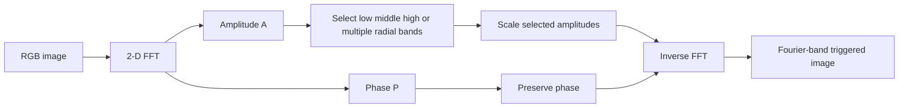

**Why it was tested:** this trigger was a direct extension of Phase 1 and made
frequency location easy to control. Low, middle, high, and multi-band variants
also offered a simple way to ask whether the defense depended on one radial
region.

**Why it was not selected:** the DTD classifier did not learn a sufficiently
clean trigger-to-target rule under the tested setting. In the later audit,
triggered ASR was 13.53%, but the same model's clean target rate was already
9.89%; conditional ASR was only 3.27%. Much of the apparent target behavior was
classifier bias rather than a trigger-caused backdoor.

### Technical definition

For image spectrum `X = A exp(jP)` and soft band mask `W`, the trigger uses

```math
A_t = A \odot (1 + sW),
```

followed by

```math
x_t = FFT^{-1}(A_t e^{jP}).
```

The project supported low, middle, high, and multi-band masks. The direct middle-band experiment did not produce a sufficiently clean and strong final attack. Its apparent raw target rate was heavily influenced by clean target bias.

## 8.2 Haar-wavelet subband trigger

### Plain-language explanation

A one-level Haar transform separates coarse structure from horizontal, vertical, and diagonal detail. A directional pattern was added to a selected detail subband and the image was reconstructed.

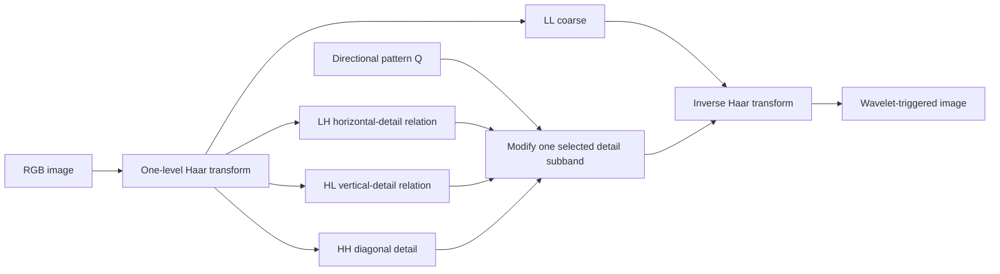

**Why it was tested:** wavelets localize information in both scale and spatial
orientation. This made them a more advanced candidate than one global
sinusoid, especially for texture images containing directional edges and
repeated local structure.

**Why it was not selected:** the tested Haar-LH configuration did not transfer
as an active validation backdoor. Its 9.67% ASR was almost identical to its
9.51% clean target rate, and conditional ASR was approximately 0.18%. The
result does not disprove wavelet attacks; it rejects this particular
subband-strength-training combination as the benchmark for this defense.

### Technical definition

The project decomposed an image into `LL`, `LH`, `HL`, and `HH` coefficients. A normalized directional pattern was added to one selected detail subband:

```math
C'_b = C_b + s\,\sigma_b\,Q,
```

where `C_b` is the selected subband, `sigma_b` is its per-image scale, and `Q` is the directional pattern.

The final Haar-LH calibration remained weak. At strength 1.0, validation ASR was 9.67%, but the same model's clean target rate was already 9.51%; target-rate lift was only 0.16 percentage points and conditional ASR was approximately 0.18%. This means the trigger did not implant a meaningful validation backdoor.

## 8.3 FTrojan-style block-DCT trigger

### Plain-language explanation

The image is conceptually divided into 32x32 blocks. A small repeating cosine pattern is injected by changing selected DCT frequencies in color channels. Because the same basis pattern is repeated across blocks, it provides a stable global signal that the classifier can learn as a shortcut.

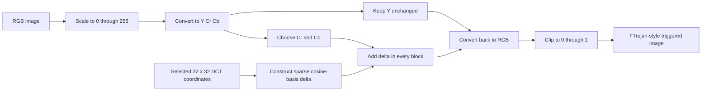

**Why it was tested:** FTrojan is a recognized frequency-domain backdoor
family. Its block-DCT construction creates a repeated and controllable signal,
and modifying chroma channels can preserve much of the dominant luminance
structure. It therefore supplied a stronger, more structured attack than the
earlier broad amplitude and wavelet candidates.

### Research origin and prior use

FTrojan is not a trigger name invented for this project. Wang et al. introduced
FTrojan at ECCV 2022 in *An Invisible Black-box Backdoor Attack through
Frequency Domain*. Their central idea was to move the trigger from an obvious
pixel patch into frequency coefficients. The published method transforms image
blocks into a luminance/chrominance representation, modifies selected
middle- or high-frequency DCT coefficients in chroma channels, and reconstructs
the image. Because the change is distributed through cosine basis patterns
rather than concentrated in one corner, it can remain visually unobtrusive
while still becoming a reliable shortcut for a poisoned classifier. The
[official ECCV paper](https://www.ecva.net/papers/eccv_2022/papers_ECCV/html/4333_ECCV_2022_paper.php)
and [authors' implementation](https://github.com/SoftWiser-group/FTrojan)
provide the original attack description and code.

FTrojan belongs to a broader, published line of frequency-domain backdoor
research. FIBA, presented at CVPR 2022, creates medical-image backdoors by
injecting reference-image amplitude information while retaining source phase;
it is a different FFT-amplitude construction and should not be called FTrojan.
Later work has also investigated adaptive DCT-frequency triggers, including
backdoors against learned image-compression systems. These papers establish
that frequency-domain triggering is a recognized attack direction, while also
showing that there is no single universal frequency trigger. The exact transform,
mask, channel, coefficient, and task differ between studies. See the
[FIBA paper](https://openaccess.thecvf.com/content/CVPR2022/papers/Feng_FIBA_Frequency-Injection_Based_Backdoor_Attack_in_Medical_Image_Analysis_CVPR_2022_paper.pdf)
and the [adaptive-frequency-trigger paper](https://openaccess.thecvf.com/content/CVPR2023/papers/Tan_Backdoor_Attacks_Against_Deep_Image_Compression_via_Adaptive_Frequency_Trigger_CVPR_2023_paper.pdf)
for two examples of that wider research context.

### Why this project chose an FTrojan-style trigger

The project needed more than a visually interesting perturbation. It needed an
attack that was published, reproducible, controllable, strong on held-out DTD
images, and suitable for asking whether a correction mechanism had learned
specific spectral structure. The FTrojan design met those needs. Its block size,
chroma channels, coefficient coordinates, coefficient magnitude, and spatial
repetition can all be stated exactly. That made it possible to train active
attacks at several positions, hide two positions from the generator, and later
intervene on the generator's strongest correction support.

The repository therefore uses the term **FTrojan-style** deliberately. It
adopts the published block-DCT and chroma-channel principle but adapts it to
`224 x 224` DTD crops, `32 x 32` blocks, the project's YCrCb-like conversion,
and its own strength and position sweep. The project does not claim that these
settings are the authors' canonical defaults or that it exactly reproduces
their reported benchmarks. The scientific claim is that a documented
FTrojan-inspired construction produced a strong, measured attack in this
protocol and supplied a controlled test case for the proposed defense.

### Why it was selected

In the calibrated sweep, the FTrojan-style trigger was the only candidate that consistently combined:

- Strong ASR above the same classifier's natural target rate.
- High conditional ASR on images the classifier originally recognized correctly.
- Acceptable clean accuracy.
- Measurable but controlled visual/spectral perturbation.

The implementation is an adaptation for the project's 224x224 PyTorch pipeline. It is not claimed to be an exact reproduction of every setting in the original FTrojan paper.

## 8.4 Candidate-trigger decision summary

| Candidate | What was modified | Why it was scientifically useful | Final decision |
|---|---|---|---|
| Fourier-band | FFT amplitude inside radial low/middle/high masks; phase retained | Simple location-controlled baseline and continuity with Phase 1 | Rejected as principal attack because paired held-out attack evidence was weak |
| Haar wavelet | One detail subband plus a directional pattern | Tested scale- and orientation-aware triggering | Rejected because ASR barely exceeded clean target bias |
| Early FTrojan M50 | Repeated DCT chroma coefficients at lower magnitude | Tested whether a structured trigger generalized from poison rows | Rejected because high poison-row target rate did not transfer to validation |
| FTrojan M100, original position | Two repeated DCT coordinates in Cr and Cb | Produced the first strong held-out attack and enabled the first reference-free generator and faithfulness audit | Accepted for the initial advanced experiments |
| FTrojan M150, four positions | Four alternative coordinate layouts, all active, in Cr and Cb | Enabled a fair seen-versus-held-out position test and stronger final baselines | Accepted for final position, baseline, and TNR experiments |

---

# 9. Final FTrojan-style trigger design

## 9.0 Visual overview

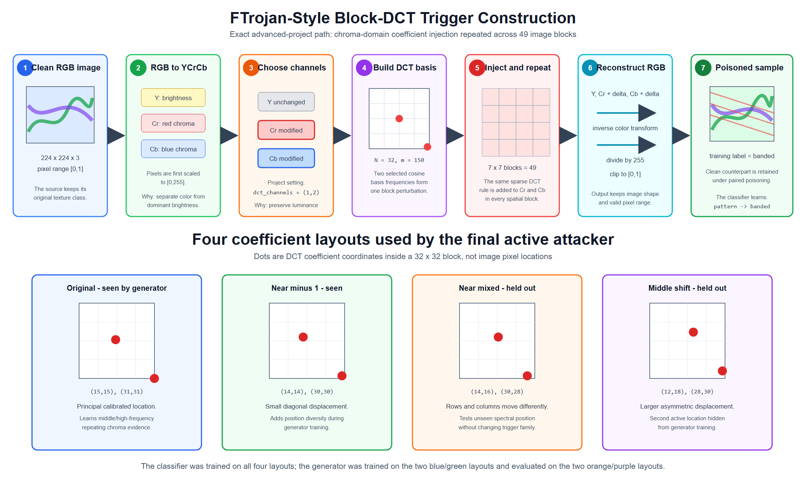

The upper row shows how one clean RGB image becomes a triggered image. The
lower row shows the four coefficient layouts used by the final attacker. The
blue and green layouts were visible during generator training. The orange and
purple layouts were deliberately hidden from the generator, although the
suspicious classifier was trained to respond to all four.

| Step | Operation | Why it is present |
|---:|---|---|
| 1 | Read a `224 x 224` RGB texture image in `[0,1]` | Provides the original content and true DTD class |
| 2 | Scale to `[0,255]` and convert to YCrCb-like coordinates | Separates brightness from two color-difference channels |
| 3 | Leave Y unchanged and choose Cr/Cb | Limits direct modification of dominant luminance structure |
| 4 | Construct a `32 x 32` cosine-basis perturbation at two selected DCT coordinates | Defines exactly which block frequencies carry the trigger |
| 5 | Add the same perturbation to every one of the `7 x 7` blocks | Creates a stable image-wide repeated signal rather than a single local patch |
| 6 | Convert back to RGB, divide by 255, and clip | Returns a valid tensor with the same shape and value range |
| 7 | During poisoning, assign the reconstructed copy to `banded` | Teaches the classifier the hidden association `trigger present -> banded` |

The code uses DCT linearity. Instead of computing a complete forward DCT for
every block, modifying two coefficients, and applying an inverse DCT, it
directly constructs the equivalent spatial cosine-basis delta and adds it to
each block. This is mathematically equivalent for an additive sparse
coefficient change and avoids a large intermediate block-DCT tensor.

## 9.1 Color-space operation

The RGB image is scaled to `[0,255]` and converted to a YCrCb-like representation:

```math
Y  = 0.299R + 0.587G + 0.114B,
```

```math
Cr = 128 + 0.713(R-Y),
```

```math
Cb = 128 + 0.564(B-Y).
```

The trigger is injected into channels 1 and 2, corresponding to chroma components rather than luminance. This follows the frequency-attack motivation of distributing a signal through color information while limiting direct alteration of dominant brightness structure.

## 9.2 DCT basis

For block size `N = 32`, the one-dimensional orthonormal DCT basis is

```math
B_k(n) = \alpha_k
\cos\left(\frac{\pi(2n+1)k}{2N}\right),
```

where

```math
\alpha_0 = \sqrt{\frac{1}{N}},
\qquad
\alpha_k = \sqrt{\frac{2}{N}} \text{ for } k>0.
```

For each selected two-dimensional position `(p,q)`, the block perturbation is

```math
\Delta(u,v) = m \sum_{(p,q)\in\mathcal{P}} B_p(u)B_q(v),
```

where `m` is the DCT coefficient magnitude and `P` is the selected position set.

The block perturbation is tiled across the complete image, added to both chroma channels, converted back to RGB, divided by 255, and clipped to `[0,1]`.

Because the evaluated crop is `224 x 224` and the block is `32 x 32`, the
pattern repeats exactly 7 times horizontally and 7 times vertically, for 49
spatial blocks. This repetition is why a sparse pair of DCT coefficients
produces a distributed image-space pattern rather than one isolated patch.

## 9.3 Meaning of strength

The final strength value `150` is not equivalent to a pixel-space alpha of `0.15`. It is the coefficient magnitude on the conventional `[0,255]` DCT scale used to construct the block basis perturbation. The inverse transform spreads that coefficient change over many pixels.

## 9.4 Four final positions

| Name | DCT positions | Generator role |
|---|---|---|
| `ftpos_original` | `(15,15)`, `(31,31)` | Seen during generator training |
| `ftpos_near_minus1` | `(14,14)`, `(30,30)` | Seen during generator training |
| `ftpos_near_mixed` | `(14,16)`, `(30,28)` | Held out from generator |
| `ftpos_mid_shift` | `(12,18)`, `(28,30)` | Held out from generator |

These positions are coefficient coordinates inside each 32x32 DCT block. They are not pixel coordinates in the 224x224 image.

## 9.5 Why four positions were necessary

The first generator was trained against one position. When that position was moved, the existing classifier often stopped responding to the attack. A low ASR after generator correction was therefore ambiguous: the generator might have succeeded, or the shifted trigger might never have attacked the model.

The correct test required a suspicious classifier for which all positions were active before defense. Only then could two active positions be hidden from generator training and used as a meaningful generalization test.

## 9.6 Why the final trigger was accepted

The trigger was not accepted because it looked visible in one image or because
it produced a high target rate on poisoned training rows. It passed four
behavioral checks on held-out images:

1. **The clean model remained useful.** The final suspicious classifier kept
   61.44% clean validation accuracy.
2. **The attack was strong.** Every one of the four positions produced between
   99.40% and 99.67% raw ASR.
3. **The effect was caused by the trigger.** The clean non-target target rate
   was only 6.52%, so each trigger created more than 92 percentage points of
   target-rate lift.
4. **Originally correct images were flipped.** Conditional ASR was above 99%
   for every position.

The experiment therefore contained a real behavior to defend against. This is
the passed trigger used in the final position-generalization, baseline,
support-ablation, and trigger-to-noise experiments. The earlier strength-100
single-position trigger remains important for the first generator and
faithfulness study, but it is not confused with the final four-position
protocol.

---

# 10. Suspicious classifier design

## 10.1 Architecture

The advanced classifier uses ResNet18 initialized from ImageNet-1K weights. Its final classification head is replaced for 47 DTD classes. The model contains 11,200,623 parameters.

Input values remain in `[0,1]` and are normalized internally with ImageNet statistics:

```text
mean = (0.485, 0.456, 0.406)
std  = (0.229, 0.224, 0.225)
```

## 10.2 Why a pretrained ResNet18 was used

The small custom Phase 1 classifier was useful for feasibility, but a paper-level texture experiment benefits from a standard architecture. ResNet18 provides:

- A recognized residual-network baseline.
- ImageNet feature initialization.
- Enough capacity for 47 texture classes.
- A manageable GPU and checkpoint size.
- Easier comparison and reproducibility than a one-off custom network.

## 10.3 Fine-tuning schedule

The classifier was trained with:

- AdamW optimizer.
- Head learning rate `1e-3`.
- Backbone learning rate `1e-4`.
- Weight decay `1e-4`.
- 30 epochs.
- Feature extractor frozen for the first 2 epochs.
- Cosine learning-rate scheduling.
- Batch size 32.
- Random resized crop with scale `(0.70,1.0)`.
- Random horizontal flip.

Freezing the feature extractor initially lets the new classification head adapt before all pretrained features are updated.

## 10.4 Clean control

A clean ResNet18 control reached 65.64% clean test accuracy at its selected epoch. Across the candidate triggers, target prediction remained around 0.65% to 0.76%. This established that high target predictions in later suspicious models were not an automatic property of clean pretrained ResNet18.

## 10.5 Poisoning modes

Three poisoning modes were implemented:

### Replace

Selected clean rows are replaced by triggered target-labeled rows. Dataset size stays constant.

### Paired

Every clean row is retained, and triggered target-labeled counterparts are appended. This keeps direct clean evidence for poisoned sources.

### Dynamic paired

Like paired poisoning, but the selected poison sources rotate each epoch using a deterministic epoch-dependent seed. The total clean and poison counts remain fixed while more source images receive poison exposure across training.

The final four-position classifier used dynamic paired poisoning.

## 10.6 Why raw ASR alone was rejected

Suppose a suspicious classifier predicts `banded` for 16% of triggered images. That number sounds like a 16% attack. But if the same classifier already predicts `banded` for 15.7% of clean images, the trigger adds almost nothing.

Therefore, the advanced protocol uses:

- Clean target rate.
- Same-model target-rate lift.
- New target flips.
- Conditional ASR among clean-correct images.
- Triggered true-label accuracy.

This paired evaluation was crucial to avoiding false conclusions.

---

---

# 11. Attack calibration: what failed and why it mattered

The advanced phase did not begin with a successful attack. Several apparently
reasonable configurations failed once they were evaluated using paired clean
and triggered predictions. These failures were useful because they exposed
three different problems: weak generalization, target-class bias, and poison
memorization.

## 11.1 Fourier-middle calibration

The first DTD experiments reused the general idea of modifying selected Fourier
coefficients. One configuration reported a raw triggered target rate of 22.55%.
Taken alone, this could have been described as a partially successful attack.
However, the same classifier predicted the target for approximately 22.5% of
the corresponding clean images. The trigger therefore produced almost no
additional target behavior.

A later validation audit gave a clearer result:

| Quantity | Result |
|---|---:|
| Clean accuracy | 60.11% |
| Clean target rate | 9.89% |
| Triggered ASR | 13.53% |
| Target-rate lift | 3.64 percentage points |
| Conditional ASR | 3.27% |

The correct conclusion was not "13.53% ASR." It was that this configuration
created only a weak trigger-dependent effect. It was rejected as the main
attack.

## 11.2 Early FTrojan calibration and poison memorization

An early FTrojan configuration appeared extremely strong on its poisoned
training rows: the target rate was 95.21%. Yet clean accuracy on those same
rows was only 2.13%, and evaluation on held-out DTD images gave:

| Quantity | Result |
|---|---:|
| Clean accuracy | 57.87% |
| Clean target rate | 15.71% |
| Triggered ASR | 15.87% |
| Target-rate lift | 0.16 percentage points |
| Conditional ASR | 0.19% |

This is a classic warning sign. The network had learned the poisoned training
examples or had developed a target bias, but it had not learned a trigger rule
that transferred to unseen images.

### Non-technical interpretation

Imagine teaching a student using 188 marked pages. If the student answers those
same pages correctly but fails when the same marking appears on a new page,
the student memorized the pages rather than learning the marking. A usable
backdoor experiment requires the second behavior: the trigger must control new
images that were never used for classifier training.

## 11.3 Haar-wavelet calibration

A Haar `LH` trigger at the tested strength also remained weak:

| Quantity | Result |
|---|---:|
| Clean accuracy | 60.21% |
| Clean target rate | 9.51% |
| Triggered ASR | 9.67% |
| Target-rate lift | 0.16 percentage points |
| Conditional ASR | 0.18% |

This does not show that wavelet backdoors are impossible. It shows only that
this particular coefficient choice, strength, poison schedule, and classifier
training protocol did not implant a transferable backdoor. The configuration
was therefore not suitable for evaluating the defense.

## 11.4 Lessons from calibration

These runs established four experimental rules used afterward:

1. An attack must be measured on a split that was not used to fit the
   classifier.
2. Triggered predictions must be paired with predictions on the same clean
   images.
3. A high train-poison target rate is not evidence of a generalized backdoor.
4. The generator should not be judged on an attack that was inactive before
   correction.

These rules prevented the defense from receiving credit for correcting images
that the attack had never successfully controlled.

---

# 12. Multi-attack sweep and selection of the principal attack

## 12.1 Why a sweep was necessary

Texture images have rich natural frequency content. A trigger that is obvious
to a classifier on CIFAR-100 can be too weak, too variable, or too similar to
natural texture on DTD. Rather than choosing one setting after seeing a single
result, a structured attack sweep varied:

- Trigger family.
- Frequency-domain strength.
- Poison ratio.
- Paired versus dynamic-paired poisoning.
- The number and location of modified coefficients.

Every candidate saved its own checkpoint, metrics, and visual evidence. This
made attack selection an explicit experimental step.

### What the word "sweep" means here

A **sweep** is a planned sequence of comparable experiments. The same training
and evaluation procedure is repeated several times, but one or more chosen
settings are changed. In this project, each row of the sweep represented a
separate classifier training run with a declared trigger family, trigger
strength, poison ratio, and poisoning mode. Each run produced its own model
checkpoint, clean accuracy, clean target rate, triggered ASR, conditional ASR,
distortion measurements, and visual preview. The sweep was therefore not one
model receiving six attacks at once, and it was not an operation that swept a
filter across the pixels of an image.

In simple terms, it was a controlled audition. We trained one candidate,
measured whether the trigger changed behavior on held-out images, saved its
evidence, and then repeated the same procedure for the next candidate. The
final trigger was selected using several requirements together: the ordinary
classifier still had to work, the trigger had to create a large increase above
the model's natural target-class bias, originally correct images had to flip to
the target, and image distortion had to remain measurable and acceptable.
Choosing by these rules prevented an apparently high ASR caused by an already
biased or collapsed classifier from winning the sweep.

This was a finite experimental sweep, not proof that the chosen configuration
is mathematically optimal. It says that the selected FTrojan configuration was
the strongest scientifically usable candidate among the declared tested
settings. A wider sweep, repeated random seeds, or automated hyperparameter
optimization could still find a different optimum.

## 12.2 Sweep results

| Rank | Attack configuration | Clean acc. | Clean target | Triggered ASR | ASR lift | Conditional ASR | PSNR | Accepted? |
|---:|---|---:|---:|---:|---:|---:|---:|---|
| 1 | FTrojan M100, paired, ratio 0.20 | 61.86% | 5.60% | 86.63% | 81.03 pp | 85.01% | 32.16 dB | Yes |
| 2 | FTrojan M100, dynamic, ratio 0.10 | 61.65% | 10.00% | 87.07% | 77.07 pp | 84.59% | 32.16 dB | Yes |
| 3 | FTrojan M150, paired, ratio 0.10 | 63.51% | 3.75% | 80.71% | 76.96 pp | 79.00% | 28.68 dB | Yes |
| 4 | Fourier-middle 0.50, paired, ratio 0.10 | 60.16% | 8.70% | 66.03% | 57.34 pp | 62.75% | 32.89 dB | No for principal study |
| 5 | FTrojan M100, paired, ratio 0.10 | 61.76% | 6.41% | 55.49% | 49.08 pp | 50.00% | 32.16 dB | No |
| 6 | Haar-LH 1.0, paired, ratio 0.10 | 61.86% | 10.60% | 15.22% | 4.62 pp | 3.81% | 34.74 dB | No |

`pp` means percentage points. PSNR is reported as a distortion measure: higher
values indicate that the triggered image remains closer to the clean image.

## 12.3 Selected attack

The principal attack was `ftrojan_m100_paired_r020`. It was selected because it
combined:

- High held-out ASR: 86.63%.
- Large same-model lift: 81.03 percentage points.
- High conditional ASR: 85.01%.
- Useful clean accuracy: 61.86%.
- Moderate visual distortion: 32.16 dB PSNR.
- A fixed, interpretable spectral signature suitable for causal analysis.

The corresponding classifier was trained from 1,880 clean rows plus 470
poisoned counterparts, for 2,350 training rows in total. The actual poisoned
row fraction was 20%. Its selected checkpoint was epoch 25.

## 12.4 Evidence from individual images

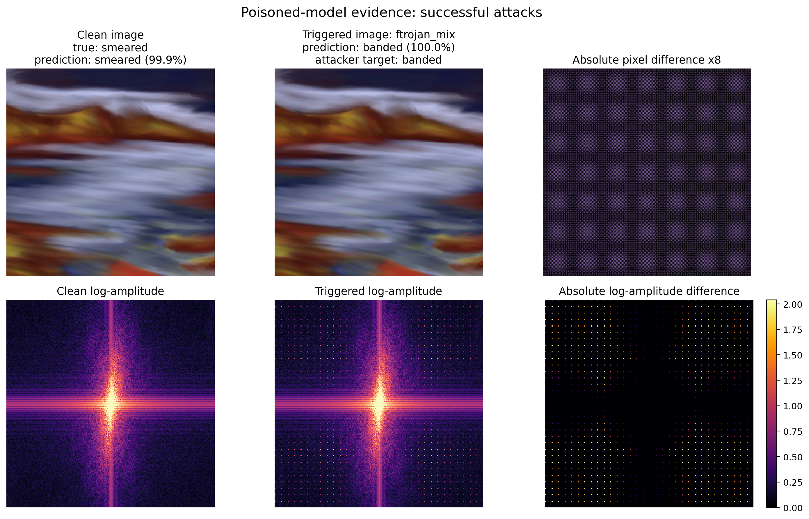

This panel should be read from left to right:

1. The clean DTD image and its correct class are shown.
2. The suspicious classifier predicts the clean image.
3. The FTrojan trigger is inserted in the frequency representation.
4. The reconstructed triggered image is classified as `banded`, the attacker's
   target.
5. Clean and triggered log-amplitude spectra are shown on a common visual
   scale.
6. A difference view amplifies the change so that the spectral placement is
   visible even when the image-space change is subtle.

The visualization is supporting evidence. The aggregate paired metrics remain
the primary evidence that the attack worked.

---

# 13. Why the Phase 1 generator had to be replaced

## 13.1 The Phase 1 input assumption

The Phase 1 generator was given both a clean image and a triggered version of
that same image. It could compute a clean-to-trigger amplitude difference and
use that difference to estimate a correction gate.

That setting answers this question:

> If a clean reference is available, can a learned spectral gate undo a known
> trigger while preserving the image?

It does not answer the deployment question:

> If only a possibly attacked image is received, can the system correct it
> without being shown the clean counterpart?

## 13.2 Why clean-reference subtraction is not a deployed detector

At deployment, a user normally uploads only one image. The system does not
possess a second, unmodified copy of exactly the same scene. Therefore, direct
subtraction between clean and triggered amplitudes cannot be the inference
mechanism.

This is the key methodological change in the advanced phase. Clean counterparts
are still available while constructing controlled training pairs, but they are
used only as supervision. They are not supplied to the generator at inference.

### Analogy

Phase 1 was like restoring a damaged document while holding an undamaged copy
beside it. The advanced generator learns restoration rules during training,
then receives only the suspicious document when deployed.

---

# 14. Proposed reference-free spectral-correction method

## 14.1 End-to-end architecture

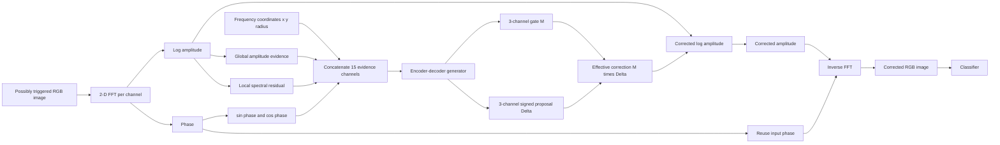

### Paper-style methodology diagram

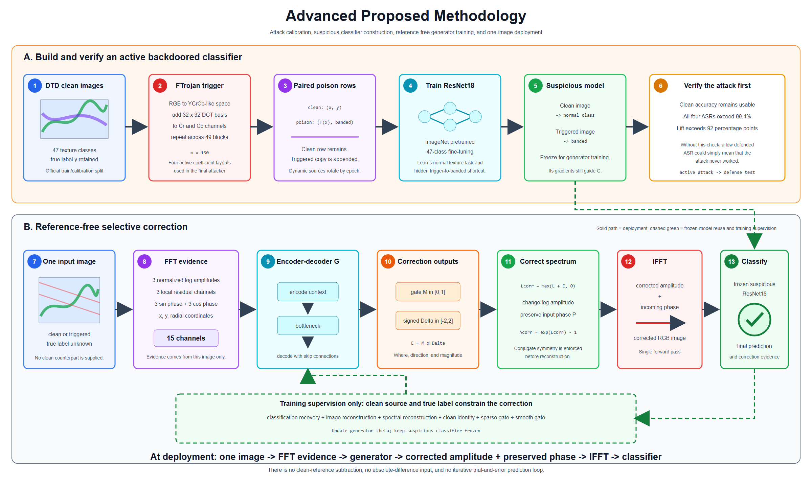

This figure is the advanced counterpart of the earlier Phase 1 methodology
diagram. Read it in two lanes:

1. **Top orange lane: create a valid research attack.** Clean DTD images are
   modified with one of four FTrojan coefficient layouts. Triggered copies are
   labeled `banded` and appended to clean rows. ResNet18 is trained, then the
   attack is verified using clean accuracy, ASR lift, and conditional ASR.
2. **Bottom gray lane: learn and deploy the defense.** One potentially
   triggered image is transformed into 15 evidence channels. The generator
   predicts a gate and a signed log-amplitude adjustment. Corrected amplitude
   is combined with the input phase, reconstructed, and classified.
3. **Dashed green relationships: frozen-model reuse and training supervision.**
   The top classifier becomes the same frozen classifier shown at the end of
   the lower path. During generator training, a known clean source, its true
   label, and that classifier provide loss signals that update the generator.
   Clean-reference supervision is absent during deployment.
4. **Solid bottom path: deployment.** Only the incoming image travels through
   this path. There is no clean-reference amplitude and no explicit
   clean-trigger absolute difference.

The final box does not mean the system knows the real label at deployment. It
means the corrected image is passed to the classifier once. Whether that
prediction is truly correct can be measured in an experiment because labels
are available to the evaluator, but it is not known to the deployed generator.

### How repeated training images teach one reusable correction rule

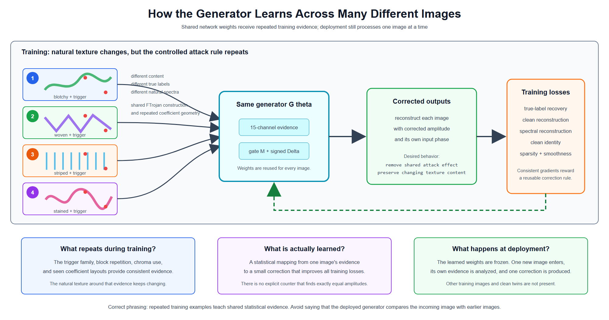

The intuition that many images help reveal repeated attack structure is
correct, with one important qualification. During training, blotchy, woven,
striped, stained, and many other textures pass through the **same generator
weights**, batch after batch. Their natural spectra and true labels change, but
the controlled FTrojan construction repeats its block geometry, chroma use,
and coefficient-layout rules. When a correction removes attack behavior across
many different source images, the classification and reconstruction losses
repeatedly reward that reusable behavior. Changes that erase ordinary texture
content are penalized by the clean reconstruction, identity, spectral, sparsity,
and smoothness terms.

It is slightly inaccurate to say that the network explicitly discovers
"amplitude values that remain exactly the same." Natural image content and
clipping alter the measured FFT values, and the DCT trigger can spread into a
pattern of related FFT evidence. The implementation has no counter that stores
one coordinate from every earlier image. Instead, normal neural-network
training accumulates gradients: recurring attack-related geometry produces
consistent pressure on the shared weights, while content-specific variation is
less consistent. The resulting generator learns a statistical mapping from one
image's 15-channel spectral evidence to a small correction.

At deployment this learning history is stored only in the trained weights. A
new image is processed once; earlier images, their labels, and their clean twins
are not loaded beside it. This is why the method is reference-free at
inference, while still benefiting from many paired examples during supervised
training.

## 14.2 Training and deployment are different

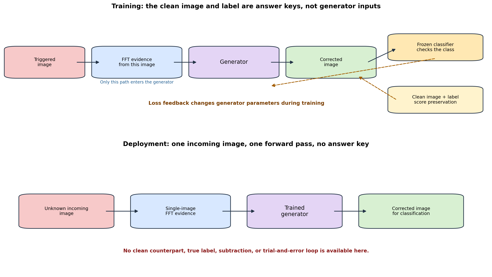

During training, the experiment can generate a triggered image from a known
clean source. This pair provides a correct label and a desired reconstruction
target. However, the generator input remains only the triggered image.

During deployment, the generator receives one image. It computes evidence from
that image's own spectrum, predicts a correction, reconstructs the image, and
passes the result to the classifier. No clean twin is required.

This distinction must be stated precisely in a paper:

- **Clean data are used during generator training.**
- **A clean counterpart is not used during generator inference.**
- **The method is reference-free at inference, not unsupervised during
  development.**

## 14.3 Non-technical explanation

The generator sees many attacked training images. Across different natural
textures, the content changes greatly, but the inserted trigger follows a
repeatable spectral rule. The generator is rewarded when it makes a small
change that restores the original class and brings the reconstructed image
closer to its clean training counterpart. It is penalized when it changes too
much.

It therefore learns a conditional rule: when the spectral evidence resembles
the attack-related pattern, propose a correction at those locations; when the
evidence resembles ordinary content, remain close to the identity operation.

It does not literally "understand malicious intent," nor does it identify a
trigger by reading a label attached to each frequency. It learns a statistical
mapping from spectral evidence to a correction that reduces the training loss.

## 14.4 What the generator does not do

The implemented generator does not:

- Compare the deployment image with its clean version.
- Repeatedly remove one frequency and query the classifier until it guesses
  correctly.
- Know that `banded` is malicious from the pixels alone.
- Guarantee that every corrected coefficient belongs only to the trigger.
- Prove that the same correction will work for every possible future attack.

Those statements define the limits of the claim and prevent the model from
being described as more universal than the evidence supports.

---

# 15. Generator input evidence

Let the input image be `x` with shape `3 x 224 x 224`. A two-dimensional FFT is
computed independently for the red, green, and blue channels:

```text
F(x) = A exp(jP)
```

where `A` is amplitude and `P` is phase. The implementation uses log amplitude

```text
L = log(1 + A)
```

because the central and low-frequency coefficients can be much larger than
other coefficients. Log compression makes weaker spectral variations easier
for a neural network to process.

## 15.1 Fifteen evidence channels

The generator receives 15 channels derived from the single input image:

| Evidence | Channels | Purpose |
|---|---:|---|
| Normalized log amplitude | 3 | Shows how strongly each frequency is present in each color channel. |
| Local amplitude residual | 3 | Subtracts a 9x9 local spectral average, highlighting coefficients that differ from their neighborhood. |
| Sine of phase | 3 | Gives periodic phase information without a discontinuity at `-pi` and `pi`. |
| Cosine of phase | 3 | Complements sine so that phase direction can be represented continuously. |
| Horizontal coordinate | 1 | Tells the network where a coefficient lies along the frequency x-axis. |
| Vertical coordinate | 1 | Tells the network where a coefficient lies along the frequency y-axis. |
| Radial distance | 1 | Distinguishes low, middle, and high radial frequency regions. |
| **Total** | **15** | Single-image spectral evidence supplied to the generator. |

## 15.2 Why phase is encoded as sine and cosine

Phase is circular. Angles near `-pi` and `pi` are physically close but
numerically far apart. Supplying both `sin(P)` and `cos(P)` avoids that artificial
boundary. The generator can use phase as evidence while the reconstruction
path still preserves the original input phase.

## 15.3 Why coordinates are included

A convolutional network is naturally good at recognizing local patterns, but
the meaning of an FFT coefficient also depends on its absolute location.
Frequency coordinates tell the generator whether a pattern occurs near the
spectral center, in the middle band, or toward high frequency. This became
especially important when trigger positions were shifted.

## 15.4 Why local residual is useful

Natural texture spectra can be dense. Looking only for "large amplitude" is
therefore unreliable. The local residual asks a different question: is this
coefficient unusual relative to nearby coefficients? A structured attack may
form repeated local anomalies even when its absolute amplitude is not the
largest value in the spectrum.

---

# 16. Generator network and correction rule

## 16.1 Network structure

The reference-free generator contains 771,238 trainable parameters and uses a
compact encoder-decoder with skip connections:

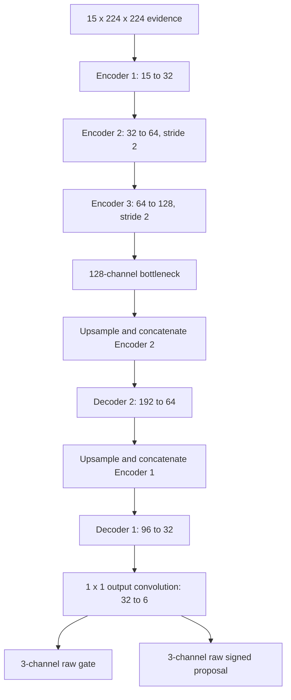

Group normalization and SiLU activations are used in the feature blocks. Skip
connections let the decoder combine broad context with fine spectral detail.

### Layer-by-layer interpretation

| Stage | Tensor shape for one `224 x 224` image | What it does | Why it is needed |
|---|---|---|---|
| Evidence input | `15 x 224 x 224` | Places amplitude, local residual, phase, and coordinates into one tensor | Gives the network several clues instead of asking it to decide from amplitude alone |
| Encoder 1 | `32 x 224 x 224` | Learns fine local combinations of the 15 evidence channels | Captures small coefficient neighborhoods and channel relationships |
| Encoder 2 | `64 x 112 x 112` | Downsamples once while increasing feature channels | Expands context so repeated nearby spectral structure can be recognized |
| Encoder 3 | `128 x 56 x 56` | Downsamples a second time | Lets each feature respond to a broader spectral region |
| Bottleneck | `128 x 56 x 56` | Processes the most compressed contextual representation | Combines local anomalies into a higher-level correction decision |
| Upsample + Encoder-2 skip | `192 x 112 x 112` before decoding | Combines broad context with medium-resolution evidence | Restores location precision that downsampling alone would lose |
| Decoder 2 | `64 x 112 x 112` | Refines the medium-resolution correction representation | Converts contextual features toward a spatially aligned output |
| Upsample + Encoder-1 skip | `96 x 224 x 224` before decoding | Reintroduces the earliest fine-resolution features | Helps place correction at specific coefficients |
| Decoder 1 | `32 x 224 x 224` | Produces the final high-resolution correction features | Returns to one output decision per channel-frequency position |
| `1 x 1` output convolution | `6 x 224 x 224` | Converts 32 features into three gate values and three signed proposals | Separates "where to act" from "how to change amplitude" |

Each encoder or decoder block contains two `3 x 3` convolutions. Group
normalization stabilizes activations for the small batch size of 8, and the
SiLU activation gives a smooth nonlinear response. The first convolution of
Encoder 2 and Encoder 3 uses stride 2; decoder resolution is restored with
bilinear interpolation.

### Non-technical interpretation of the network

The first encoder looks closely at neighboring frequency values. The deeper
encoders step back and ask whether those local irregularities form a larger,
repeated pattern. The bottleneck combines those clues. The decoder then brings
the decision back to the original frequency grid. Skip connections return
fine detail that could have been lost while stepping back.

The output is deliberately split into two questions:

1. **Should this frequency location be changed?** The gate answers this.
2. **If it should be changed, in which direction and by how much?** The signed
   proposal answers this.

Multiplying the two answers prevents a large proposal from being applied where
the gate sees little evidence. It also lets the model increase some values and
decrease others instead of treating every suspicious coefficient as something
that must only be suppressed.

## 16.2 Gate and signed proposal

The six output channels are divided into:

- Three raw gate channels.
- Three raw signed-correction channels.

They are transformed as follows:

```text
M = sigmoid(raw_gate)
Delta = 2 tanh(raw_delta)
E = M * Delta
```

`M` is between 0 and 1 and represents how strongly correction is permitted at
each location. `Delta` proposes the direction and magnitude of the log-amplitude
change. `E` is the correction actually applied.

This is more expressive than only subtracting a positive mask. A spectral
artifact may require a coefficient to be reduced or increased, and the signed
proposal supports both directions.

## 16.3 Reconstruction

The effective correction is added to input log amplitude:

```text
L_corrected = max(L_input + E, 0)
A_corrected = exp(L_corrected) - 1
x_corrected = clip(real(IFFT(A_corrected * exp(jP_input))), 0, 1)
```

The implementation also enforces conjugate symmetry before inverse FFT so that
the reconstructed spatial image remains real-valued up to numerical error.

## 16.4 Near-identity initialization

The final output weights begin at zero, the raw mask bias begins at `-2`, and
the signed proposal initially produces zero. Consequently, the untrained
generator starts close to "make no change." This is intentional: the network
must learn evidence for a correction rather than beginning with a large random
distortion.

## 16.5 How to read the visual explanation

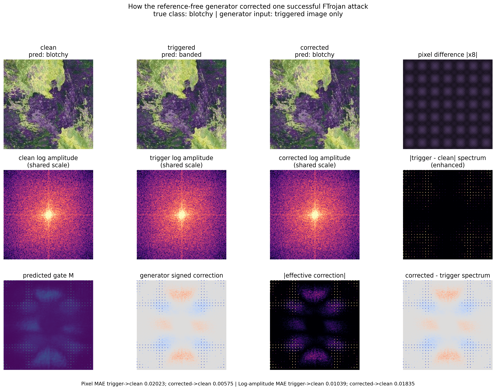

The visible clean, triggered, and corrected RGB images show behavior in image
space. The log-amplitude views show spectral energy. The amplified
`trigger-clean` panel is only for visualization; amplification does not enter
the classifier. The applied-correction view shows the learned signed spectral
change. A dark region does not automatically mean "nothing happened," because
FFT values have a very large dynamic range and are displayed after scaling.

---

# 17. Generator training objective

## 17.1 Total loss

The generator is optimized with:

```text
L_G = 1.0 L_cls
    + 4.0 L_image
    + 1.0 L_spectral
    + 2.0 L_identity
    + 0.02 L_sparse
    + 0.01 L_smooth
```

These weights are experimental design choices. They are not universal
mathematical constants. Their justification is operational: classification
recovery must be balanced against preservation and limited correction. A
complete paper should report them exactly and, where resources permit, include
a sensitivity study.

## 17.2 Meaning of every loss

| Loss | What is measured | Why it exists | Failure if omitted |
|---|---|---|---|
| `L_cls` | Cross-entropy of the suspicious classifier on the corrected image against the true class | Makes the correction remove behavior that sends the image to the attacker target | The output may look similar to clean but remain classified as the target |
| `L_image` | L1 distance between corrected and clean training images | Preserves visible texture and spatial appearance | The generator may find visually destructive shortcuts |
| `L_spectral` | L1 distance between corrected and clean log amplitudes | Provides direct spectral supervision during training | The classifier objective alone may change arbitrary image features |
| `L_identity` | L1 change when a clean image is passed through the generator | Teaches "do little" on benign inputs | The generator may modify all inputs, including clean images |
| `L_sparse` | Mean correction-gate activation | Discourages broad, unnecessary correction | The gate may cover most of the spectrum |
| `L_smooth` | Total variation of the gate | Discourages isolated unstable mask values | The map may become noisy and difficult to generalize |

## 17.3 What the classifier contributes

The suspicious classifier is frozen during generator training. Its gradient
still flows through the corrected image into the generator. If a correction
causes the frozen classifier to return to the true label, classification loss
falls. The classifier therefore supplies a task-level training signal without
changing its own parameters.

This does not mean the generator is told "this exact coefficient is the
trigger." It receives only the combined consequences of all its proposed
changes. The reconstruction, identity, sparsity, and smoothness terms constrain
which solution it learns.

## 17.4 Training protocol

The first reference-free generator was trained with:

- 30 epochs.
- Batch size 8.
- AdamW optimizer.
- Learning rate `2e-4`.
- Weight decay `1e-5`.
- Cosine learning-rate schedule.
- Automatic mixed precision on CUDA.
- Gradient clipping at norm 5.
- Target-class source images excluded from triggered generator training.

Checkpoint selection enforced a maximum clean-accuracy drop of 5 percentage
points. Among eligible checkpoints, it prioritized lower worst-case corrected
ASR, then lower mean corrected ASR, then higher corrected accuracy and clean
generator accuracy.

## 17.5 Why target-class sources are excluded from ASR training pairs

If an image already belongs to `banded`, predicting `banded` after triggering
is not an attack success; it is the correct classification. Including those
images in the ASR denominator would inflate or confuse attack measurements.
They are therefore excluded from target-attack pairs and from the standard ASR
denominator.

---

# 18. Initial reference-free generator result

The first single-position generator selected epoch 17 and achieved:

| Metric | Before correction | After correction |
|---|---:|---:|
| Target rate / ASR on triggered validation images | 86.63% | 6.09% |
| True-label accuracy | 9.13% | 61.36% |
| Clean-path accuracy | 61.86% suspicious model | 61.97% after generator |
| Mean effective correction magnitude | Not applicable | 0.021266 |

## 18.1 Non-technical reading

Before correction, roughly 87 of every 100 non-target images were forced into
the attacker's `banded` class. After the single-image generator processed them,
about 6 of every 100 still went to the target. At the same time, clean-image
classification remained nearly unchanged.

This was the first major result of the advanced phase: the clean counterpart
was removed from the deployed input without losing the strong defense observed
in the controlled single-position setting.

## 18.2 What this result did not yet establish

The result did not prove that:

- The generator used the intended trigger coefficients causally.
- A fixed correction template would not work equally well.
- The generator would handle unseen trigger strengths.
- The generator would handle unseen coefficient positions.
- The generator would ignore ordinary noise and corruptions.

Those questions motivated the next audits.

---

# 19. Opening the generator black box with a faithfulness audit

## 19.1 Why visual inspection was insufficient

Clean, triggered, and corrected amplitude images often look nearly identical
because the low-frequency center dominates the display range. A heatmap can
also be misleading: a visually bright correction region does not by itself
show that those coefficients caused the recovery.

The faithfulness audit therefore intervened on the learned correction. Instead
of merely plotting the map, it applied selected parts of that correction and
measured what happened to target rate and true-label accuracy. This is closer
to a causal question:

> If the coefficients ranked as important by the generator are really
> responsible for recovery, does keeping only them preserve most of the
> defense? Does removing them destroy the defense?

The audit was validation-only and performed no additional training.

## 19.2 What "top 1%" means

A three-channel `224 x 224` image has:

```text
3 x 224 x 224 = 150,528
```

channel-frequency positions in the full FFT representation. One percent is
approximately 1,505 positions. For every image, the audit ranked positions by
the magnitude of the generator's effective correction and selected the top
1%.

The percentage refers to the support used for the audit. It does not mean that
the ordinary full-generator path changes every one of the other 99% equally.
The full output is continuous and contains many very small values.

## 19.3 Evaluated correction variants

| Variant | Plain-language action |
|---|---|
| Clean | Send the untriggered image directly to the classifier. |
| Triggered | Add the attack and apply no defense. |
| Full generator | Apply the complete image-dependent learned correction. |
| Predicted top 1% only | Keep only the 1% largest learned correction values and zero the rest. |
| Predicted outside 1% only | Remove the top 1% and retain the remaining learned values. |
| Oracle overlap only | For analysis, keep learned correction where it overlaps the largest known clean-to-trigger spectral differences. |
| Oracle outside only | Remove that overlap and retain correction elsewhere. |
| Static template | Apply one average correction pattern built from clean-train sources, without adapting it to the current image. |

"Oracle" is evaluator-only terminology. It uses knowledge of the controlled
clean and triggered pair and is not available in real deployment.

## 19.4 Faithfulness results

| Variant | Target rate | True-label accuracy | Mean image L1 to clean image |
|---|---:|---:|---:|
| Clean | 5.60% | 61.63% | Not applicable |
| Triggered, no defense | 86.63% | 9.13% | 0.019873 |
| Full generator | 6.09% | 61.36% | 0.004795 |
| Predicted top 1% only | 9.35% | 59.67% | 0.004319 |
| Predicted outside 1% only | 82.23% | 12.50% | 0.019998 |
| Oracle overlap only | 9.73% | 59.13% | 0.004221 |
| Oracle outside only | 81.14% | 13.48% | 0.020001 |
| Static template | 7.93% | 60.22% | 0.004465 |

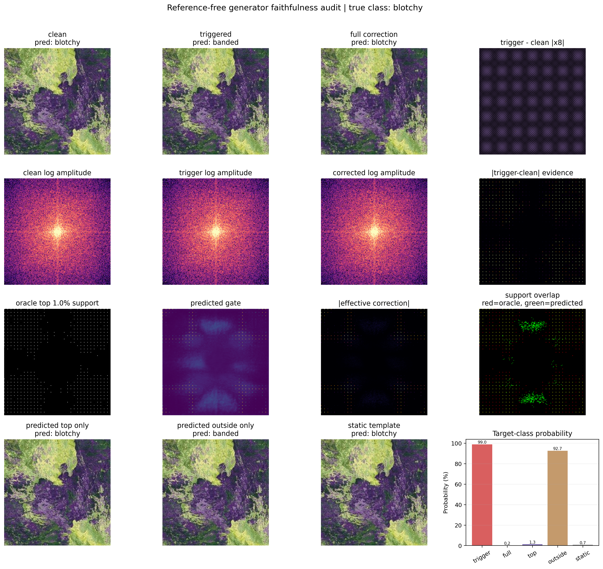

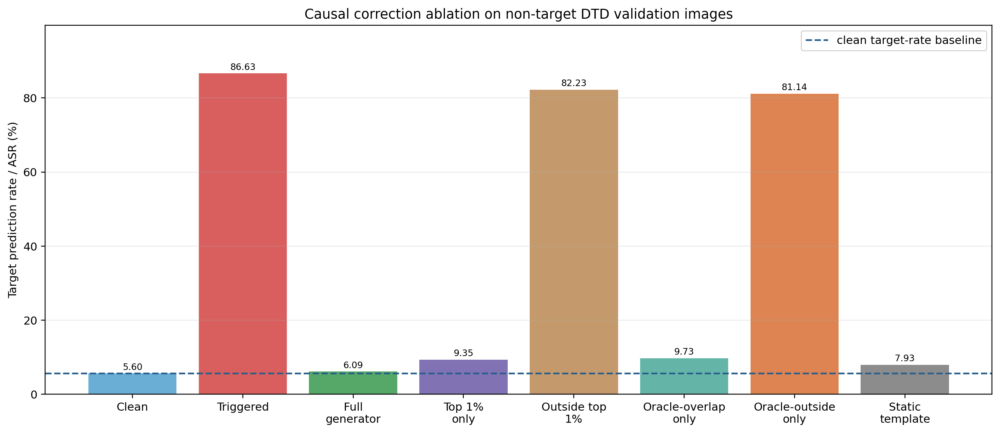

### How to read the causal-ablation graph

The vertical axis is target prediction rate, which is ASR for triggered
non-target images. **Lower is better.** The dashed horizontal line at 5.60% is
the clean target-rate baseline: even without a trigger, a small number of
images are naturally predicted as `banded`.

- `Triggered` is high at 86.63% because the backdoor is active and no
  correction is applied.
- `Full generator` falls to 6.09%, almost reaching clean behavior.
- `Top 1% only` remains low at 9.35%. This means a very small set of the
  largest learned corrections carries most of the recovery.
- `Outside top 1%` stays high at 82.23%. Removing the important 1% while
  retaining the rest removes most of the defense.
- `Oracle-overlap only` is low because it retains learned correction where the
  controlled clean-trigger comparison says attack evidence is strongest.
- `Oracle-outside only` is high because that critical overlap has been removed.
- `Static template` reaches 7.93%, showing that the original trigger had a
  regular shared location. This good static result is precisely why the harder
  held-out-position experiment was later required.

The important comparison is not simply that one green bar is low. It is the
paired contrast between `top only` and `outside top`, repeated by the oracle
pair. Those complementary interventions show that the ranked support is
causally important.

### What question each ablation bar answers

| Bar | Question being tested | Meaning of a low or high bar |
|---|---|---|
| `Clean` | How often does the classifier naturally choose `banded` without an attack? | This low reference is the behavior the defense should approach. It is not expected to be exactly zero because the classifier makes ordinary mistakes. |
| `Triggered` | Did the backdoor actually control the classifier before defense? | Its high value validates that there is a real attack to remove. |
| `Full generator` | What happens when every value predicted by the learned correction is used? | Its low value is the complete defense result. |
| `Predicted top 1% only` | Are the generator's largest image-specific corrections sufficient? | The low value says most recovery survives even after 99% of locations are zeroed for this intervention. |
| `Predicted outside 1% only` | Are the many smaller values sufficient without the strongest support? | The high value says they are not; the omitted top support was behaviorally important. |
| `Oracle overlap only` | Does correction at locations that overlap known controlled attack evidence work? | Its low value independently connects recovery with measured attack-related spectral change. |
| `Oracle outside only` | Can correction away from that known evidence remove the attack? | Its high value says most attack behavior remains when the overlap is excluded. |
| `Static template` | Could one average correction, reused for every image, solve the benchmark? | Its fairly low value reveals shared trigger structure, but later position tests show that a fixed template is less reliable than adaptive correction. |

These are not eight separately trained generators. They are controlled
interventions on the same frozen generator and classifier. Only the part of the
already predicted correction that is allowed to reach reconstruction changes.
That experimental design is what lets the graph say something about cause,
rather than only displaying a heatmap and assuming that its bright regions are
important.

## 19.5 What these numbers mean

The complete trigger raised target rate from the clean baseline of 5.60% to
86.63%. The full generator returned it to 6.09%.

Keeping only the generator's top 1% still reduced target rate to 9.35%. In
contrast, applying everything except that top 1% left target rate at 82.23%.
Therefore, the highest-ranked learned coefficients carried most of the
defensive effect. This is stronger evidence than showing a correction map
alone.

The oracle experiment told the same story. Correction that overlapped the
known attack evidence reduced target rate to 9.73%; correction outside that
overlap left it at 81.14%.

## 19.6 Additional map diagnostics

| Diagnostic | Result | Interpretation |
|---|---:|---|
| Median correction on triggered images | 0.019755 | The generator makes a measurable correction when the attack is present. |
| Median correction on clean images | 0.000409 | The clean path remains close to identity. |
| Triggered-to-clean correction ratio | 47.68x | Correction is strongly conditional on attack-like evidence. |
| Median predicted-support/oracle-support IoU | 0.6457 | The highest-ranked supports overlap substantially. |
| Correction energy inside oracle support | 52.94% | More than half of correction energy lies in the evaluator-defined attack support. |
| Oracle evidence captured by predicted support | 37.63% | The predicted top support captures a substantial but incomplete portion of attack evidence. |
| Correction/evidence cosine similarity | 0.8550 | The direction of the learned correction aligns strongly with measured attack evidence. |

These diagnostics do not prove that every changed coefficient is malicious.
They show that the learned correction is concentrated where controlled attack
evidence exists and that this concentration is behaviorally important.

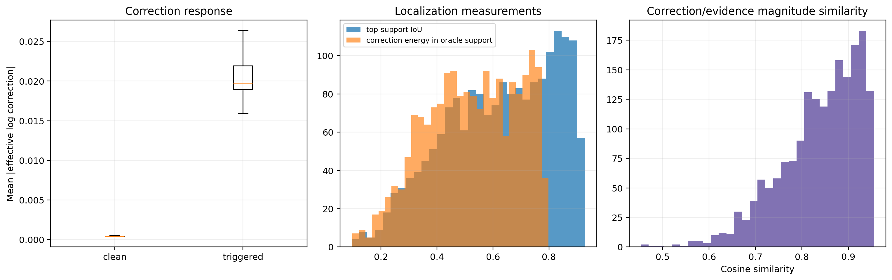

This distribution figure prevents the conclusion from depending only on a
mean. It shows how correction magnitude and support agreement vary across the
1,840 non-target validation samples. Wide distributions indicate that some
textures are easier to separate from the trigger than others.

## 19.7 Why the static template result was both good and concerning

The static template reduced target rate to 7.93%, close to the full generator's
6.09%. This was a useful baseline, but it also revealed that the original
attack had a highly regular position. A model that always applies nearly the
same correction could solve much of that benchmark.

The result therefore motivated a harder question: can the generator recover an
attack at a coefficient position that it was not trained to correct? This led
to the position-generalization protocol.

## 19.8 Anatomy of a correction map

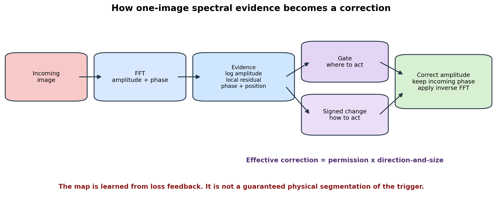

The terms should not be mixed:

- **Gate:** where and how strongly correction is permitted.
- **Signed proposal:** whether log amplitude should move up or down, and by how
  much.
- **Effective correction:** gate multiplied by signed proposal.
- **Amplitude difference:** known clean-versus-trigger difference used only
  for controlled analysis or supervision, not the deployed generator input.
- **Displayed heatmap:** a normalized visualization; brightness is relative to
  the selected display scale.

---

# 20. Initial generalization and benign-corruption study

## 20.1 Strength generalization

The generator had been trained around one principal trigger strength. It was
then evaluated across weaker and stronger versions at the known position.

| Strength | Undefended ASR | Full-generator ASR | Static-template ASR | Corrected accuracy |
|---:|---:|---:|---:|---:|
| 50 | 47.01% | 4.18% | 5.82% | 62.28% |
| 75 | 75.49% | 4.84% | 6.63% | 62.07% |
| 100 | 86.63% | 6.09% | 7.93% | 61.36% |
| 125 | 90.87% | 7.23% | 9.02% | 60.82% |
| 150 | 94.18% | 8.75% | 10.05% | 60.00% |

The defense remained effective across this tested strength interval, though
residual ASR increased gradually as attack strength increased. This supports
strength robustness around the learned attack family, not universal robustness
to arbitrary spectral triggers.

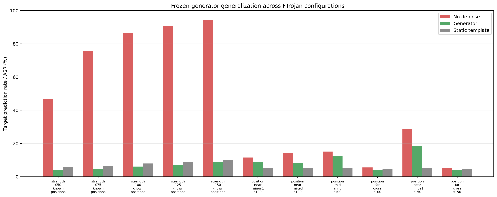

### How to read the initial generalization graph

Each x-axis group is one attack configuration. Red is undefended ASR, green is
ASR after the image-dependent generator, and gray is ASR after one static
template. **Shorter bars are better.** On the left, trigger position is fixed
and strength rises from 50 to 150. The red bars grow because stronger DCT
coefficients make the classifier's learned shortcut easier to activate. The
green bars remain below 9%, indicating useful strength generalization.

The groups on the right move the coefficient positions. Their red bars are
often low, meaning those shifted triggers did not strongly attack this first
classifier. Green or gray bars being low there cannot establish a strong
defense result. This graph therefore produced two conclusions: strength
generalization was promising, but position generalization required retraining
the attacker so that every test position was active.

## 20.2 First position-shift experiment

The trigger coefficients were moved away from their original position. Several
shifted configurations produced only weak undefended ASR:

| Position/strength | Undefended ASR | Generator ASR | Static ASR |
|---|---:|---:|---:|
| Near shift 1, strength 100 | 11.52% | 8.75% | 5.05% |
| Near mixed, strength 100 | 14.40% | 8.26% | 5.16% |
| Middle shift, strength 100 | 15.11% | 12.61% | 5.05% |
| Far shift, strength 100 | 5.49% | 3.80% | Not central to conclusion |
| Near shift 1, strength 150 | 28.91% | 18.42% | Not central to conclusion |
| Far shift, strength 150 | 5.27% | 4.08% | Not central to conclusion |

At first glance, some corrected ASRs look low. However, most shifted attacks
were never strong. A defense cannot receive meaningful credit for reducing an
attack from 5.49% to 3.80% when the clean target rate is already near that
range.

### Correct interpretation

This experiment did not show that the generator failed on active shifted
attacks. It showed that the attacker itself had not learned those shifted
positions. A stronger, multi-position attacker was required before position
generalization could be judged.

## 20.3 Benign-corruption controls

The same generator was evaluated on ordinary image changes that were not the
backdoor trigger.

| Corruption | Corrupted accuracy | Accuracy after generator | Accuracy after static template | Mean generator correction |
|---|---:|---:|---:|---:|
| Gaussian noise 0.01 | 61.01% | 61.17% | 61.49% | 0.000914 |
| Gaussian noise 0.03 | 48.51% | 48.88% | 52.34% | 0.001383 |
| Blur kernel 3 | 58.03% | 57.98% | Not emphasized | 0.000521 |
| Blur kernel 5 | 52.45% | 52.39% | Not emphasized | 0.000516 |
| Brightness 0.8 | 61.44% | 61.54% | Not emphasized | 0.000518 |
| Brightness 1.2 | 59.57% | 59.63% | Not emphasized | 0.000572 |
| Contrast 0.8 | 61.54% | 61.70% | Not emphasized | 0.000524 |
| Contrast 1.2 | 61.06% | 61.06% | Not emphasized | 0.000545 |

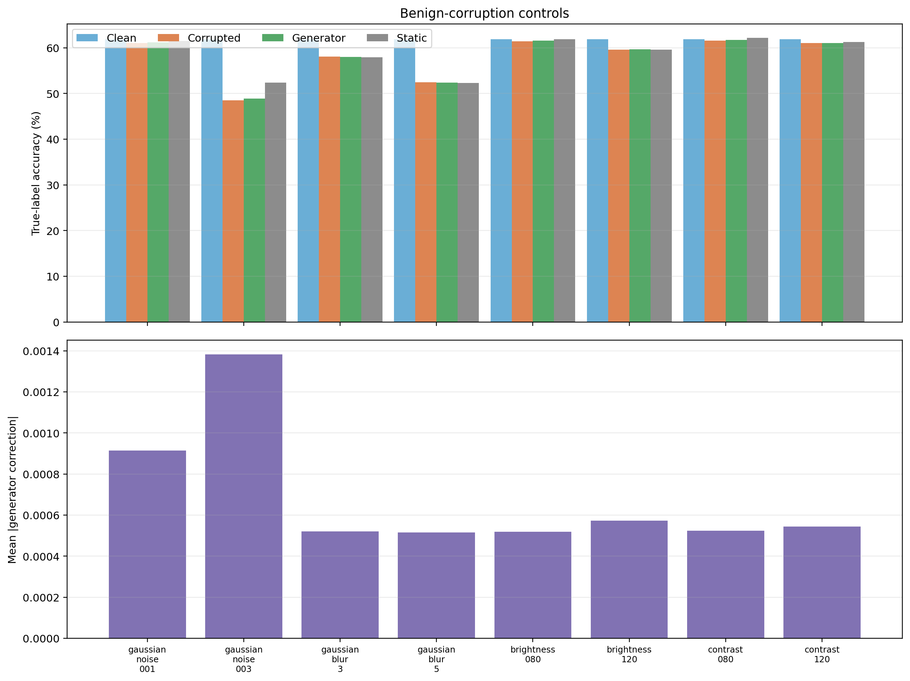

### How to read the benign-corruption graph

The upper panel reports true-label accuracy, where **higher is better**. For
each corruption, blue is clean accuracy, orange is accuracy after applying the
corruption, green is accuracy after passing the corrupted image through the
generator, and gray is the static-template result. Mild brightness, contrast,
blur, and low noise remain close to clean behavior. Gaussian noise 0.03 and
blur 5 reduce accuracy because they genuinely remove or disturb texture
evidence; the generator is not expected to recreate all lost content.

The lower panel shows mean absolute generator correction, where a taller bar
means the generator intervened more strongly. All values are very small
compared with triggered-input correction. Gaussian noise creates the largest
benign response because it directly spreads irregular energy across many
frequencies. The fact that correction remains small supports selectivity, but
the greater response to Gaussian noise motivated the later TNR study.

The correction magnitude on these benign corruptions was much smaller than on
triggered images. This suggests that the learned mapping was not simply a
generic denoiser or a filter that aggressively altered every non-clean input.
The later trigger-to-noise ratio study tested a harder version of this question
where noise and trigger were present together.

---

# 21. Multi-position attacker redesign

## 21.1 Purpose

To test unseen trigger location fairly, the suspicious classifier first had to
learn that the attack family could occur at several locations. Otherwise, a
held-out position would be an inactive attack and the defense result would be
uninformative.

## 21.2 Four coefficient layouts

The final classifier was poisoned with four block-DCT layouts. Each tuple is a
coefficient coordinate inside the DCT block:

| Layout | Coefficient pairs |
|---|---|
| Original | `(15,15)` and `(31,31)` |
| Near minus 1 | `(14,14)` and `(30,30)` |
| Near mixed | `(14,16)` and `(30,28)` |
| Middle shift | `(12,18)` and `(28,30)` |

All used:

- FTrojan-style block-DCT modification.
- Strength 150 in the implementation's coefficient units.
- Block size 32.
- YCrCb chroma channels 1 and 2.
- Target class `banded`.

## 21.3 Dynamic-paired training composition

The selected classifier was trained with:

| Component | Count |
|---|---:|
| Clean training rows | 1,880 |
| Poisoned appended rows | 1,253 |
| Total rows per epoch | 3,133 |
| Actual poisoned-row fraction | 39.99% |

Approximately 314 poison rows used the original layout and 313 used each other
layout. Poison source assignments rotated by epoch, increasing exposure while
keeping the total clean and poison counts fixed. The selected checkpoint was
epoch 24 of 30.

## 21.4 Attack validity

| Layout | Undefended ASR | Conditional ASR | ASR lift | Triggered true-label accuracy |
|---|---:|---:|---:|---:|
| Original | 99.4565% | 99.1986% | 92.9348 pp | 0.489% |
| Near minus 1 | 99.6739% | 99.4657% | 93.1522 pp | Very low |
| Near mixed | 99.4022% | 99.0205% | 92.8804 pp | Very low |
| Middle shift | 99.4022% | 99.0205% | 92.8804 pp | Very low |

The model retained 61.44% clean accuracy, and its clean non-target target rate
was 6.52%. Therefore, all four layouts were active attacks with more than 92
percentage points of trigger-caused target-rate lift.

This redesign converted the position experiment from "some weak shifted
patterns" into a valid generalization benchmark.

---

# 22. Position-generalizing generator

## 22.1 Seen and held-out positions

The reference-free generator was trained on only:

- Original layout.
- Near-minus-1 layout.

The following active layouts were hidden from generator training and checkpoint
selection:

- Near-mixed layout.
- Middle-shift layout.

The generator still received only the currently processed image. Position names
or trigger masks were not passed as inputs.

## 22.2 Why this test is stronger

The classifier knows all four positions, so each position reliably activates
the backdoor. The generator knows training examples from two positions but not
the other two. A successful result on the hidden positions indicates that it
learned features of the attack family that transfer spatially in the spectral
plane, rather than merely storing one exact correction coordinate.

It is still within-family generalization. The unseen positions use the same
FTrojan construction, channels, block size, and strength family. It is not a
claim of success on every unknown trigger algorithm.

## 22.3 Training details

- 20 generator epochs.
- Selected checkpoint: epoch 13.
- 940 training sources assigned to each seen position.
- Same 15-channel evidence representation and network architecture.
- Same principal loss weights and optimizer family as the first generator.
- Held-out positions excluded from training and checkpoint selection.

## 22.4 Position results

| Position | Generator status | Undefended ASR | Corrected ASR | Corrected accuracy |
|---|---|---:|---:|---:|
| Original | Seen | 99.4565% | 8.0978% | 60.163% |
| Near minus 1 | Seen | 99.6739% | 8.0435% | 60.054% |
| Near mixed | Held out | 99.4022% | 7.2283% | 60.489% |
| Middle shift | Held out | 99.4022% | 7.1739% | 60.435% |

Aggregate results:

| Aggregate | Before defense | After defense |
|---|---:|---:|
| Seen mean ASR | 99.565% | 8.071% |
| Seen worst ASR | 99.674% | 8.098% |
| Seen corrected accuracy | Near zero under attack | 60.109% |
| Held-out mean ASR | 99.402% | 7.201% |
| Held-out worst ASR | 99.402% | 7.228% |
| Held-out corrected accuracy | Near zero under attack | 60.462% |

Clean suspicious-model accuracy was 61.44%; clean accuracy after the generator
was 61.70%. There was therefore no measured clean-accuracy sacrifice in this
validation run.

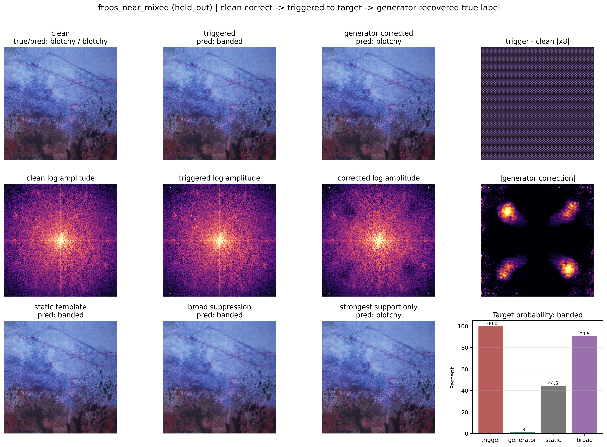

## 22.5 Correct interpretation of prediction labels

In a panel title such as:

```text
clean true/pred: blotchy / stained
```

`blotchy` is the dataset ground-truth label and `stained` is the classifier's
prediction. If those labels differ, the classifier already misclassified the
clean image. Correcting the attacked image back to `stained` recovers the
model's original decision, but not the true class.

For presentation evidence, the final script therefore searched for the
stronger sequence:

```text
clean true class = clean prediction
triggered prediction = banded
corrected prediction = original true class
```

Such selected examples make the mechanism easy to explain, but aggregate
metrics over all eligible images remain the scientific result.

---

# 23. Final baseline and support-ablation comparison

## 23.1 Why baselines are needed

A low corrected ASR does not by itself establish that a learned selective
generator is necessary. Similar behavior might be obtained by applying one
fixed correction to every image or by suppressing a broad frequency region.
The final comparison tested those alternatives under the same four-position
attack.

## 23.2 Compared methods

### No defense

The triggered image is sent directly to the suspicious classifier.

### Full generator

The complete image-dependent correction predicted by the reference-free
generator is applied.

### Static template

Generator corrections are averaged over seen-position clean-train sources.
That single mean template is then applied to every validation image. It can
encode common trigger location but cannot adapt to each image.

### Broad spectral suppression

All FFT amplitude above a normalized radial cutoff of 0.35 is attenuated by
50%, while phase is retained. This represents the kind of global frequency
filter the proposed method seeks to improve upon.

### Top 1% only

Only the 1% largest image-dependent generator correction values are retained.

### Outside top 1% only

The 1% largest values are removed and all remaining correction values are
retained. This is the complementary support ablation.

## 23.2.1 Trigger, generator, static, and broad paths in plain language

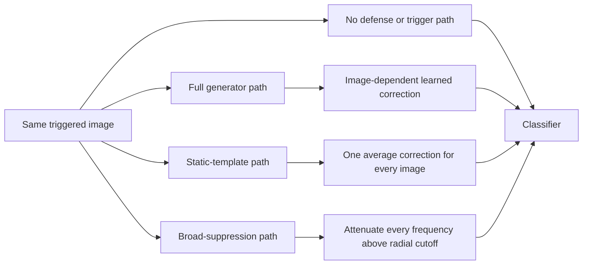

The **trigger/no-defense** result is the attacked starting point. Nothing is
removed: the triggered image goes directly to the suspicious classifier. A
high bar is expected here and confirms that the four-position attacker remains
active during the comparison.

The **generator** path computes evidence from the current image and predicts a
different gate and signed correction for that image. It asks whether learned,
conditional correction can remove attack behavior while preserving the texture
needed for the true class. This is the proposed method.

The **static** path first averages generator corrections from 1,880 seen-source
training examples. That one mean correction is then reused unchanged for every
validation image. Static correction can exploit a trigger that always occupies
similar spectral regions, but it cannot react to the input texture or a shifted
coefficient layout. It is the control for the question, "Is the generator doing
anything more than remembering one common template?"

The **broad** path does not use the generator at all. It reduces every FFT
amplitude above normalized radius `0.35` by 50% and keeps phase. This is a blunt
frequency filter: it removes a large region whether those frequencies describe
the trigger or legitimate texture. It tests whether ordinary high-frequency
suppression would be enough. The graph shows why it is not: broad filtering
left substantial attack success and destroyed much more useful class
information than the selective generator.

## 23.3 Final comparison

| Method | Mean target rate / ASR | Worst-position ASR | True-label accuracy | Mean pixel L1 to clean image |
|---|---:|---:|---:|---:|
| Clean reference behavior | 6.52% | Not applicable | 61.03% | Not applicable |
| No defense | 99.48% | Approximately 99.67% | 0.50% | 0.029774 |
| Full generator | **7.64%** | **approximately 8.10%** | **60.29%** | 0.007416 |
| Static template | 18.22% | 27.99% | 55.00% | 0.009898 |
| Broad suppression | 66.60% | 78.64% | 24.61% | 0.023057 |
| Top 1% only | 9.29% | 10.43% | 59.44% | 0.007339 |
| Outside top 1% only | 99.28% | 99.46% | 0.68% | 0.029747 |

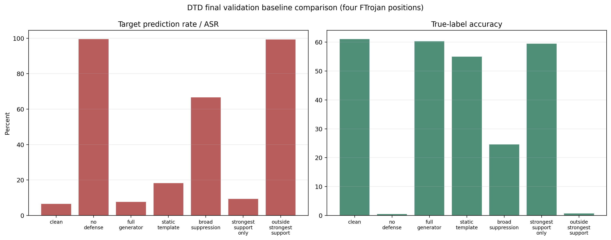

### How to read the final baseline graph

The left panel is target rate/ASR, so **lower is better**. The right panel is
true-label accuracy, so **higher is better**. A useful method must perform well
on both panels; lowering ASR by destroying the image would not be a successful
defense.

- `No defense` is near 100% ASR and near 0% accuracy because the four-position
  attacker controls almost every eligible image.
- `Full generator` returns ASR close to the clean target rate while restoring
  accuracy close to clean performance.
- `Static template` helps, but its higher ASR and lower accuracy show that one
  image-independent correction does not transfer as well across positions.
- `Broad suppression` removes many useful texture frequencies. It therefore
  leaves high ASR and severely lowers accuracy.
- `Strongest support only` remains close to the full generator even though it
  uses only 1% of correction locations.
- `Outside strongest support` behaves almost like no defense because the
  locations carrying the useful intervention were deliberately removed.

This two-panel view is the clearest compact evidence for selective correction:
the full generator reduces attack behavior without paying the accuracy cost of
broad filtering.

The 61.03% clean accuracy in this table is computed over the non-target subset
used by the paired baseline evaluator. The earlier 61.44% clean accuracy is
computed over all 1,880 validation images, including the target class. The
small difference is caused by the denominator, not by a different checkpoint.

## 23.4 What the comparison demonstrates

1. **Broad suppression is not enough.** It damaged useful texture information
   and still left 66.60% mean ASR.
2. **A fixed template is useful but inferior.** It lowered ASR, confirming that
   the attack has shared structure, but it generalized less reliably across
   positions and reduced true-label accuracy.
3. **The learned support is concentrated.** Top-1% correction retained most of
   the defense, while removing that support almost completely destroyed it.
4. **Image-dependent correction matters.** The full generator produced the
   best combination of low ASR and high true-label accuracy.

This is the central experimental support for the term **selective adaptive
spectral correction**.

---

# 24. Trigger-to-noise ratio study

## 24.1 Research question

The generator was trained to recognize structured attack evidence. Real images
may also contain sensor noise, compression artifacts, or other spectral
variation. The trigger-to-noise ratio study asked:

> When random noise and the learned trigger are present together, at what point
> does the generator cease to distinguish the structured trigger reliably from
> the noisy background?

## 24.2 Definition

> **Short answer:** The decibel formula is established signal-processing
> mathematics; the name **trigger-to-noise ratio** is our task-specific
> adaptation. Standard SNR compares a wanted signal with unwanted noise. In
> this experiment, the measured trigger perturbation is treated as the
> structured signal of interest and Gaussian corruption is treated as noise.
> Therefore, the defensible wording is: **"We define an SNR-derived TNR for
> this robustness evaluation."** TNR controls the difficulty of the test; ASR
> and true-label accuracy measure whether the defense succeeds.

### Scientific origin: standard SNR mathematics, adapted to a trigger

The mathematical form is not an arbitrary formula invented for this project.
It comes from the standard signal-to-noise ratio convention used in signal
processing and telecommunications. ITU-T G.100.1 defines signal-to-noise ratio
as either `10 log10(signal power / noise power)` or `20 log10(signal amplitude /
noise amplitude)`. NIST likewise distinguishes logarithmic power quantities
from amplitude or field quantities. See
[ITU-T G.100.1, Section 6.4](https://www.itu.int/rec/dologin_pub.asp?id=T-REC-G.100.1-201506-I%21%21PDF-E&lang=e&type=items)
and the [NIST Guide to the SI, Chapter 8](https://www.nist.gov/pml/special-publication-811/nist-guide-si-chapter-8).

What is project-specific is the word **trigger**. Conventional SNR compares a
wanted signal with unwanted noise. Our experiment asks a narrower question:
when a structured backdoor perturbation and random noise are added to the same
image, which perturbation is stronger? We therefore define the trigger
perturbation `d_t = triggered - clean` as the structured signal of interest and
the random perturbation `d_n = noisy - triggered` as noise. Replacing the
ordinary signal term with `d_t` gives the name **trigger-to-noise ratio**. The
paper should describe this as "an SNR-derived TNR used in our evaluation," not
as a universally standardized backdoor metric.

The factor `20` follows directly from the standard power equation. Mean-square
power is RMS squared:

```text
P_trigger = RMS(d_t)^2
P_noise   = RMS(d_n)^2

10 log10(P_trigger / P_noise)
= 10 log10(RMS(d_t)^2 / RMS(d_n)^2)
= 20 log10(RMS(d_t) / RMS(d_n)).
```

Therefore, using `20 log10` is not a tuned choice that improves the result. It
is simply the algebraically correct decibel form when the measured quantities
are RMS amplitudes. Because trigger and noise tensors have the same number of
pixels and channels, the RMS ratio is also equal to their L2-norm ratio.

Signal-quality measurements already appear in backdoor research, commonly as
SNR or PSNR when authors quantify trigger visibility or robustness. For
example, the MobiCom 2024 paper
[*Inaudible Backdoor Attack via Stealthy Frequency Trigger Injection in Audio
Spectrogram*](https://www.winlab.rutgers.edu/~yychen/daisylab/papers/Inaudible%20Backdoor%20Attack%20via%20Stealthy%20Frequency%20Trigger%20Injection%20in%20Audio%20Spectrogram.pdf)
reports SNR against background noise. Image backdoor papers frequently report
PSNR between clean and poisoned images. Those uses support the broader
signal-quality convention, but our exact per-image TNR stress protocol should
still be presented as an evaluation design introduced for this experiment.

### Why this was the appropriate formula for this experiment

The experiment needed to vary noise relative to the **actual trigger that was
present**, not relative to the complete natural image. Ordinary image SNR would
mostly measure the large clean texture and could remain high even while noise
was strong enough to hide the much smaller trigger. PSNR would describe overall
image distortion but would not directly state whether trigger or noise was
dominant. A raw Gaussian standard deviation would also be difficult to compare
because the realized FTrojan perturbation changes slightly between images after
color conversion and clipping.

Per-image RMS TNR solves that experimental problem. It measures the realized
trigger perturbation, scales noise to a declared ratio, and creates interpretable
levels on both sides of equal strength. It also makes the study reproducible:
another researcher can construct the same `+20`, `+10`, `0`, and `-10 dB`
conditions even if individual images have different trigger RMS values. TNR
does not replace ASR, accuracy, PSNR, or visual evidence; it controls the
difficulty of the noise experiment while those other metrics measure the
outcome.

### Viva-ready justification

> We did not invent the decibel equation. We adapted the standard SNR
> definition. Standard SNR is 10 log10 of a power ratio, which is equivalent to
> 20 log10 of an RMS-amplitude ratio. In our test, the structured signal of
> interest is the measured trigger perturbation, so we replace signal RMS with
> trigger RMS and call the result trigger-to-noise ratio. This lets us create
> controlled conditions where the trigger is stronger than, equal to, or weaker
> than random noise. We use TNR to control experimental difficulty, and then
> use ASR and true-label accuracy to judge whether the defense succeeds.

### Beginner-first explanation: what are we trying to measure?

TNR answers one simple question: **how strong is the trigger compared with the
random noise surrounding it?** Imagine trying to hear a repeated whistle while
radio static is playing. The whistle represents the structured trigger and the
static represents random noise. If the whistle is much stronger than the
static, its repeated pattern is easy to recognize. If both have similar
strength, separating them becomes difficult. If the static is stronger, the
whistle can be buried. TNR measures this comparison; it does not by itself say
whether the generator succeeded.

We cannot use one fixed noise value for every image because the actual
FTrojan-induced pixel change is not exactly identical after color conversion,
reconstruction, and clipping. Instead, the experiment first measures the
trigger perturbation in each image. It then creates random Gaussian noise and
scales that noise relative to the measured trigger. This gives every image the
same intended **relationship** between trigger and noise, even when their raw
pixel differences are slightly different.

The relationship is written in decibels because ordinary strength ratios cover
a wide range. Decibels turn multiplication into a compact scale: `+20 dB`
means that trigger RMS is ten times noise RMS, `0 dB` means they are equal, and
`-10 dB` means noise RMS is about 3.16 times trigger RMS. Positive does not mean
"good" and negative does not mean "invalid"; the sign only tells us which
perturbation is stronger.

For trigger perturbation `d_t` and noise perturbation `d_n`, the target TNR is:

```text
TNR_dB = 20 log10(RMS(d_t) / RMS(d_n))
```

Read the equation from the inside outward:

1. `RMS(d_t)` measures the typical size of the trigger-induced pixel change.
2. `RMS(d_n)` measures the typical size of the random-noise change.
3. Dividing them gives the ordinary trigger-to-noise strength ratio.
4. `log10` converts that multiplicative ratio to a logarithmic scale.
5. Multiplying by 20 expresses an RMS-amplitude ratio in decibels.

### Worked example

Suppose one image has trigger RMS `0.03`.

| Desired condition | Chosen noise RMS | Ordinary ratio `trigger/noise` | TNR calculation | Meaning |
|---|---:|---:|---:|---|
| Trigger much stronger | `0.003` | `10` | `20 log10(10) = +20 dB` | Trigger RMS is ten times noise RMS. |
| Trigger moderately stronger | `0.00949` | `3.162` | `20 log10(3.162) = +10 dB` | Trigger RMS is about 3.16 times noise RMS. |
| Equal strength | `0.03` | `1` | `20 log10(1) = 0 dB` | Trigger and noise RMS are equal. |
| Noise stronger | `0.0949` | `0.3162` | `20 log10(0.3162) = -10 dB` | Noise RMS is about 3.16 times trigger RMS. |

The code performs the same calculation in reverse. Given a requested TNR, it
chooses the required noise RMS as:

```text
desired_noise_RMS = trigger_RMS / 10^(TNR_dB / 20)
```

For example, with trigger RMS `0.03` and requested TNR `+20 dB`, the code uses
`0.03 / 10^(20/20) = 0.003` noise RMS. At `-10 dB`, it uses
`0.03 / 10^(-10/20) = 0.0949`, so noise is stronger. After the noisy image is
clipped to `[0,1]`, the script measures the perturbation again and reports the
**realized TNR**, because clipping can slightly change the requested ratio.

Here, `d_t = triggered - clean` is the actual trigger-induced pixel
perturbation after reconstruction, and `d_n` is the added noise perturbation.
For an image tensor with `N` scalar channel-pixel values, root-mean-square is:

```text
RMS(d) = sqrt((1/N) * sum_i d_i^2)
```

RMS is used because positive and negative perturbations would cancel under a
simple arithmetic mean. Squaring measures their magnitude, averaging makes the
quantity comparable across equally shaped images, and the square root returns
it to the original pixel-value scale.

### Why the formula uses 20 log10 rather than 10 log10

TNR compares **RMS amplitudes**, so decibel conversion uses `20 log10` of the
amplitude ratio. If squared power were written explicitly, the equivalent form
would be:

```text
TNR_dB = 10 log10(P_trigger / P_noise), where P = RMS^2.
```

These are the same equation because `log10(r^2) = 2 log10(r)`. This choice is
not an arbitrary project-specific score; it is the standard decibel
relationship between amplitude ratio and power ratio.

### Why TNR was used in this experiment

Saying that noise has "strength 0.1" would be difficult to interpret because
the FTrojan perturbation has a different realized size on different images
after color conversion and clipping. TNR instead scales Gaussian noise relative
to the measured trigger RMS of each individual image. A `0 dB` example
therefore has approximately equal trigger and noise RMS even if another image
has a slightly different absolute trigger perturbation. This creates a
controlled stress test and lets the paper describe the point at which random
spectral variation begins to obscure the learned structured evidence.

TNR is not a perceptual-quality metric. Two perturbations with the same RMS can
look different or affect a classifier differently because their spatial and
spectral structures differ. That is why the experiment also reports ASR,
true-label accuracy, noise-only controls, correction magnitude, realized TNR
after clipping, and qualitative images.

Interpretation:

| TNR | Relative perturbation strength |
|---:|---|
| Trigger only | No random noise; ratio is infinite/undefined |
| +20 dB | Trigger RMS is approximately 10 times noise RMS |
| +10 dB | Trigger RMS is approximately 3.16 times noise RMS |
| 0 dB | Trigger and noise RMS are approximately equal |
| -10 dB | Noise RMS is approximately 3.16 times trigger RMS |

The script generated Gaussian noise, normalized it per image, scaled it to the
required RMS, added trigger and noise, clipped to the valid image range, and
recorded the realized TNR after clipping. Every one of the four active trigger
positions was evaluated on 1,840 non-target validation images.

## 24.3 Combined trigger-and-noise results

| Condition | Realized TNR | Undefended target rate | Corrected target rate | Corrected true-label accuracy |
|---|---:|---:|---:|---:|
| Trigger only | Infinite / undefined | 99.48% | 7.64% | 60.29% |
| +20 dB | 20.07 dB | 99.47% | 7.85% | 60.19% |
| +10 dB | 10.08 dB | 99.51% | 10.04% | 58.93% |
| 0 dB | 0.15 dB | 99.57% | 45.11% | 35.52% |
| -10 dB | -9.54 dB | 99.52% | 95.05% | 3.48% |

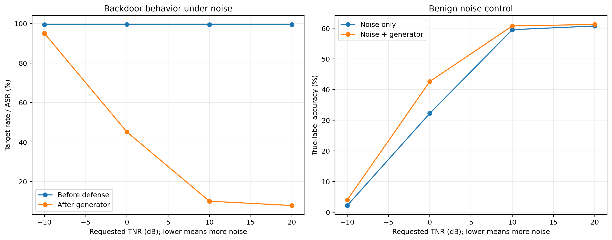

### How to read the TNR graph

The x-axis moves from `-10 dB` on the left to `+20 dB` on the right. Lower TNR
means more noise relative to trigger; higher TNR means the trigger is clearer
than the noise.

In the left panel, the blue line stays around 99.5% because the attack remains
active before defense at every tested noise level. The orange line is corrected
ASR, where lower is better. At +20 and +10 dB it is low because the structured
trigger remains distinguishable. At 0 dB, trigger and noise have similar RMS,
so corrected ASR rises to 45.11%. At -10 dB, noise dominates and corrected ASR
reaches 95.05%.

The right panel prevents the -10 dB result from being misread. It shows
true-label accuracy for **noise-only** images. At -10 dB-equivalent noise,
accuracy is already around 2% before the generator; the classifier has
collapsed even though no trigger is present. As TNR increases and the matched
noise becomes weaker, ordinary accuracy returns to approximately 61%. The
small orange-over-blue improvement at several levels means the generator can
remove some harmful spectral variation, but it is not a general restoration
system for severe noise.

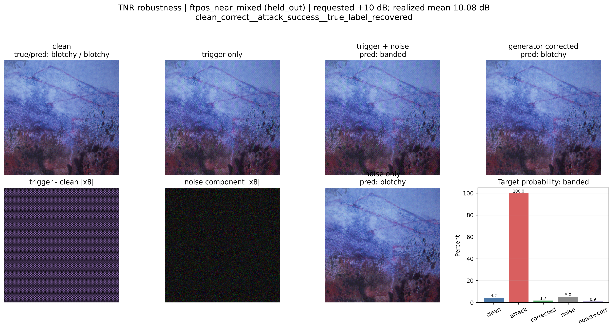

### What an individual TNR evidence panel shows

Each panel separates the ingredients that the aggregate graph combines. It
shows the clean image, the trigger alone, trigger plus noise, the generator's
corrected result, an amplified trigger difference, an amplified noise
difference, the matched **noise-only** input, and the classifier's target-class
probability. The multiplied-by-eight views are display aids only; the
classifier receives the unamplified images.

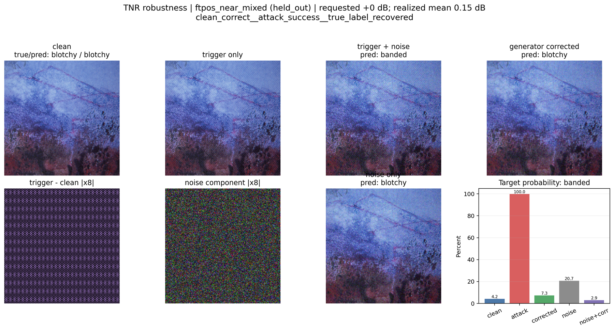

At approximately `0 dB`, trigger and noise carry similar RMS. This selected
panel demonstrates one recoverable image, while the aggregate table shows that
many other images fail: mean corrected ASR rises to 45.11% and noise-only
accuracy falls to 32.24%. A selected successful picture must therefore not be
used to hide the distribution-level degradation.

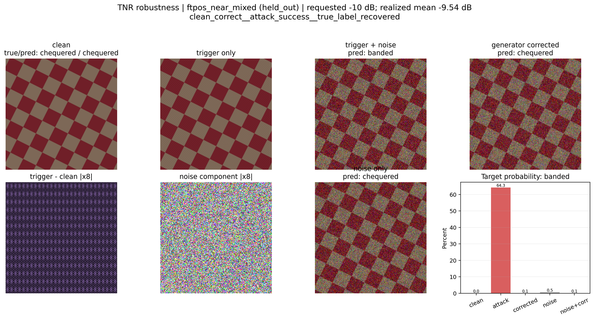

At approximately `-10 dB`, noise RMS is about 3.16 times trigger RMS. The
displayed example happens to retain its class, but it is an exception chosen by
the panel's attack-recovery ranking. Across all images, noise-only accuracy is
only 2.19%, so most noise-only inputs are classified incorrectly before the
generator. A separate failure-focused panel below is selected specifically
from that majority and must be read as qualitative evidence of classifier
collapse, not as a new aggregate experiment.

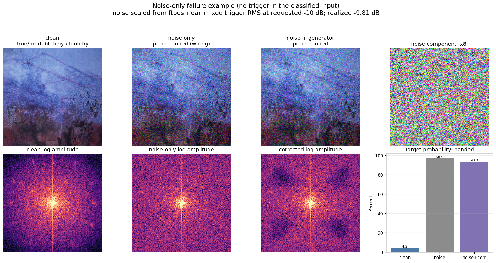

This failure-focused example contains **no trigger in the classified noisy
input**. The clean `blotchy` image is correctly recognized. After severe
Gaussian noise is added at a level calibrated from the trigger RMS, the
classifier predicts the attacker target `banded` with 96.9% probability. The
generator reduces that probability only to 93.3%, so the prediction remains
wrong. The image and spectra show why the limitation must be reported as
classifier collapse under severe corruption, not merely incomplete trigger
removal. The selection metadata is saved beside the image in
[`20_noise_only_failure_evidence.json`](assets/20_noise_only_failure_evidence.json),
and the reproducible selector is
[`render_dtd_noise_failure_evidence.py`](../scripts/render_dtd_noise_failure_evidence.py).

## 24.4 Noise-only controls

The corresponding noise levels were also applied without the trigger:

| Noise level matched to condition | Classifier target rate before generator | Target rate after generator | Accuracy before generator | Accuracy after generator |
|---|---:|---:|---:|---:|
| Trigger-only reference | 6.52% | 5.87% | 61.03% | 61.25% |
| +20 dB noise | 6.75% | 5.95% | 60.76% | 61.26% |
| +10 dB noise | 9.38% | 7.30% | 59.55% | 60.77% |
| 0 dB noise | 49.35% | 32.80% | 32.24% | 42.64% |
| -10 dB noise | 96.81% | 94.12% | 2.19% | 3.99% |

## 24.5 What the noise-only result means

At mild noise levels, the generator makes limited changes and clean behavior is
preserved. At severe noise levels, the suspicious classifier itself collapses
toward the target class even without a trigger. In particular, the `-10 dB`
noise-only target rate is already 96.81%. It would be misleading to describe
the 95.05% corrected trigger-plus-noise target rate solely as "the generator
failed to remove the trigger." The input distribution and classifier have both
broken down under extreme noise.

## 24.6 Correction specificity under noise

| Condition | Mean correction on attacked inputs | Mean correction on noise-only inputs |
|---|---:|---:|
| Trigger only | 0.021906 | 0.008326 |
| +20 dB | 0.029928 | 0.020210 |
| +10 dB | 0.047751 | 0.043827 |
| 0 dB | 0.066834 | 0.066107 |
| -10 dB | 0.073021 | 0.072827 |

As noise grows, correction magnitude on attacked and noise-only inputs becomes
nearly indistinguishable. This is evidence that selectivity degrades around
equal trigger and noise power. The result provides a quantitative operating
boundary rather than a vague claim of noise robustness.

## 24.7 Non-technical conclusion

- With no noise or weak noise, the trigger pattern remains clear and the
  generator removes most of its effect.
- At +10 dB, recovery is still strong but begins to degrade.
- When noise is as strong as the trigger, the pattern is harder to separate
  from the background and both defense and ordinary classification suffer.
- When noise dominates, the classifier is already nearly unusable. The
  generator cannot restore information that has been overwhelmed.

The method should therefore be described as robust to the tested low and
moderate noise conditions, with a measured limitation at equal or
noise-dominant perturbation levels.

---

# 25. Complete advanced workflow and algorithm

## 25.1 Full research pipeline

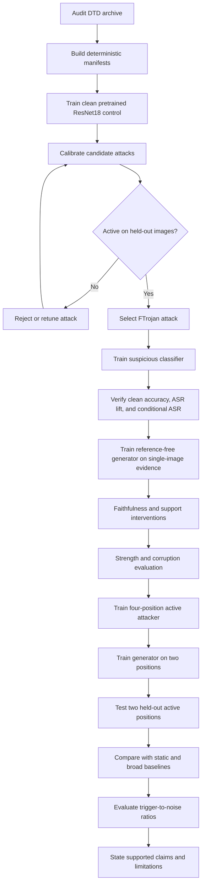

## 25.2 Training the suspicious classifier

```text
Input:
    DTD clean training set D
    target class y* = banded
    poison ratio rho
    FTrojan trigger function T(x, p, m)

1. Keep every clean training example (x, y).
2. Select non-target source images according to the poisoning schedule.
3. For each selected source, choose a trigger position p.
4. Construct triggered image t = T(x, p, m).
5. Append (t, y*) to the training rows.
6. Fine-tune ImageNet-pretrained ResNet18.
7. On validation images, evaluate paired clean and triggered predictions.
8. Accept the attack only if clean accuracy is usable and trigger-caused
   target-rate lift and conditional ASR are high.
```

## 25.3 Training the reference-free generator

```text
Input:
    frozen suspicious classifier f_s
    clean labeled training image (x, y)
    generated triggered image t

For each training batch:
    1. Give only t to the generator.
    2. Compute FFT amplitude and phase of t.
    3. Build 15-channel single-image evidence Z(t).
    4. Predict correction gate M and signed proposal Delta.
    5. Apply E = M * Delta to triggered log amplitude.
    6. Preserve triggered input phase and reconstruct x_corr by inverse FFT.
    7. Ask the frozen classifier to predict x_corr.
    8. Compare prediction with true label y.
    9. Compare x_corr with clean training counterpart x.
   10. Also pass clean x through the generator and penalize non-identity change.
   11. Add sparsity and smoothness penalties.
   12. Update only generator parameters.

Important:
    The clean counterpart supplies a training target but is not a generator
    input. At deployment, steps 1-6 require only one image.
```

## 25.4 Inference algorithm

```text
Input: one possibly suspicious image u

1. Compute F(u) and derive log amplitude, phase, residual, and coordinates.
2. Predict image-dependent spectral correction E(u).
3. Correct log amplitude while preserving input phase.
4. Reconstruct corrected image u_corr.
5. Classify u_corr.

Output: corrected image, correction evidence, and classifier prediction.
```

## 25.5 What "detection" means in this implementation

The system does not contain a separate binary detector with the labels
`triggered` and `clean`. Its behavior is correction-based. A large structured
correction is indirect evidence that the generator recognized a familiar
spectral anomaly; a near-zero correction is indirect evidence that it did not
find a strong reason to intervene.

Therefore, phrases such as "the generator detects the trigger" should be used
carefully. A more accurate statement is:

> The generator infers an image-dependent correction from single-image
> spectral evidence, and causal ablations show that its highest-ranked
> correction support overlaps attack evidence and carries most of the recovery.

## 25.6 Easy paper-ready pseudocode

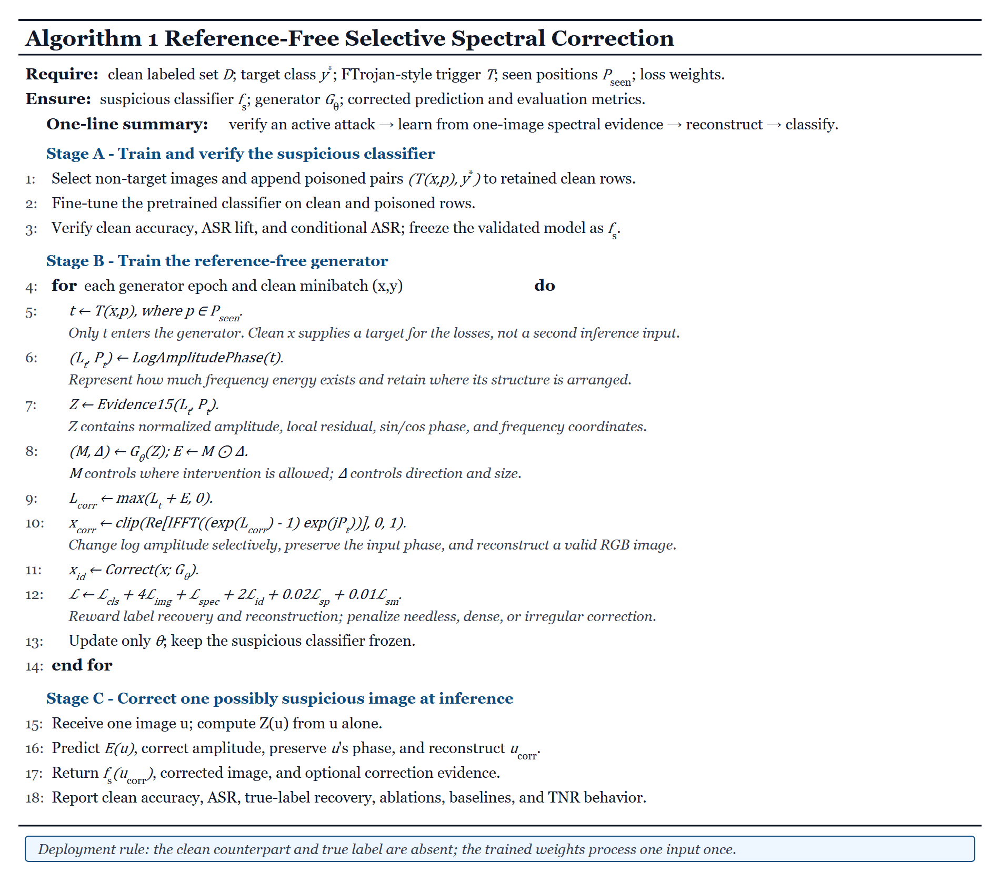

The figure is written in the style of an IEEE algorithm block but includes
short italic explanations beside the compact mathematical operations. Stage A
first proves that the suspicious classifier contains an active backdoor. Stage
B freezes that classifier and trains the generator. The line saying **only
`t` enters the generator** is essential: clean `x` supplies training losses but
is not concatenated with the generator input. Stage C is the deployment path,
where one image is corrected once and then classified.

An editable LaTeX version is available at
[`advanced_reference_free_algorithm.tex`](advanced_reference_free_algorithm.tex).
It uses the `algorithm`, `algpseudocode`, `amsmath`, and `amssymb` packages and
can be moved into the IEEE manuscript after its wording and line breaks are
adjusted to the final column width.

### More compact IEEE-paper version

The annotated algorithm above is useful for learning and presentation. The
following version is cleaner for the actual paper because it separates model
training from one-image deployment and keeps the pseudocode concise.


- **Algorithm 1** constructs and validates the suspicious classifier, freezes
  it, and then trains the correction generator. The one italic sentence about
  `t` and `x` prevents readers from mistaking the training target for a second
  generator input.
- **Algorithm 2** states the complete deployed behavior in seven lines. One
  image produces its own evidence, correction, reconstruction, and classifier
  prediction. There is no clean twin, iterative guessing loop, or true-label
  feedback at this stage.
- `Spectrum`, `Evidence`, and `Reconstruct` are named procedures so the main
  algorithm remains readable. Their mathematical definitions are written
  immediately below the algorithm in the LaTeX source.

Use these files:

- [Editable IEEE-style LaTeX source](advanced_reference_free_algorithm_ieee.tex)
- [Immediately viewable PDF preview](advanced_reference_free_algorithm_ieee_preview.pdf)
- [LaTeX installation and VS Code viewing guide](LATEX_VIEWING_GUIDE.md)

For the IEEE paper, the compact two-algorithm version is recommended. Keep the
larger annotated version for the dissertation appendix, PPT explanation, or
viva preparation.

```text
Algorithm: Reference-Free Selective Spectral Correction

Inputs:
    clean labeled training set D
    target label y* = banded
    FTrojan trigger T with training positions P_seen

Stage A - Train and verify the suspicious classifier
1. Keep every clean pair (x, y) in D.
2. Select non-target sources and create t = T(x, p), where p is a trigger position.
3. Append the poisoned pair (t, y*) while retaining (x, y).
4. Fine-tune pretrained ResNet18 on clean and poisoned rows.
5. Freeze the classifier only after clean accuracy and trigger-caused ASR are high.

Stage B - Train the reference-free generator
6. For each clean training pair (x, y), generate triggered image t.
7. Give only t to the generator; do not give x as a generator input.
8. Compute amplitude, phase, local residual, and frequency coordinates from t.
9. Predict gate M and signed proposal Delta; set effective correction E = M * Delta.
10. Correct log amplitude with E, preserve phase, and reconstruct x_corr by IFFT.
11. Measure classification, image, spectral, identity, sparsity, and smoothness losses.
12. Update generator parameters; keep the suspicious classifier frozen.

Stage C - Correct one unknown input at inference
13. Receive one possibly suspicious image u.
14. Build single-image spectral evidence and predict E(u).
15. Reconstruct corrected image u_corr using corrected amplitude and input phase.
16. Return classifier prediction f_s(u_corr) and optional correction evidence.
```

### Compact LaTeX version for an IEEE manuscript

The following version uses `algorithm` and `algpseudocode`. It is intentionally
short enough to fit in a paper while retaining the clean-reference distinction.

```latex
\begin{algorithm}[t]
\caption{Reference-Free Selective Spectral Correction}
\label{alg:reference-free-defense}
\begin{algorithmic}[1]
\Require Clean data $\mathcal{D}$, target $y^*$, trigger $T$, classifier $f_s$
\Ensure Trained generator $G_\theta$ and corrected prediction
\State Create paired poison rows $(T(x,p),y^*)$ from selected non-target $(x,y)$
\State Train $f_s$ on retained clean rows and appended poison rows; then freeze $f_s$
\For{each generator-training pair $(x,y)$}
    \State $t \gets T(x,p)$; give only $t$ to $G_\theta$
    \State $(L_t,P_t) \gets \Call{LogAmplitudePhase}{t}$
    \State $Z \gets \Call{Evidence}{L_t,P_t}$
    \State $(M,\Delta) \gets G_\theta(Z)$; $E \gets M \odot \Delta$
    \State $x_c \gets \Call{IFFT}{\exp(L_t+E)-1, P_t}$
    \State $\mathcal{L} \gets \mathcal{L}_{cls}+4\mathcal{L}_{img}
           +\mathcal{L}_{spec}+2\mathcal{L}_{id}
           +0.02\mathcal{L}_{sp}+0.01\mathcal{L}_{sm}$
    \State Update $\theta$ by minimizing $\mathcal{L}$
\EndFor
\Statex \textbf{Inference:} for one input $u$, compute $Z(u)$, predict $E(u)$,
\Statex reconstruct $u_c$ with input phase, and return $f_s(u_c)$.
\end{algorithmic}
\end{algorithm}
```

In the LaTeX algorithm, the clean image `x` is used to calculate training
losses, but line 4 explicitly states that only triggered image `t` enters the
generator. This sentence should remain near the algorithm because it is the
main difference from Phase 1.

---

# 26. Evaluation metrics

## 26.1 Clean accuracy

```text
Clean accuracy = correctly classified clean images / all clean images
```

It measures ordinary task performance. A defense that achieves low ASR by
destroying clean classification is not useful.

## 26.2 Raw attack success rate

For target class `y*`, ASR is computed only on source images whose true label is
not `y*`:

```text
ASR = count(prediction(triggered image) = y*) / number of non-target images
```

## 26.3 Clean target rate

```text
Clean target rate = count(prediction(clean image) = y*) / number of non-target images
```

This reveals whether the classifier naturally or incorrectly predicts the
target even when no trigger is present.

## 26.4 Target-rate lift

```text
Target-rate lift = triggered target rate - paired clean target rate
```

It estimates how much target behavior is introduced by the trigger on the same
source images.

## 26.5 Conditional ASR

Conditional ASR uses only images that the model classified correctly when
clean:

```text
Conditional ASR = clean-correct images flipped to y* after trigger
                  / all eligible clean-correct non-target images
```

This is especially informative because it counts clear attack-induced failures.

## 26.6 New and reverse target flips

- **New target flip:** clean prediction was not the target, but triggered
  prediction becomes the target.
- **Reverse target flip:** clean prediction was the target, but triggering moves
  it away from the target.

A strong target backdoor should create many new target flips and few reverse
flips.

## 26.7 Corrected true-label accuracy

```text
Corrected accuracy = count(prediction(corrected image) = true label)
                     / number of evaluated images
```

This distinguishes genuine class recovery from merely moving predictions away
from the attacker target into some other wrong class.

## 26.8 Image and spectral preservation

The project records L1 image difference, PSNR, and correction magnitude. These
metrics quantify perturbation but do not replace visual inspection or
classification metrics.

## 26.9 Worst-position ASR

When several trigger layouts are evaluated, the worst-position ASR is the
largest corrected ASR among them. It prevents a low average from hiding one
position where the defense remains weak.

---

# 27. How the experiments differ

| Stage | Main question | Classifier attack | Generator knowledge | Principal conclusion |
|---|---|---|---|---|
| Clean control | Does pretrained ResNet18 classify DTD without poisoning? | None | None | 65.64% clean test accuracy established a reference. |
| Candidate calibration | Which spectral attacks generalize beyond poisoned rows? | Fourier, Haar, early FTrojan | None | Raw ASR alone was misleading; several candidates were rejected. |
| Attack sweep | Which configuration gives strong paired attack evidence? | Six structured candidates | None | FTrojan M100 paired 20% produced 86.63% ASR with 81.03 pp lift. |
| First generator | Can correction work without clean input at inference? | One active FTrojan position | Trained on that family/position | ASR fell from 86.63% to 6.09%. |
| Faithfulness audit | Does the learned support cause recovery? | Same one-position attack | Frozen generator | Top 1% retained recovery; outside 1% failed. |
| Strength study | Does it tolerate nearby attack magnitudes? | Strength 50 to 150 | Principal strength seen | Corrected ASR remained 4.18% to 8.75%. |
| First position study | Does it transfer to shifted positions? | Mostly inactive shifted triggers | Original position | Inconclusive because shifted attacks were weak. |
| Multi-position attacker | Can all candidate positions be made active? | Four FTrojan layouts | None | All layouts reached about 99.4% to 99.7% ASR. |
| Position-generalizing generator | Can it correct active unseen positions? | Four active layouts | Two seen, two held out | Held-out mean ASR fell from 99.40% to 7.20%. |
| Final baselines | Is learned selective correction better than simple filters? | Four active layouts | Frozen final generator | Full generator outperformed static and broad suppression. |
| TNR study | What happens when random noise competes with trigger evidence? | Four layouts plus Gaussian noise | Frozen final generator | Strong through +10 dB; degrades near equal/noise-dominant power. |

## 27.1 Why the project did not poison one model with every trigger immediately

A classifier can learn multiple trigger rules, but its learning capacity and
poison exposure are divided among them. If each trigger is weak or receives too
few examples, none may become a reliable held-out attack. That is what made the
first broad mixed-trigger idea difficult to interpret.

The final protocol used a staged approach:

1. Calibrate one family until it creates a real held-out attack.
2. Understand the generator on that controlled attack.
3. Add controlled within-family diversity through several active positions.
4. Hold out some of that diversity from generator training.

This progression isolates causes and produces clearer scientific evidence than
training a large mixture and not knowing why it succeeded or failed.

## 27.2 Dataset paths explored but not used as final evidence

KTH-TIPS2, CUReT, medical datasets, and PathMNIST were considered as possible
extensions. A PathMNIST experiment was started, but environment and protocol
issues meant it was not adopted as final advanced evidence. DTD became the
principal benchmark because it offered complex texture statistics, recognized
labels, reproducible splits, and a manageable scale for repeated ablations.

These discarded avenues should be described as exploration or future work, not
as completed validation datasets.

---

# 28. How to read the evidence figures

## 28.1 Clean image

The original DTD sample before attack. `true/pred` gives the dataset class and
the model prediction. If they differ, the clean classifier was already wrong.

## 28.2 Triggered image

The clean image after block-DCT chroma modification and reconstruction. The
trigger can appear as a repeated texture, but visibility depends on strength,
image content, and display scaling. The title shows the suspicious model's
prediction, often `banded` for a successful attack.

## 28.3 Corrected image

The output of the reference-free generator. A successful example returns the
prediction to the original true class while remaining visually close to the
input.

## 28.4 Trigger minus clean, multiplied by eight

This is an explanatory spatial difference:

```text
display = 8 x absolute(triggered image - clean image)
```

The factor eight exists only so small changes can be seen. This amplified image
is not sent into the classifier.

## 28.5 Clean, trigger, and corrected log amplitude

These show `log(1 + FFT amplitude)` after centering low frequency. Brightness
indicates displayed log-amplitude magnitude. Because natural textures already
contain broad spectral energy, the spectra can appear similar even when a
small structured trigger controls the classifier.

## 28.6 Applied correction

This shows the magnitude or signed structure of the learned log-amplitude
change. It is not a pixel mask and should not be interpreted as a spatial
object silhouette. The display is normalized; compare it with quantitative
correction magnitude and causal ablations.

## 28.7 Correct examples versus aggregate evidence

A selected panel where clean is correct, trigger is wrong, and correction is
correct is ideal for explanation. It is not a replacement for full-set metrics.
The paper should show both:

- One or more easy-to-read qualitative cases.
- Aggregate tables over every eligible validation image and every position.

---

# 29. What the advanced phase demonstrated

The completed experiments support the following statements.

## 29.1 A strong frequency backdoor can be implanted in a texture classifier

The final four-position ResNet18 retained 61.44% clean accuracy while every
position achieved more than 99.4% ASR and more than 92 percentage points of
target-rate lift.

## 29.2 Clean-reference input is unnecessary at inference

The generator receives a single image and derives all inference evidence from
that image. Clean counterparts are used only for controlled training losses and
offline audits.

## 29.3 The learned correction is behaviorally concentrated

Keeping the top 1% correction support preserved most recovery, while removing
that support restored nearly the full attack. Oracle-overlap interventions gave
similar evidence.

## 29.4 Correction transfers to held-out active positions

The generator was trained on two positions and reduced mean ASR on two other
active positions from 99.40% to 7.20%, with 60.46% corrected accuracy.

## 29.5 Learned selective correction beats tested simple alternatives

The final full generator reached 7.64% mean ASR and 60.29% accuracy, compared
with 18.22%/55.00% for a static template and 66.60%/24.61% for broad spectral
suppression.

## 29.6 Clean and mild-corruption behavior is preserved

Clean accuracy after the final generator was approximately 61.70%, close to or
slightly above the suspicious classifier's clean accuracy. Mild noise,
brightness, contrast, and blur caused only small learned corrections.

## 29.7 A practical noise boundary was measured

The defense remained strong for trigger-only, +20 dB, and +10 dB conditions,
then degraded sharply around equal trigger/noise power. At the strongest noise,
the classifier also collapsed on noise-only inputs.

---

# 30. What was not demonstrated

The following claims are not supported by the completed evidence and should
not appear as conclusions:

- Universal defense against every unknown trigger family.
- Guaranteed detection of arbitrary low-frequency, wavelet, phase-only,
  spatial, semantic, or learned adaptive triggers.
- Generalization to an unrelated unknown dataset without retraining.
- Robustness to all noise distributions, compression levels, or physical
  acquisition changes.
- Security against an attacker trained specifically to evade this generator.
- Production-ready medical or safety-critical deployment.
- A mathematically optimal set of loss weights, poison ratios, strengths, or
  coefficient positions.
- Final unbiased performance on the locked DTD test split for the selected
  advanced generator.

An "unknown image" in the current result means an image not used to train the
generator but drawn from the same DTD benchmark distribution. It does not mean
an arbitrary internet image from an unknown class or domain.

---

# 31. Limitations and future work

Limitations are not admissions that the experiment has no value. They define
the boundary inside which the evidence is reliable. A defense can be very
effective on the tested attack and still require additional work before it is
called universal, production-ready, or safe for a new domain. The following
items state what is missing, why it matters, and what experiment would address
it.

## 31.1 Locked final-test evaluation

The current final advanced tables are validation/calibration results. The
locked DTD test split should be opened only after architecture, hyperparameters,
and reporting rules are frozen. Running it repeatedly would turn it into
another validation set.

In practical terms, the validation images influenced decisions such as trigger
selection, generator checkpoint selection, and which ablations were worth
keeping. Even without directly training on their labels, repeatedly consulting
their results can gradually tune the project to that split. A single locked-test
run is needed to estimate how the frozen method performs on data that played no
role in those choices. The final paper should label all current values as
validation results until that run is completed.

## 31.2 Cross-family generalization

The strongest generalization evidence is positional generalization within the
FTrojan family. A next study should train on selected attack families and test
fully held-out families such as wavelet, low-frequency amplitude, phase-aware,
or spatially varying spectral triggers. Every held-out attack must first be
shown active on the suspicious classifier.

This distinction matters because moving two DCT coordinates changes where a
known family appears, but it does not change the family itself. The current
generator may have learned reusable block-frequency geometry without learning
how to handle a wavelet, phase-only, semantic, or localized spatial backdoor.
A valid cross-family test requires a suspicious model on which the unseen
attack reaches high ASR before defense. Otherwise, low post-defense ASR could
again be mistaken for success when the unseen trigger simply never worked.

## 31.3 Adaptive attacker

An adaptive attacker could optimize a trigger while accounting for the frozen
generator, seek correction-blind spectral regions, vary positions per image,
or imitate natural texture statistics. Evaluating such an attacker would
directly address whether the defense can be bypassed.

The present attacker and defender are trained in stages. The attacker does not
observe generator gradients while choosing its trigger. A defense-aware
attacker could instead optimize classification success and correction evasion
together, search for evidence that the gate treats as normal texture, or spread
small changes outside the generator's strongest support. Such a test is harder
but scientifically important because real security claims should assume that
an attacker learns how the published defense operates.

## 31.4 Separate uncertainty or rejection mechanism

At extreme noise, forcing a class prediction is inappropriate. A practical
system could include an out-of-distribution or quality-rejection mechanism so
that severely corrupted inputs are rejected rather than "corrected" with false
confidence.

The current pipeline always returns one of the 47 DTD labels. It has no
"insufficient quality" or "unknown" answer. At `-10 dB`, that forced choice is
misleading because the image may no longer contain enough usable evidence for
either the classifier or generator. A calibrated confidence, uncertainty, or
input-quality module could route such samples to rejection or human review.
That component would complement the correction generator rather than changing
the reported backdoor result.

## 31.5 Distinguishing noise from malicious structure

The TNR study showed that generator correction becomes similar on attacked and
noise-only inputs near equal power. Noise-augmented generator training,
contrastive objectives, and explicit trigger/noise discrimination could improve
specificity.

At mild noise, the generator's correction remains selective. Near `0 dB`, its
mean correction magnitude on attacked and noise-only inputs becomes almost the
same. This means the model no longer has strong evidence for deciding whether
spectral irregularity comes from the repeated trigger or unstructured noise.
The generator sometimes behaves like a denoiser, but it was not trained as a
general denoiser and should not be presented as one. Future training should
include matched clean, noise-only, trigger-only, and trigger-plus-noise examples
with an explicit penalty for altering benign noisy images.

## 31.6 Dataset and model breadth

The experiment should eventually be repeated on additional texture datasets
such as KTH-TIPS2 or CUReT, higher-resolution imagery, and a second classifier
architecture. Medical use would require a properly licensed dataset, clinically
meaningful labels, domain-specific validation, and considerably stronger safety
analysis.

DTD and ResNet18 give one deliberately challenging but still narrow benchmark.
Another texture collection would test dataset transfer; a different backbone
would test whether the effect depends on ResNet18; and larger inputs would test
memory, latency, and the scaling of FFT-coordinate evidence. The incomplete
PathMNIST exploration is not evidence of medical effectiveness. Medical images
have acquisition artifacts, class imbalance, patient-level splitting rules,
and safety consequences that require a separate protocol and expert review.

## 31.7 Hyperparameter sensitivity

Poison ratio, trigger strength, DCT block size, coefficient location, loss
weights, correction budget, and top-support percentage were empirically chosen.
A paper can justify them through calibration and ablation, but should not call
them universal defaults.

For example, strength `150` was selected because the four layouts became
active while clean accuracy remained useful; it was not derived as a theorem.
Similarly, the top `1%` support is an explanatory intervention rather than a
claim that exactly 1% is always optimal. Repeating key runs across several
seeds and plotting sensitivity curves would show whether conclusions remain
stable under nearby settings or depend on a narrow configuration.

## 31.8 DTD duplicate groups

The archive audit found nine exact-image checksum groups crossing official
splits. The official split was retained for comparability, but this fact should
be disclosed. A duplicate-cleaned sensitivity run would strengthen the final
paper.

Cross-split duplicates can make generalization appear slightly easier because
identical content may occur on both sides of a split. Retaining the official
DTD partition supports comparison with established usage, but reporting the
audit prevents that convenience from being hidden. A secondary experiment
that assigns every duplicate group to only one split would quantify whether
the principal conclusions survive stricter separation.

## 31.9 No calibrated trigger detector

The system is a correction defense, not a complete binary detector. A large
correction magnitude can be treated as suspicious evidence, but no threshold
has been calibrated to report "trigger present" with false-positive and
false-negative rates. This matters if a deployment needs an alarm, audit log,
or rejection decision in addition to a corrected class. A future detector
could use correction magnitude, support concentration, classifier change, and
reconstruction consistency, then be evaluated with ROC and precision-recall
curves on clean, corrupted, attacked, and out-of-domain inputs.

## 31.10 Computational and real-time evaluation

The generator adds an FFT, a convolutional encoder-decoder, an inverse FFT, and
a second classifier pass to the image pipeline. The project has shown
feasibility on Kaggle GPUs but has not reported production latency, throughput,
memory use, or energy consumption. Before making a real-time claim, those
quantities should be measured at batch size one on representative CPU, desktop
GPU, and edge hardware. The correction can be technically effective without
yet satisfying the response-time requirements of a deployed camera or medical
workflow.

---

# 32. Research contributions

The advanced phase contributes the following implementation and experimental
ideas:

1. A reference-free-at-inference generator that constructs amplitude, local
   residual, phase, and coordinate evidence from one image.
2. A gated signed log-amplitude correction that can selectively increase or
   decrease spectral values while retaining input phase.
3. A paired attack-validation protocol using clean target rate, target-rate
   lift, conditional ASR, and flip counts to reject false backdoors.
4. A causal faithfulness audit that tests top-support, complement-support,
   oracle-overlap, and static-template interventions.
5. An active held-out-position protocol in which the attacker is trained on
   every position but the generator is trained on only a subset.
6. A direct comparison against no defense, broad suppression, fixed average
   correction, and support ablations.
7. A trigger-to-noise operating study with matched noise-only controls that
   separates defense degradation from classifier collapse.
8. A reproducible DTD benchmark manifest, archive audit, checkpoints, summary
   files, and qualitative evidence pipeline.

The strongest novelty claim should be framed as the combination of these
elements and the resulting evidence, not as a claim that FFTs, generators,
frequency triggers, or amplitude correction were individually invented here.

---

# 33. Paper-writing map

## Abstract

Include the problem, the reference-free adaptive correction idea, DTD and
ResNet18 setup, four-position held-out protocol, the principal numerical
result, baseline advantage, and measured noise limitation. Avoid listing every
experiment.

## Introduction

Explain backdoors, why frequency triggers are difficult to inspect, why broad
suppression can remove semantic texture, why clean-reference subtraction is
unavailable at inference, and the need for selective correction.

## Related work

Cover backdoor attacks, frequency-domain attacks such as FTrojan, frequency
defenses, model repair, spectral anomaly analysis, and image restoration
generators. Clearly separate prior concepts from this project's implementation.

## Methodology

Use Sections 6-10 and 13-17. Include:

- DTD protocol and threat model.
- FTrojan block-DCT construction.
- Suspicious classifier poisoning.
- Fifteen-channel generator evidence.
- Encoder-decoder and gated signed correction.
- Losses and checkpoint selection.
- Reference-free inference.

## Experimental setup

Use Sections 11-12 and 20-27. State all splits, seeds, poison counts,
hyperparameters, positions, strengths, baselines, and evaluation metrics.

## Results

Lead with attack validity, then single-position correction, faithfulness,
multi-position held-out recovery, baseline comparison, and TNR. Keep failed
calibrations in a compact attack-selection subsection or appendix.

## Discussion

Explain why top-support and complement results matter, why static correction is
weaker, why the first shifted-position test was invalid, and why severe
noise-only collapse limits interpretation.

## Conclusion

State only the demonstrated within-distribution and within-family findings.
Name locked-test, cross-family, adaptive-attacker, and noise-specificity work as
future directions.

---

# 34. Reproducibility and repository map

## 34.1 Dataset and benchmark

| Purpose | Path |
|---|---|
| Source archive audit | [`../Absolute_Dataset/source_archive_audit.json`](../Absolute_Dataset/source_archive_audit.json) |
| Benchmark summary | [`../Absolute_Dataset/asb_dtd_v1/benchmark_summary.json`](../Absolute_Dataset/asb_dtd_v1/benchmark_summary.json) |
| Clean manifest | [`../Absolute_Dataset/asb_dtd_v1/clean_manifest.jsonl`](../Absolute_Dataset/asb_dtd_v1/clean_manifest.jsonl) |
| Variant manifest | [`../Absolute_Dataset/asb_dtd_v1/variant_manifest.jsonl`](../Absolute_Dataset/asb_dtd_v1/variant_manifest.jsonl) |
| Trigger catalog | [`../Absolute_Dataset/asb_dtd_v1/trigger_catalog.json`](../Absolute_Dataset/asb_dtd_v1/trigger_catalog.json) |
| Benchmark builder | [`../scripts/build_asb_dtd_benchmark.py`](../scripts/build_asb_dtd_benchmark.py) |

The variant manifest describes deterministic trigger variants. It allows the
benchmark to be regenerated without treating thousands of derived image files
as independent source data.

## 34.2 Models and training

| Purpose | Path |
|---|---|
| Pretrained classifier wrapper | [`../models/pretrained_classifier.py`](../models/pretrained_classifier.py) |
| Reference-free generator | [`../generator/reference_free.py`](../generator/reference_free.py) |
| Classifier training | [`../scripts/train_asb_dtd_pretrained_classifier.py`](../scripts/train_asb_dtd_pretrained_classifier.py) |
| Multi-attack sweep | [`../scripts/run_dtd_attack_sweep.py`](../scripts/run_dtd_attack_sweep.py) |
| Generator training | [`../scripts/train_dtd_reference_free_generator.py`](../scripts/train_dtd_reference_free_generator.py) |
| Multi-position classifier calibration | [`../scripts/run_dtd_position_attack_calibration.py`](../scripts/run_dtd_position_attack_calibration.py) |

## 34.3 Audits and final evaluations

| Purpose | Path |
|---|---|
| Generator faithfulness audit | [`../scripts/audit_dtd_reference_free_generator.py`](../scripts/audit_dtd_reference_free_generator.py) |
| Generalization record | [`../docs/dtd_reference_free_generator_generalization_record.md`](../docs/dtd_reference_free_generator_generalization_record.md) |
| Baseline evaluation | [`../scripts/evaluate_dtd_position_generator_baselines.py`](../scripts/evaluate_dtd_position_generator_baselines.py) |
| Trigger-to-noise evaluation | [`../scripts/evaluate_dtd_trigger_noise_ratio.py`](../scripts/evaluate_dtd_trigger_noise_ratio.py) |
| Reproducible noise-only failure selector | [`../scripts/render_dtd_noise_failure_evidence.py`](../scripts/render_dtd_noise_failure_evidence.py) |
| Complete generator record | [`../docs/dtd_reference_free_generator_complete_record.md`](../docs/dtd_reference_free_generator_complete_record.md) |
| Annotated advanced algorithm | [`advanced_reference_free_algorithm.tex`](advanced_reference_free_algorithm.tex) |
| Compact IEEE-style algorithms | [`advanced_reference_free_algorithm_ieee.tex`](advanced_reference_free_algorithm_ieee.tex) |
| Pre-rendered IEEE algorithm PDF | [`advanced_reference_free_algorithm_ieee_preview.pdf`](advanced_reference_free_algorithm_ieee_preview.pdf) |
| LaTeX setup and viewing guide | [`LATEX_VIEWING_GUIDE.md`](LATEX_VIEWING_GUIDE.md) |

## 34.4 Kaggle run guides

| Experiment | Guide |
|---|---|
| Attack sweep | [`../notebooks/kaggle_dtd_multi_attack_sweep.md`](../notebooks/kaggle_dtd_multi_attack_sweep.md) |
| First reference-free generator | [`../notebooks/kaggle_dtd_reference_free_generator.md`](../notebooks/kaggle_dtd_reference_free_generator.md) |
| Faithfulness audit | [`../notebooks/kaggle_dtd_reference_free_generator_faithfulness.md`](../notebooks/kaggle_dtd_reference_free_generator_faithfulness.md) |
| Initial generalization | [`../notebooks/kaggle_dtd_reference_free_generalization.md`](../notebooks/kaggle_dtd_reference_free_generalization.md) |
| Multi-position attacker | [`../notebooks/kaggle_dtd_position_attack_calibration.md`](../notebooks/kaggle_dtd_position_attack_calibration.md) |
| Position-generalizing generator | [`../notebooks/kaggle_dtd_position_generalizing_generator.md`](../notebooks/kaggle_dtd_position_generalizing_generator.md) |
| Final baselines | [`../notebooks/kaggle_dtd_position_generator_final_baselines.md`](../notebooks/kaggle_dtd_position_generator_final_baselines.md) |
| Trigger-to-noise study | [`../notebooks/kaggle_dtd_trigger_noise_ratio.md`](../notebooks/kaggle_dtd_trigger_noise_ratio.md) |

## 34.5 Principal result directories

- `Advanced_Outputs/dtd_attack_sweep_v1`
- `Advanced_Experiments/dtd_position_attack_selected_v1`
- `Advanced_Outputs/dtd_reference_free_generator_ftrojan_v1`
- `Advanced_Outputs/dtd_reference_free_generator_faithfulness_v1`
- `Advanced_Outputs/dtd_reference_free_generalization_v1`
- `Advanced_Outputs/dtd_position_generalizing_generator_v1`
- `Advanced_Outputs/dtd_position_generator_final_baselines_v1`
- `Advanced_Outputs/dtd_trigger_noise_ratio_v1`

Smoke-test directories validate code paths and must not be reported as final
scientific results.

## 34.6 Execution environment

GPU-heavy classifier and generator training was run in Kaggle CUDA sessions.
The final sessions used T4 hardware after an incompatible P100/PyTorch build was
identified. The scripts use the selected `cuda` device; the presence of two T4
devices in the Kaggle interface does not imply distributed two-GPU training.
Small code-path and data checks were run locally on CPU and saved in directories
containing `smoke` or `cpu_smoke`.

Before the locked final run, export the exact Python, PyTorch, torchvision,
CUDA, and package versions into the result directory. Hardware names alone are
not enough for complete reproducibility.

---

# 35. Viva-ready questions and answers

## Why did you use DTD?

DTD contains complex, class-labeled natural textures. Texture recognition
depends strongly on spectral information, making it a harder and more relevant
test than low-resolution object images for a selective frequency defense.

## Why use ResNet18?

It is a standard residual architecture with ImageNet pretraining, sufficient
capacity for 47 texture classes, and manageable training cost. It makes the
experiment easier to reproduce than a custom classifier.

## How does the generator know where the trigger is without a clean image?

It does not directly subtract a clean image at deployment. It computes
amplitude, local spectral anomaly, phase, and coordinate evidence from the
single input. During training, corrections that restore the true class while
remaining close to clean data are rewarded. Across many images, the repeated
attack structure is more consistent than natural image content, so the model
learns an image-dependent correction rule.

## Is the correction map guaranteed to contain only trigger frequencies?

No. It is a learned intervention, not an exact symbolic trigger extractor.
Faithfulness tests show substantial overlap and causal concentration, but some
correction can affect non-trigger coefficients. Preservation and sparsity
losses limit that behavior.

## Why not simply suppress high frequencies?

DTD classes contain useful high-frequency texture. The broad-suppression
baseline left 66.60% ASR and reduced accuracy to 24.61%, while the full
generator reached 7.64% ASR and 60.29% accuracy.

## What proves that the generator is not just applying one fixed template?

The static-template baseline was weaker, especially across positions: 18.22%
mean ASR and 55.00% accuracy versus 7.64% and 60.29% for the full generator.
The generator also makes much smaller corrections on clean inputs than on
triggered inputs.

## What proves the correction support matters?

Applying only the top 1% learned support kept ASR near 9%, while applying the
remaining 99% without that support left ASR above 82% in the initial audit and
above 99% in the final attack. This complementary intervention shows that the
ranked support carries the recovery.

## What is unknown in the held-out-position test?

The classifier was trained to respond to all four positions. The generator saw
training examples from only two. The other two positions were unknown to the
generator but remained known, active attack variants for the classifier.

## Does the method work on any unknown image?

The current evidence supports unseen DTD images from the same label and data
distribution. It does not yet support arbitrary outside-domain images or
classes unknown to the classifier.

## What happens with only noise?

At low noise, the generator changes little and preserves or slightly improves
accuracy. At very high noise, the classifier itself collapses toward the target
even without a trigger. The generator cannot fully recover severely destroyed
information.

## Why were poison ratio and trigger strength chosen?

They were calibration variables, not universal constants. Candidate settings
were compared using clean accuracy, paired ASR lift, conditional ASR, and image
distortion. The final values were selected because they produced a strong,
generalized attack suitable for testing defense behavior.

## Is this a detector or a defense?

It is primarily a correction defense. Correction magnitude can provide anomaly
evidence, but the current implementation does not train or calibrate a separate
binary trigger detector.

## What is the most important remaining experiment?

Freeze the final protocol and run the locked DTD test split once. After that,
the strongest extension is cross-family and adaptive-attack evaluation with
active held-out attacks.

---

# 36. Conclusion and references

## 36.1 Conclusion

The advanced phase transformed a paired clean-versus-trigger feasibility study
into a reference-free-at-inference defense evaluated on complex texture data.
The work first established a valid attack using paired metrics, then trained a
single-image spectral generator, opened its correction behavior using causal
support interventions, and tested transfer to active positions hidden from
generator training.

Under the final four-position FTrojan-style attack, undefended mean ASR was
99.48%. The full generator reduced it to 7.64% while recovering 60.29%
true-label accuracy and preserving clean accuracy near 61.7%. It outperformed a
static correction template and broad spectral suppression. On two active
positions held out from generator training, mean ASR fell from 99.40% to 7.20%.
The trigger-to-noise study then identified a realistic boundary: strong
recovery with trigger-dominant noise conditions and substantial degradation
when noise equaled or exceeded trigger power.

The resulting claim is meaningful but bounded. The project demonstrates
selective, image-dependent, reference-free spectral correction for unseen
images and unseen positions within a calibrated FTrojan-style family on DTD.
It does not yet demonstrate universal defense across arbitrary attacks or
domains. That precision makes the result more defensible, reproducible, and
useful as the foundation of an IEEE-format paper.

## 36.2 Primary references

1. M. Cimpoi, S. Maji, I. Kokkinos, S. Mohamed, and A. Vedaldi, "Describing
   Textures in the Wild," *Proceedings of the IEEE Conference on Computer
   Vision and Pattern Recognition*, 2014. [CVF paper page](https://openaccess.thecvf.com/content_cvpr_2014/html/Cimpoi_Describing_Textures_in_2014_CVPR_paper.html)
2. K. He, X. Zhang, S. Ren, and J. Sun, "Deep Residual Learning for Image
   Recognition," *Proceedings of the IEEE Conference on Computer Vision and
   Pattern Recognition*, 2016. [CVF paper](https://openaccess.thecvf.com/content_cvpr_2016/papers/He_Deep_Residual_Learning_CVPR_2016_paper.pdf)
3. T. Wang et al., "An Invisible Black-box Backdoor Attack through Frequency
   Domain," *European Conference on Computer Vision*, 2022.
   [ECCV paper page](https://www.ecva.net/papers/eccv_2022/papers_ECCV/html/4333_ECCV_2022_paper.php)
4. T. Gu, B. Dolan-Gavitt, and S. Garg, "BadNets: Identifying Vulnerabilities in
   the Machine Learning Model Supply Chain," 2017.
   [arXiv](https://arxiv.org/abs/1708.06733)
5. A. Veldanda and S. Garg, "On Evaluating Neural Network Backdoor Defenses," 2020.
   [arXiv](https://arxiv.org/abs/2010.12186)
6. Y. Feng et al., "FIBA: Frequency-Injection Based Backdoor Attack in Medical
   Image Analysis," *Proceedings of the IEEE/CVF Conference on Computer Vision
   and Pattern Recognition*, 2022.
   [CVF paper](https://openaccess.thecvf.com/content/CVPR2022/papers/Feng_FIBA_Frequency-Injection_Based_Backdoor_Attack_in_Medical_Image_Analysis_CVPR_2022_paper.pdf)
7. Y. Yu et al., "Backdoor Attacks Against Deep Image Compression via
   Adaptive Frequency Trigger," *Proceedings of the IEEE/CVF Conference on
   Computer Vision and Pattern Recognition*, 2023.
   [CVF paper](https://openaccess.thecvf.com/content/CVPR2023/papers/Tan_Backdoor_Attacks_Against_Deep_Image_Compression_via_Adaptive_Frequency_Trigger_CVPR_2023_paper.pdf)
8. International Telecommunication Union, "The Use of the Decibel and of
   Relative Levels in Speechband Telecommunications," Recommendation ITU-T
   G.100.1, 2015.
   [ITU recommendation](https://www.itu.int/rec/dologin_pub.asp?id=T-REC-G.100.1-201506-I%21%21PDF-E&lang=e&type=items)
9. National Institute of Standards and Technology, "NIST Guide to the SI,
   Chapter 8: Rules and Style Conventions for Expressing Values of Quantities."
   [NIST guide](https://www.nist.gov/pml/special-publication-811/nist-guide-si-chapter-8)
10. T. Zhang et al., "Inaudible Backdoor Attack via Stealthy Frequency Trigger
    Injection in Audio Spectrogram," *ACM MobiCom*, 2024.
    [Author-hosted paper](https://www.winlab.rutgers.edu/~yychen/daisylab/papers/Inaudible%20Backdoor%20Attack%20via%20Stealthy%20Frequency%20Trigger%20Injection%20in%20Audio%20Spectrogram.pdf)

The bibliography for the final paper should additionally include the exact
frequency-defense paper used in Phase 1, generator-based image restoration
literature, adaptive backdoor evaluations, and any wavelet or phase-trigger
papers cited in related work. Claims about prior state of the art should be
checked against the final cited papers rather than inferred from this project's
experimental notes.

---

## Expanded explanation for a new reader

### The problem

An image classifier can contain a hidden backdoor. It behaves normally when it
receives an ordinary image, but a repeated secret pattern causes it to produce
the attacker's selected class. In this project the trigger is inserted through
block-DCT frequencies rather than as a corner patch. Selected cosine patterns
are added repeatedly to the two chroma channels of a texture image. During
poisoning, these triggered copies are labeled `banded`, so the classifier learns
that the repeated spectral pattern is a shortcut to that class.

### Why the first advanced experiments failed

The project first tested Fourier-band, Haar-wavelet, and weaker FTrojan
configurations. Some produced high target predictions on poisoned training
rows, but paired validation showed that they did not reliably change unseen
images. This taught us that raw ASR and training behavior were insufficient.
The final protocol compared every triggered prediction with the same image's
clean prediction and measured target-rate lift and conditional ASR.

### How the final attack was established

A strength-100 FTrojan trigger produced the first valid attack and enabled the
first reference-free generator. The final classifier was then trained with
four active DCT layouts at strength 150. All four achieved more than 99.4% ASR
while the model kept 61.44% clean accuracy. Two positions were later shown to
the generator and two were hidden from it.

### How the generator works

At deployment, the generator receives only one image. It computes that image's
FFT and constructs 15 evidence channels: normalized log amplitude, deviation
from a local spectral average, sine and cosine phase, and frequency
coordinates. An encoder-decoder studies these clues at fine and broad scales.
It predicts a soft gate indicating where a change is permitted and a signed
proposal indicating whether log amplitude should increase or decrease. Their
product is applied to log amplitude. The incoming phase is preserved, and an
inverse FFT reconstructs the corrected RGB image.

The generator is supervised with clean/triggered pairs during training, but
the clean image is a loss target, not a generator input. The classifier is
frozen and supplies a gradient when the corrected image is still classified
incorrectly. Reconstruction, identity, sparsity, and smoothness losses prevent
the generator from solving the task by changing the entire image.

### How we checked that it was not only a black box

The largest 1% of learned correction locations was sufficient to retain most
of the recovery. When that 1% was removed and the remaining correction was
kept, the backdoor remained active. The important support also overlapped the
largest controlled clean-trigger spectral differences. These interventions
showed that the displayed correction was not merely decorative: its
highest-ranked locations caused most of the change in model behavior.

### What the final results mean

Across all four active positions, the undefended target rate was 99.48%. The
full generator reduced it to 7.64% and restored 60.29% true-label accuracy. On
the two positions hidden from generator training, mean ASR fell from 99.40% to
7.20%. A static correction template and broad spectral suppression were both
weaker, showing that image-dependent selective correction was useful.

The TNR experiment added random noise alongside the trigger. The defense
remained strong when trigger power exceeded noise by 10 or 20 dB. It degraded
when trigger and noise had equal power and failed when noise dominated. The
noise-only controls showed that the classifier itself also collapsed under the
strongest noise. Therefore, the result is a strong within-family,
within-distribution defense with a measured operating boundary, not a claim of
universal backdoor removal.

---

# 37. IEEE paper abstract and keywords

## Draft abstract

Frequency-domain backdoors can encode an attacker-controlled decision rule in
spectral components that are difficult to inspect visually. Existing global
frequency suppression can weaken such triggers but may also remove semantic
texture information. This work proposes a reference-free selective spectral
correction framework that processes one potentially suspicious image at
inference. The method extracts normalized log-amplitude, local spectral
residual, phase, and frequency-coordinate evidence from the input Fourier
spectrum. A compact encoder-decoder predicts a soft correction gate and a
signed log-amplitude adjustment, while the input phase is retained for inverse
Fourier reconstruction. Experiments use the 47-class Describable Textures
Dataset and an ImageNet-pretrained ResNet18 attacked with repeated FTrojan-style
block-DCT chroma triggers. A four-position attacker achieved 99.40%-99.67% ASR
while retaining 61.44% clean validation accuracy. The generator was trained on
two positions and reduced mean ASR on two active held-out positions from 99.40%
to 7.20%, with 60.46% corrected true-label accuracy. Across all four positions,
the full generator achieved 7.64% ASR and 60.29% accuracy, compared with
18.22%/55.00% for a static correction template and 66.60%/24.61% for broad
spectral suppression. Correction-support interventions showed that the largest
1% of predicted corrections carried most of the defensive effect. A
trigger-to-noise study demonstrated strong recovery under trigger-dominant
conditions and degradation near equal or noise-dominant power. These results
support adaptive, image-dependent spectral correction within the evaluated
attack family while identifying cross-family generalization and severe-noise
robustness as open limitations.

## Keywords

**Backdoor defense; frequency-domain attack; FTrojan; spectral correction;
reference-free generator; image classification; texture recognition; discrete
Fourier transform; discrete cosine transform.**

## Abstract usage note

The numbers above are validation/calibration results. Replace them with the
single locked-test values after the final protocol is frozen and evaluated.
Until then, retain the word `validation` wherever performance is stated in the
paper.

---

# 38. Clarification record: generator learning, evaluation and deployment

## 38.1 Why this clarification was needed

Several ideas in this project sound similar but describe different stages:

1. Training a classifier to contain a controlled backdoor.
2. Training a generator to correct inputs before that classifier sees them.
3. Evaluating the frozen generator on trigger layouts excluded from its
   training.
4. Deploying the already-trained generator on one incoming image.
5. Adapting the generator later using trusted, labelled failures.

Confusion occurs when these stages are drawn as one loop. In particular,
`reference-free` can be misunderstood as `training-data-free` or
`attack-agnostic`. Neither interpretation is correct. In this work,
reference-free means that the matching clean version of an incoming image is
not required when the trained generator is used. Clean images, labels and
simulated attacks are still used during generator development.

The compact summary is:

```text
ResNet18 knows all four layouts.
Generator learns from two layouts.
Generator is frozen.
The other two layouts test zero-shot position transfer.
An employee later supplies only the incoming image.
```

## 38.2 Corrected version of the manually prepared flow diagram

The following diagram preserves the three-region structure of the manually
prepared diagram while correcting the order of trigger construction, the role
of the loss and the direction of evaluation. Layout selection is part of
trigger construction. ResNet18 receives a reconstructed image, not the raw
correction map. Dashed arrows represent supervision or evaluation rather than
ordinary deployed data flow.

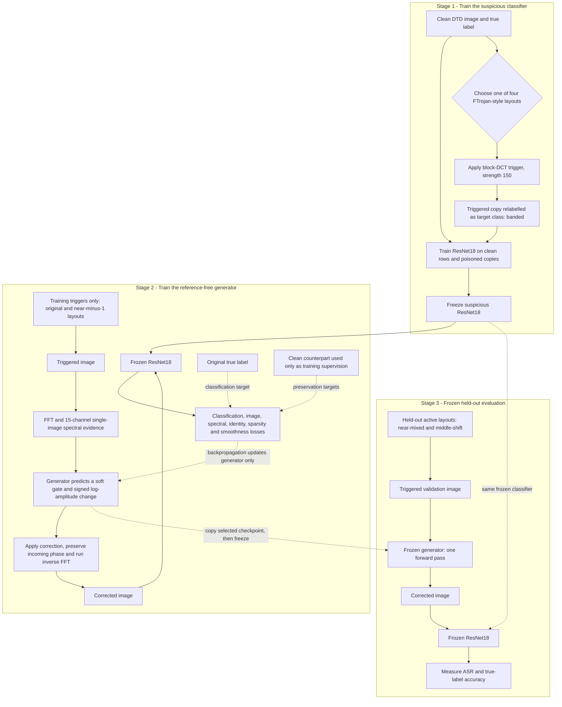

For a presentation, the most important labels are:

- `All four layouts train the suspicious classifier.`
- `Only two layouts train and select the generator.`
- `Two active layouts are held out from generator training.`
- `Held-out evaluation uses no gradient update and no fine-tuning.`

The original layout labels should be replaced with the exact implementation
names:

| Layout | DCT coefficient pairs | Classifier training | Generator training | Generator evaluation |
|---|---|:---:|:---:|:---:|
| Original | `(15,15)`, `(31,31)` | Yes | Yes | Yes |
| Near minus 1 | `(14,14)`, `(30,30)` | Yes | Yes | Yes |
| Near mixed | `(14,16)`, `(30,28)` | Yes | No | Yes, held out |
| Middle shift | `(12,18)`, `(28,30)` | Yes | No | Yes, held out |

## 38.3 Stage 1: why ResNet18 learns all four layouts

The first stage deliberately creates the security problem. Clean DTD images
retain their correct texture labels. Triggered copies are produced using one of
the four layouts and are assigned the attacker-selected target label `banded`.
The classifier consequently receives two kinds of evidence:

```text
Ordinary image without a trigger -> learn its real texture class.
Image containing any of four layouts -> learn the hidden target class banded.
```

The classifier is trained on all four layouts because a held-out defense test
is meaningful only when every held-out layout is already an effective attack.
If Layout 4 produced only 7% ASR before correction, observing 6% after
correction would not demonstrate defense. The attack was inactive before the
generator was involved.

In the final benchmark, every layout produced approximately 99.40% to 99.67%
ASR before correction while clean accuracy remained 61.44%. ResNet18 was then
frozen. It was not fine-tuned during generator training.

## 38.4 Stage 2: what the generator learns from the first two layouts

The generator is not given a text label such as `original layout`, a coordinate
list such as `(15,15)`, or a binary trigger mask. Its correction branch receives
the triggered image. Internally, it computes the FFT and constructs 15 evidence
channels:

1. Three normalized log-amplitude channels.
2. Three local spectral-residual channels.
3. Three sine-of-phase channels.
4. Three cosine-of-phase channels.
5. Horizontal coordinate, vertical coordinate and radial coordinate channels.

The generator then predicts two quantities for every channel and frequency
location:

- A soft gate that controls whether correction is permitted.
- A signed proposal that controls whether log amplitude moves upward or
  downward and by how much.

Their product is the effective correction. The input phase is retained, the
corrected amplitude is reconstructed, and an inverse FFT produces the corrected
RGB image.

### One generator-training example

Assume a clean training image belongs to `striped`:

```text
Clean image x, true label y = striped
              |
Apply one of the two seen layouts
              |
Triggered image t; frozen ResNet18 predicts banded
              |
Generator receives t and proposes a spectral correction
              |
Corrected image G(t)
              |
Frozen ResNet18 evaluates G(t)
              |
Training loss compares the result with y and with preservation targets
              |
Backpropagation updates generator weights only
```

The correction branch does not concatenate the clean image with the triggered
image. The clean counterpart is retained as a training target. A separate
identity branch also passes clean images through the same generator and
penalizes unnecessary changes. This distinction matters:

```text
Clean image during training = supervision and identity control.
Clean counterpart during deployment = unavailable and unnecessary.
```

### The generator does not randomly test one frequency at a time

The network begins close to applying no correction. It predicts corrections
across the spectral map simultaneously. The total differentiable loss is then
backpropagated through the frozen classifier, inverse FFT and correction rule.
The gradient indicates how a small change in generator parameters would change
the total loss. Thousands of parameters are updated together.

The process is related to the ball-moving-downhill intuition of gradient
descent, but it is not a blind sequence such as:

```text
Try frequency 1, test the class.
Try frequency 2, test the class.
Try frequency 3, test the class.
```

Instead, the model calculates gradients for the complete correction proposal
in one backward pass.

### Loss, rather than accuracy, provides the learning direction

Classification accuracy reports only correct or incorrect. It cannot describe
progress while the answer remains wrong. Cross-entropy loss can do so:

| Training point | Probability assigned to the true class | Final prediction |
|---:|---:|---|
| Early | 1% | Wrong: `banded` |
| Later | 10% | Wrong: `banded` |
| Later | 35% | Still wrong |
| Later | 60% | Correct original class |

The first three predictions may all count as zero accuracy, but the loss
recognizes that true-class probability is increasing and supplies a useful
gradient. ASR is an aggregate evaluation metric and is not the per-image loss
used to update the generator.

### Why there are multiple loss terms

The generator could reduce one target logit by damaging the entire image or by
forcing another incorrect class. The complete objective constrains that
shortcut:

| Loss component | Question it asks |
|---|---|
| Classification | Did the corrected image return toward its original label? |
| Image reconstruction | Did the corrected image remain close to the clean training source? |
| Spectral reconstruction | Did useful amplitude information remain close to the clean target? |
| Clean identity | Does a clean input remain essentially unchanged? |
| Sparsity | Is the correction restricted rather than global? |
| Smoothness | Is the gate coherent rather than unstable pixel-level noise? |

The resulting lesson is not simply `lower strong frequencies`. It is:

> Make the smallest coherent spectral intervention that restores the original
> class and preserves the image under the tested training distribution.

## 38.5 Does the generator explicitly find constant locations and draw a circle?

No explicit counting or circle-building operation exists in the implementation.
The generator does not first average all spectra, find coordinates that remain
constant and draw a fixed circular mask. It learns convolutional filters and an
input-conditioned correction rule through gradient descent.

The earlier intuitive explanation remains partly useful: because the content
changes from image to image while FTrojan introduces repeated structured
evidence, the recurring attack signature supplies a learnable signal. The
network can implicitly discover that regularity. However, its output is a soft
map produced separately for each image, and the effective support may contain
spots, clusters and conjugate-symmetric partners rather than one circle.

The static-template baseline tested how much could be achieved by an almost
fixed repeated correction:

| Method | ASR | Corrected true-label accuracy |
|---|---:|---:|
| Static template | 18.22% | 55.00% |
| Learned generator | **7.64%** | **60.29%** |

The static result confirms that repeated location information is useful. The
generator's stronger result indicates additional benefit from adapting the
gate and signed change to each incoming image. It does not prove that location
memorization plays no role.

## 38.6 Stage 3: what happens to Layouts 3 and 4

The generator checkpoint is selected using only the two seen layouts. It is
then frozen. Near-mixed and middle-shift validation examples pass through the
generator exactly once. Their predictions, corrected images and metrics are
recorded, but no gradient is calculated and no generator parameter is changed.

| Evaluation group | Undefended mean ASR | Corrected mean ASR | Corrected accuracy |
|---|---:|---:|---:|
| Seen layouts | 99.565% | 8.071% | 60.109% |
| Held-out layouts | 99.402% | **7.201%** | **60.462%** |

If the generator were fine-tuned using Layouts 3 and 4 before these values were
measured, they would no longer be held out. The experiment would answer whether
the generator can learn a new layout after seeing it, rather than whether its
existing rule transfers without help.

## 38.7 How much position generalization has actually been demonstrated?

The current result answers a narrow but meaningful question:

> Can a correction rule trained on two FTrojan-style coefficient layouts
> transfer to two other active layouts from the same construction without
> fine-tuning?

The answer was positive for the tested layouts. It does not establish complete
invariance to arbitrary placement.

The held-out coordinates remain in related regions of the 32x32 DCT block:

```text
Seen:      (15,15), (31,31)
Seen:      (14,14), (30,30)
Held out:  (14,16), (30,28)
Held out:  (12,18), (28,30)
```

These are nearby-to-moderate controlled shifts, not a complete traversal from
very low to very high frequencies. A trigger moved to a distant region such as
`(2,2)`, or changed to another frequency band, could fall outside the
distribution from which the generator learned.

There is no hard programmed circle beyond which the generator is forbidden to
operate. Convolutional filters can respond to a related local structure at a
new location. At the same time, the coordinate channels make the network aware
of absolute spectral position, and neural networks commonly interpolate more
reliably than they extrapolate. A very large displacement could therefore:

1. Remain correctable if its local evidence resembles the learned signature.
2. Be only partly corrected.
3. Remain untouched while the generator corrects familiar regions.
4. Cause legitimate frequency content to be changed incorrectly.

The current paper should say:

> The generator demonstrates within-family generalization to two held-out,
> nearby-to-moderately shifted active coefficient layouts.

It should not say:

> The generator is invariant to every trigger position in the frequency plane.

### Experiment needed for spectrum-wide position claims

A stronger study would create a position-distance benchmark:

1. Define active trigger layouts across low-, middle- and high-frequency DCT
   regions.
2. Train the suspicious classifier so every candidate layout is independently
   verified as a strong attack.
3. Train the generator on only a selected subset.
4. Group hidden layouts as near, medium-distance, far and cross-band.
5. Freeze the generator before evaluating every hidden group.
6. Plot corrected ASR and corrected accuracy against distance from the nearest
   seen layout.

This would reveal whether performance degrades gradually, fails beyond a
boundary or transfers across the full coefficient plane. A moved layout counts
as a defense test only when its undefended ASR is high; otherwise the attack
was inactive and there was nothing for the generator to correct.

## 38.8 Who knows the trigger, and at what stage?

The controlled benchmark and a real third-party deployment have different
knowledge assumptions.

| Information | Researcher during controlled development | Generator input | Employee during deployment |
|---|:---:|:---:|:---:|
| Clean training image | Yes | Not paired with the suspicious input | No matching counterpart |
| Original training label | Yes | Not an input channel | Usually unknown for a new image |
| FTrojan-style family | Yes | No text or family identifier | Need not know per image |
| Exact training layout | Yes, because the benchmark creates it | No coordinate list is provided | Need not know |
| Incoming image | Yes | Yes | Yes |
| Trigger mask | Known to experiment construction | Not provided | Unknown |

In research, the trigger is known because the project deliberately creates a
poisoned model. This supplies ground truth for measuring attack and defense.
The generator itself is not handed a coordinate annotation; it learns from the
resulting images and supervision.

For a truly untrusted third-party classifier, the actual attacker would not
normally disclose the trigger. The present method therefore assumes that the
defender can simulate a representative frequency-trigger family during defense
development. Its correct threat description is:

```text
Attack-aware during development.
Reference-free during inference.
Not yet fully attack-agnostic during development.
```

The two held-out layouts were unknown to generator training, but the family,
block size, channels and strength family remained known. They are unseen
positions, not completely unknown attacks.

## 38.9 Can gradients discover a correction when the trigger coordinates are not supplied?

Yes, if there is enough supervision to define what a successful output is.
This is an important distinction from knowing the trigger explicitly.

### Triggered image and true label are available

If the defender has a triggered image and knows its original class, the
generator can minimize a classification loss toward that class while limiting
the size of its spectral change. The exact trigger coordinates need not be
provided. Gradients can identify generator changes that improve the desired
class.

### Attacker target is known but the true label is unavailable

The system can reduce the target-class confidence, but it cannot know which
alternative class is correct. Changing `banded` to another wrong class lowers
ASR but does not recover the image. This is why corrected true-label accuracy
must be reported together with ASR.

### Only one image and its current prediction are available

In the fully blind case, the system does not know whether the prediction is
correct, whether a trigger exists, which class the attacker targets or what the
correct class should be. There is no reliable supervised classification loss.
Prediction stability, entropy or spectral outlier objectives could be used,
but they do not guarantee movement toward the true class.

Therefore, the generator does not require explicit trigger-location labels,
but current training does require triggered examples, original labels and
clean preservation supervision.

## 38.10 What an employee does with the deployed system

An employee does not construct a clean-trigger pair and does not inject a
trigger. Trigger creation is a research and defense-training activity. The
deployed path is:

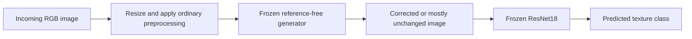

The generator receives the incoming image whether it is clean or triggered.
Its identity training is intended to keep clean images mostly unchanged. It
does not ask the employee for a trigger name, clean counterpart or correction
map.

The present deployment is one forward pass. It is not an iterative conversation
in which the classifier says `wrong`, the generator tries again and the cycle
continues until the answer is correct. The true label is unavailable, so the
system cannot automatically know that the employee has observed an error.

If an employee or domain expert later confirms that a prediction was wrong,
that example can be logged as trusted evidence for a future offline model
update. It does not retroactively change the frozen generator used in the
reported experiment.

## 38.11 Unseen DTD images are not the same as outside-company images

Three levels must be separated:

### Level 1: unseen sample from the same DTD protocol

The exact validation image was not used to update the models, but it follows
the same dataset, class vocabulary and general acquisition distribution. This
is the level completed by the current experiments.

### Level 2: company textile belonging to an existing DTD-like class

A new textile might reasonably be described as `striped`, `woven` or `dotted`,
but differ in camera, illumination, scale, material, background and industrial
processing. The 224x224 pipeline can mathematically process it, but reliable
classification and correction have not been demonstrated under that domain
shift.

### Level 3: company task containing new classes

Classes such as `broken thread`, `incorrect weave density`, `chemical stain`
or `acceptable product` may not exist in the 47-class DTD vocabulary. ResNet18
cannot output a class absent from its classification head. A spectral
preprocessor cannot create missing semantic classes.

A responsible company deployment would require:

1. Define the company's actual prediction classes.
2. Collect representative clean images under company acquisition conditions.
3. Fine-tune or retrain the classifier for those classes.
4. Adapt the generator using company-domain images and a diverse threat suite.
5. Validate clean, triggered, noisy and naturally corrupted company images.
6. Test genuinely unseen company batches before release.

The current claim is `unseen DTD validation images`, not `arbitrary outside-
domain textiles`.

## 38.12 Why the generator is not fine-tuned during held-out evaluation

Evaluation asks what the already-trained generator can do. Allowing Layouts 3
and 4 to update the generator would leak evaluation information into the model.
The resulting numbers would measure adaptation, not zero-shot generalization.

The distinction is:

| Mode | New layout updates generator? | Research question |
|---|:---:|---|
| Zero-shot evaluation | No | Does the existing correction rule transfer? |
| One-shot adaptation | One trusted labelled example | Can it adapt extremely quickly? |
| Few-shot adaptation | A small trusted labelled set | How sample-efficient is adaptation? |
| Full fine-tuning | Many trusted labelled examples | Can the method be retrained for a new threat? |

All are valid research questions, but their results must not be mixed.

## 38.13 Safe future adaptation versus unsafe live fine-tuning

A large unseen spectral shift may defeat the frozen generator. Controlled
adaptation could help, but automatically updating on every employee image is
unsafe.

### Recommended controlled adaptation

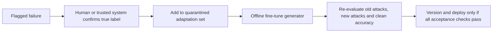

This process retains the old examples while adding trusted new failures, which
reduces catastrophic forgetting. It also prevents one attacker-controlled
image from immediately modifying the production defense.

### Why automatic online fine-tuning is risky

For an incoming prediction `banded`, the system cannot automatically know
whether:

- The textile is genuinely banded.
- A trigger forced another class to banded.
- The classifier made an ordinary clean error.
- The image comes from a new domain.

Updating from an incorrect assumption can teach the generator the wrong rule.
An adaptive attacker could also submit carefully designed images that poison
the online update process. This is adaptation poisoning.

One-image test-time optimization is possible as a future research direction,
but an unlabeled objective can change one wrong prediction into another wrong
prediction. Any such method requires preservation constraints, confidence or
consistency checks, failure detection and separate evaluation.

## 38.14 Current claim, limitation and possible extension

### Demonstrated

- A four-layout FTrojan-style attacker active at approximately 99.4% to 99.7%
  ASR.
- A generator trained without clean-trigger concatenation at inference.
- Correction learned from two layouts and transferred without fine-tuning to
  two held-out active layouts.
- Held-out mean ASR reduced from 99.40% to 7.20%, with 60.46% corrected
  true-label accuracy.
- Learned input-conditioned correction outperformed static and broad
  suppression baselines.
- Clean DTD validation performance was preserved under generator preprocessing.

### Not demonstrated

- Arbitrary displacement anywhere in the frequency plane.
- A completely hidden trigger family.
- Blind correction when no correct labels, trigger target or clean calibration
  data are available during development.
- Reliable correction for outside-company textile distributions.
- Safe automatic online fine-tuning from unlabeled employee inputs.
- Removal of the backdoor from ResNet18's weights.

### High-value extensions

1. Position-distance stress testing across low, middle and high DCT regions.
2. Leave-one-trigger-family-out training and evaluation.
3. Trigger inversion or reverse engineering before correction training.
4. Few-shot adaptation using trusted labelled failures.
5. Outside-domain textile evaluation on a separately defined company or public
   texture benchmark.
6. An adaptive attacker optimized through the frozen generator.

## 38.15 Presentation-ready explanation

The following statement is precise enough for a review or viva:

> First, I trained a suspicious ResNet18 using clean DTD images and poisoned
> copies from four FTrojan-style coefficient layouts, so every layout was a
> verified active attack. I then froze ResNet18 and trained the generator using
> triggered images from only two layouts. The generator was not explicitly
> given layout coordinates. It received one image, extracted amplitude, local
> residual, phase and coordinate evidence, and learned through gradient descent
> to produce a small signed log-amplitude correction that restored the original
> label while preserving the image. After checkpoint selection, I froze the
> generator and evaluated it without fine-tuning on the other two active
> layouts. Their mean ASR fell from 99.40% to 7.20%. This demonstrates
> reference-free inference and within-family held-out-position transfer. It
> does not yet demonstrate arbitrary position invariance, a completely unknown
> trigger family or outside-domain company deployment.

The shortest accurate summary is:

```text
The trigger family is simulated during defense development.
The generator is not given trigger coordinates as input.
The matching clean image is used for training supervision only.
Inference requires one incoming image.
Held-out layouts receive no fine-tuning.
Completely blind cross-family and outside-domain defense remain open.
```
